# Codebase Modularization & File Organization Audit

> **Scope:** Full scan of `Engine/include`, `Engine/src`, `Sandbox/src`, and `Tests/src` (`184` C++ files scanned across `Engine`, `Sandbox`, and `Tests`).
> **Engineering Principles Enforced:**
> 1. **One Primary Class Per File:** Split multi-class headers into dedicated `.h`/`.cpp` pairs.
> 2. **No C++ "Partial-Class" Scattering (Pitfall B):** Never scatter a single class's member functions across multiple `.cpp` files; instead, shrink large files by extracting **true standalone helper classes/modules** with their own clear state and API.
> 3. **Respect File-Local Singleton State (Pitfall A):** Never split a `.cpp` file across translation units if both halves would need to share anonymous-namespace `static` storage (`s_Data`, `s_State`). Extract self-contained sub-objects or pure math helpers instead.
> 4. **Right-Sized Subfolder Depth (Pitfall C):** Only create subfolders where a genuine 6+ file domain cluster exists (e.g., `Engine/Terrain/`, `Engine/Scene/Components/`), avoiding 2–3 file micro-folders that cause `#include` churn.

---

## 1. Files Containing More Than One Class

### 1.1 Production Engine Headers with Multiple Top-Level `class` Definitions

These **7 production headers** (and their corresponding `.cpp` files) define multiple distinct top-level `class` types in a single file:

| # | Header File | Lines | Classes Defined (Line) | Accompanying `.cpp` | Split Priority |
| :-: | :--- | --: | :--- | :--- | :-: |
| 1 | [`PhysicsComponents.h`](file:///c:/DEV/GameEngineCPP/Engine/include/Engine/Physics/PhysicsComponents.h) | 240 | `Rigidbody2D` (L14), `Collider2D` (L141), `BoxCollider2D` (L187), `CircleCollider2D` (L201), `CapsuleCollider2D` (L219) | [`PhysicsComponents.cpp`](file:///c:/DEV/GameEngineCPP/Engine/src/Physics/PhysicsComponents.cpp) (894L) | **High** |
| 2 | [`Buffer.h`](file:///c:/DEV/GameEngineCPP/Engine/include/Engine/Renderer/Buffer.h) | 192 | `BufferLayout` (L70), `VertexBuffer` (L103), `IndexBuffer` (L145), `UniformBuffer` (L167) *(+ `struct BufferElement`)* | [`Buffer.cpp`](file:///c:/DEV/GameEngineCPP/Engine/src/Renderer/Buffer.cpp) (199L) | **High** |
| 3 | [`FoliageWindComponents.h`](file:///c:/DEV/GameEngineCPP/Engine/include/Engine/Scene/FoliageWindComponents.h) | 344 | `WindComponent` (L19), `SquashStretchComponent` (L181) | Header-only (344L) | **High** |
| 4 | [`WorldBiomeGenerator.h`](file:///c:/DEV/GameEngineCPP/Engine/include/Engine/Scene/WorldBiomeGenerator.h) | 147 | `NoiseGenerator` (L12), `WorldBiomeGenerator` (L83) *(+ 4 config/desc structs)* | [`WorldBiomeGenerator.cpp`](file:///c:/DEV/GameEngineCPP/Engine/src/Scene/WorldBiomeGenerator.cpp) (633L) | **High** |
| 5 | [`LightComponents.h`](file:///c:/DEV/GameEngineCPP/Engine/include/Engine/Scene/LightComponents.h) | 157 | `DirectionalLightComponent` (L14), `PointLightComponent` (L98) | Header-only (157L) | **Medium** |
| 6 | [`JobSystem.h`](file:///c:/DEV/GameEngineCPP/Engine/include/Engine/Core/JobSystem.h) | 406 | `JobHandle` (L47), `JobSystem` (L66) *(+ `struct JobState`, `QueuedJob`)* | [`JobSystem.cpp`](file:///c:/DEV/GameEngineCPP/Engine/src/Core/JobSystem.cpp) (495L) | **Medium** |
| 7 | [`Tilemap.h`](file:///c:/DEV/GameEngineCPP/Engine/include/Engine/Scene/Tilemap.h) | 72 | `TileSet` (L17), `Tilemap` (L38) *(+ `struct Tile`)* | Header-only (72L) | **Skip** *(72L cohesive)* |

> [!NOTE]
> **Why `FoliageWindComponents.h` and `WorldBiomeGenerator.h` are top split candidates:**
> - `WindComponent` (global environmental wind field) and `SquashStretchComponent` (per-entity spring-damper combat juice) are unrelated domains sharing a header.
> - `NoiseGenerator` (Simplex2D, FBm2D, DomainWarp2D) is a pure reusable math utility currently buried inside `Scene/WorldBiomeGenerator.h`.

---

### 1.2 Production Headers with 1 Class + Reusable Standalone `struct`s

Small config/DTO structs that only serve their host class (e.g., `ParticleProps` in `ParticleSystem.h`, `UIRectTransform` in `UICanvas.h`, `FramebufferSpecification` in `Framebuffer.h`) should **stay co-located**. Only the following **4 headers** bundle independently reused types that merit extraction to reduce transitive `#include` coupling:

| Header File | Co-located Types | Coupling Issue & Recommendation |
| :--- | :--- | :--- |
| [`PerspectiveCamera.h`](file:///c:/DEV/GameEngineCPP/Engine/include/Engine/Renderer/PerspectiveCamera.h) (161L) | `struct Frustum` (L16), `class PerspectiveCamera` (L67) | `DecalManager` and culling utilities only need `Frustum`, not the full camera class. Extract **`Math/Frustum.h`**. |
| [`Texture.h`](file:///c:/DEV/GameEngineCPP/Engine/include/Engine/Renderer/Texture.h) (113L) | `struct CompressedMipLevel` (L11), `struct DDSInfo` (L18), `class Texture` (L28) | DDS binary header/format parsing (`Texture.cpp` L60–L370) is independent of OpenGL texture objects. Extract **`Renderer/DDSLoader.h/.cpp`**. |
| [`Scene.h`](file:///c:/DEV/GameEngineCPP/Engine/include/Engine/Scene/Scene.h) (253L) | `struct IlluminationSample` (L36), `struct IlluminationQueryOptions` (L53), `class Scene` (L61) | Extract **`Scene/LightQuerySystem.h/.cpp`** so AI/UI/gameplay files don't include full `Scene.h` just for lighting query structs. |
| [`TerrainChunkManager.h`](file:///c:/DEV/GameEngineCPP/Engine/include/Engine/Scene/TerrainChunkManager.h) (264L) | `struct ChunkCoord`, `ChunkCoordHash`, `TerrainChunk`, `class TerrainChunkManager` | Extract **`Terrain/TerrainChunk.h/.cpp`** (holding `ChunkCoord`, `ChunkCoordHash`, `TerrainChunk`) so `TerrainRenderer` doesn't pull the streaming manager. |

---

### 1.3 Test Files Containing Multiple Classes (Fixtures & Mock Components)

In `Tests/src/`, **6 test files** define multiple local mock/fixture classes:

| Test File | Lines | Classes Defined | Action |
| :--- | --: | :--- | :--- |
| [`DeferredLifecycleTests.cpp`](file:///c:/DEV/GameEngineCPP/Tests/src/Scene/DeferredLifecycleTests.cpp) | 863 | 10 mock component classes + 2 structs (`LifecycleTrackerComponent`, `MidFrameSpawnerComponent`, `MidFrameDestroyerComponent`, `SpawnAndSelfDestroyComponent`, `SpawnHierarchyAndDestroyComponent`, `SpawnAndDestroyPhysicsComponent`, `SecondaryDestroyerComponent`, `TriggerDestroyComponent`, `StressTesterComponent`, `FixedUpdateStressComponent`, `StartObserverComponent`, `TeardownTrackerComponent`) | Each distinct mock component consumes a slot in the process-wide `ComponentMask128` (`kMaxComponentTypes = 128`). Consolidating parameterized mock components saves ~8–10 global component IDs. |
| [`GameObjectTests.cpp`](file:///c:/DEV/GameEngineCPP/Tests/src/Scene/GameObjectTests.cpp) | 444 | 10 mock component classes (`LifecycleComponent`, `DynamicComponentB`, `MutatingComponentA`, `DisablingComponent`, `TrailingComponent`, `CustomPolyBase`, `CustomPolyDerived`, `IUnregisteredBase`, `UnregisteredDerivedA`, `UnregisteredDerivedB`) | Intentionally tests RTTI/polymorphic dispatch — keep or split polymorphic TypeID tests into `ComponentTypeIDTests.cpp`. |
| [`PrefabAndPoolingTests.cpp`](file:///c:/DEV/GameEngineCPP/Tests/src/Scene/PrefabAndPoolingTests.cpp) | 682 | `CustomPooledComponent`, `DetachOnReleaseComponent`, `struct TempDirCleanup` | Split into `PrefabTests.cpp` + `EntityPoolManagerTests.cpp`. |
| [`PhysicsTests.cpp`](file:///c:/DEV/GameEngineCPP/Tests/src/Physics/PhysicsTests.cpp) | 610 | Two local `VisualDummyComponent` definitions inside anonymous test blocks (L367, L464) | Deduplicate into a single shared helper at the top of the file. |
| [`ContactAndSensorEventTests.cpp`](file:///c:/DEV/GameEngineCPP/Tests/src/Physics/ContactAndSensorEventTests.cpp) | 563 | `TestEventReceiver`, `ContactAndSensorEventTest` | Standard GTest fixture + 1 helper receiver — **keep as-is**. |
| [`RigidbodyLifecycleTests.cpp`](file:///c:/DEV/GameEngineCPP/Tests/src/Physics/RigidbodyLifecycleTests.cpp) | 597 | `RigidbodyLifecycleTest`, `SelfRemoveRigidbodyInCollision` | Standard GTest fixture + 1 collision callback component — **keep as-is**. |

---

## 2. File-Splitting Blueprints

### 2.1 Splitting Multi-Class Production Files (One Class Per File)

| Current File(s) | Proposed Split Files | Rationale |
| :--- | :--- | :--- |
| `PhysicsComponents.h` (240L) `PhysicsComponents.cpp` (894L) | • `Rigidbody2D.h` / `Rigidbody2D.cpp` (~485L) • `Collider2D.h` / `Collider2D.cpp` (~275L) • `BoxCollider2D.h` / `BoxCollider2D.cpp` (~65L) • `CircleCollider2D.h` / `CircleCollider2D.cpp` (~60L) • `CapsuleCollider2D.h` / `CapsuleCollider2D.cpp` (~80L) *(Keep lightweight umbrella `PhysicsComponents.h` during transition)* | Cuts an 894-line file into clean one-class-per-file units; `Collider2D.h` becomes a minimal base include. |
| `Buffer.h` (192L) `Buffer.cpp` (199L) | • `BufferLayout.h` (header-only: `ShaderDataType`, `BufferElement`, `BufferLayout`) • `VertexBuffer.h` / `VertexBuffer.cpp` • `IndexBuffer.h` / `IndexBuffer.cpp` • `UniformBuffer.h` / `UniformBuffer.cpp` | `VertexArray.h` only needs `VertexBuffer`/`IndexBuffer`; `SceneLighting`/`PostProcessor` only need `UniformBuffer`. |
| `FoliageWindComponents.h` (344L) | • `WindComponent.h` (~165L) • `SquashStretchComponent.h` (~170L) | Separates environmental wind field from combat squash-and-stretch spring component. |
| `LightComponents.h` (157L) | • `DirectionalLightComponent.h` (~85L) • `PointLightComponent.h` (~75L) | One component per header matching `CameraComponent.h` and `PostProcessComponent.h`. |
| `WorldBiomeGenerator.h` (147L) `WorldBiomeGenerator.cpp` (633L) | • `Math/NoiseGenerator.h` / `NoiseGenerator.cpp` (~120L) • `Terrain/WorldGenTypes.h` (`BiomeSample`, `PropSpawnDesc`, `POISpawnDesc`, `WorldGenConfig`) • `Terrain/WorldBiomeGenerator.h` / `.cpp` (~480L) | Decouples generic Simplex/FBm/DomainWarp noise from world-biome logic so particles, camera trauma shake, and shaders can reuse `NoiseGenerator`. |
| `JobSystem.h` (406L) `JobSystem.cpp` (495L) | • `JobHandle.h` (`JobState`, `JobHandle`) • `JobSystem.h` / `JobSystem.cpp` | Allows APIs returning `JobHandle` (`CutoutProcessor.h`, `TerrainChunkManager.h`, `ResourceManager.h`) to include a ~60-line `JobHandle.h` instead of pulling in the 406-line thread-pool template header. |

---

### 2.2 Splitting Large Files via Helper-Class/Module Extraction (Avoiding Partial Classes & Static-State Leaks)

> [!IMPORTANT]
> **Refined Rules (Pitfalls A & B):**
> - **Do NOT scatter a single class's member functions across multiple `.cpp` files** (`PhysicsWorld2D`, `TerrainChunkManager`, `SceneRenderer`, `CutoutProcessor`, `TerrainComponent`).
> - **Do NOT split `.cpp` files that share file-local `static` storage** (`Renderer2D`'s `s_Data` or `Input`'s `s_State`) without extracting a true encapsulated helper class or stateless math module.

| Current File | Lines | Clean Extraction Blueprint (No Partial Classes) |
| :--- | --: | :--- |
| **[`SceneSerializer.cpp`](file:///c:/DEV/GameEngineCPP/Engine/src/Scene/SceneSerializer.cpp)** | **1,889** | **Domain Dispatch Split** (stateless free functions per subsystem, registered in `SceneSerializer.cpp` ~250L): • `Serialization/JsonHelpers.h` (`ToJson`, `AsVec2/3/4`, `SerializeSubTexture`) • `Serialization/SceneSerializerCore.cpp` (Transform, Camera, Audio, Lights, PostProcess, Wind, SquashStretch) • `Serialization/SceneSerializerRender.cpp` (SpriteRenderer, Animator, ParticleSystem) • `Serialization/SceneSerializerTerrain.cpp` (Tilemap, TerrainComponent, TerrainChunkManager) • `Serialization/SceneSerializerPhysics.cpp` (Rigidbody2D, Box/Circle/Capsule colliders) • `Serialization/SceneSerializerUI.cpp` (UIPanel, UILabel, UIButton, UIMinimap, UIRadialWheel) |
| **[`InspectorPanel.cpp`](file:///c:/DEV/GameEngineCPP/Sandbox/src/Panels/InspectorPanel.cpp)** | **1,046** | **Subsystem UI Drawer Split** (stateless ImGui drawer functions in `Sandbox/src/Panels/Inspector/`): • `InspectorPanel.cpp` (~200L — entity header, tag/layer bar, component dispatch, AddComponent popup) • `InspectorRenderDrawers.cpp` (SpriteRenderer, ParticleSystem, Camera, Lights, PostProcess, Wind, SquashStretch) • `InspectorPhysicsDrawers.cpp` (Rigidbody2D, Box/Circle/Capsule colliders) • `InspectorTerrainDrawers.cpp` (TerrainComponent, TerrainChunkManager, Tilemap) |
| **[`TerrainChunkManager.cpp`](file:///c:/DEV/GameEngineCPP/Engine/src/Scene/TerrainChunkManager.cpp)** | **1,135** | **Extract `TerrainChunk` + `ProceduralPropFactory`** (keeps `TerrainChunkManager` in a single `.cpp` ~880L): • `Terrain/TerrainChunk.h/.cpp` (~90L — `ChunkCoord`, `TerrainChunk::SetSplatTexel*`, `MarkDirtyRect`) • `Terrain/ProceduralPropFactory.h/.cpp` (~180L — `kPropSpecs`, `BuildBuiltinPropPrefab`, `BuildTarFirewallPrefab`) |
| **[`Renderer2D.cpp`](file:///c:/DEV/GameEngineCPP/Engine/src/Renderer/Renderer2D.cpp)** | **1,134** | **Extract Stateless `BillboardMath`** (keeps `s_Data` strictly file-local inside `Renderer2D.cpp` ~980L): • `Math/BillboardMath.h/.cpp` (~160L — `ComputeBillboardCorners`, `ComputeParticleCorners`, `BuildGroundQuadCorners`) |
| **[`Scene.cpp`](file:///c:/DEV/GameEngineCPP/Engine/src/Scene/Scene.cpp)** | **903** | **Extract `LightQuerySystem`** (keeps `Scene` lifecycle in a single `Scene.cpp` ~740L): • `Scene/LightQuerySystem.h/.cpp` (~170L — `IlluminationSample`, `IlluminationQueryOptions`, `EvaluateIlluminationAtXZ`, `EvaluateIlluminationDetailedXZ`) |
| **[`Input.cpp`](file:///c:/DEV/GameEngineCPP/Engine/src/Core/Input.cpp)** | **890** | **Extract Encapsulated `InputActionMap` Class** (keeps `s_State` private inside `Input.cpp` ~580L): • `Core/InputActionMap.h/.cpp` (~310L — owns `ActionBindings` table, `BindAction`, `EvaluateAction`, and JSON binding save/load) |
| **[`Texture.cpp`](file:///c:/DEV/GameEngineCPP/Engine/src/Renderer/Texture.cpp)** | **775** | **Extract Stateless `DDSLoader`** (shrinks `Texture.cpp` to ~455L): • `Renderer/DDSLoader.h/.cpp` (~320L — `DDS_PIXELFORMAT`, `DDS_HEADER`, `DDS_HEADER_DXT10`, `IsDDS`, `ParseDDS`) |
| **[`Texture2DArray.cpp`](file:///c:/DEV/GameEngineCPP/Engine/src/Renderer/Texture2DArray.cpp)** | **660** | **Extract Stateless `TerrainTexturePacker`** (shrinks `Texture2DArray.cpp` to ~300L): • `Renderer/TerrainTexturePacker.h/.cpp` (~360L — `ResizeRGBA8Bilinear`, `ResizeR8Bilinear`, `PackAlbedoHeightRGBA8`, `PackNormalGlossRGBA8`, `Build*SliceFromFiles`) |
| **[`GameObject.h`](file:///c:/DEV/GameEngineCPP/Engine/include/Engine/Scene/GameObject.h)** | **625** | **Extract `ComponentTypeRegistry.h`** (shrinks `GameObject.h` to ~535L): • `Scene/ComponentTypeRegistry.h` (~90L — `Detail::GetComponentTypeID`, `GetComponentTypeMask`, polymorphic base traits) |
| `PhysicsWorld2D.cpp` (1,522L) `SceneRenderer.cpp` (1,040L) `CutoutProcessor.cpp` (812L) `TerrainComponent.cpp` (804L) | — | **Keep as single `.cpp` files.** Their methods share private member state heavily and are already well-structured subsystems (extracted during earlier refactoring waves). |

---

### 2.3 Splitting Oversized Test Files

| Current Test File | Lines | Proposed Split |
| :--- | --: | :--- |
| [`TerrainComponentTests.cpp`](file:///c:/DEV/GameEngineCPP/Tests/src/Scene/TerrainComponentTests.cpp) | **1,275** | Move to `Tests/src/Terrain/` and split into: • `TerrainSplatAndComponentTests.cpp` • `TerrainChunkStreamingTests.cpp` • `WorldBiomeAndScatterTests.cpp` • `TerrainFireGridTests.cpp` |
| [`UITests.cpp`](file:///c:/DEV/GameEngineCPP/Tests/src/UI/UITests.cpp) | **1,063** | Split inside `Tests/src/UI/` into: • `UICanvasTests.cpp` • `UIWidgetsTests.cpp` (UIPanel 9-slice/radial, UIButton focus) • `FontBMFontTests.cpp` (Font + UILabel styled text) • `UIHUDTests.cpp` (RadialWheel + MinimapFogSystem) |
| [`DeferredLifecycleTests.cpp`](file:///c:/DEV/GameEngineCPP/Tests/src/Scene/DeferredLifecycleTests.cpp) | **863** | • `DeferredLifecycleTests.cpp` (core spawn/destroy ordering) • `LifecycleStressAndTeardownTests.cpp` (stress tests + physics teardown) |
| [`SceneSerializerTests.cpp`](file:///c:/DEV/GameEngineCPP/Tests/src/Scene/SceneSerializerTests.cpp) | **785** | • `SceneSerializerCoreTests.cpp` • `SceneSerializerScenarioTests.cpp` |
| [`AnimationTests.cpp`](file:///c:/DEV/GameEngineCPP/Tests/src/Animation/AnimationTests.cpp) | **749** | • `AnimatorStateMachineTests.cpp` (`ANI-01`) • `AnimationEventTests.cpp` (`ANI-02`) |
| [`PrefabAndPoolingTests.cpp`](file:///c:/DEV/GameEngineCPP/Tests/src/Scene/PrefabAndPoolingTests.cpp) | **682** | • `PrefabTests.cpp` • `EntityPoolManagerTests.cpp` |

---

## 3. Right-Sized Subfolder Organization (Avoiding Micro-Folders)

### 3.1 Current Directory Bottlenecks
- **`Engine/Scene/`** (`23` headers / `14` `.cpp` files) mixes **Core ECS**, **Terrain & Procedural Worldgen**, **Attachable Visual Components**, **Serialization**, and **`StandeeCommand.h`** (which belongs in `Renderer/`).
- **`Engine/Renderer/`** (`21` headers / `19` `.cpp` files) mixes low-level **OpenGL RHI primitives** (`Buffer`, `Shader`, `Framebuffer`, `VertexArray`, `GLUtils`) with high-level **Scene/2D/Terrain renderers, cameras, and textures**.
- **`Sandbox/src/`** leaves gameplay scripts (`PlayerController.h`, `CameraController.h`) loose at root beside `main.cpp`.
- Conversely, `Core/`, `Physics/`, `UI/`, `Particles/`, `Animation/`, `Audio/`, and `Utils/` each have `2–8` cohesive files and **should stay flat** (no 2-file micro-subfolders).

### 3.2 Right-Sized Target Folder Hierarchy

```mermaid
flowchart TD
    ENG["Engine/"]
    ENG --> CORE["Core/  (flat — 10 files)\nApp · Window · Time · Input · InputActionMap · JobHandle · JobSystem · ResourceManager"]
    ENG --> MATH["Math/  (4 files)\nIsometric · NoiseGenerator · Frustum · BillboardMath"]
    ENG --> SCENE["Scene/\nRoot: Core ECS (Object, Component, GameObject, Transform, Scene, Prefab, Pool, LightQuerySystem)\n├── Components/  (Camera, Lights, PostProcess, Wind, SquashStretch)\n└── Serialization/  (SceneSerializer + 5 domain serializer TUs)"]
    ENG --> TERRAIN["Terrain/  (NEW top-level module — 9 files)\nTerrainComponent · TerrainChunk · TerrainChunkManager · ProceduralPropFactory\nTerrainFireGrid · TerrainHelpers · SurfaceSample · WorldBiomeGenerator · Tilemap"]
    ENG --> REND["Renderer/\nRoot: Cameras, Textures, Lighting, SceneRenderer, Renderer2D, TerrainRenderer, SpriteRenderer, StandeeCommand\n└── RHI/  (BufferLayout, VertexBuffer, IndexBuffer, UniformBuffer, VertexArray, Framebuffer, Shader, GLUtils, Renderer)"]
    ENG --> PHYS["Physics/  (flat — 11 files)\nRigidbody2D · Collider2D · Box/Circle/CapsuleCollider2D · PhysicsWorld2D · PhysicsQueries · Handles/Layers"]
    ENG --> VFX["Particles/  (2 files)\nParticleSystem · DecalManager"]
    ENG --> UI["UI/  (flat — 8 files)\nUICanvas · Font · UIPanel · UILabel · UIButton · UIMinimap · MinimapFogSystem · UIRadialWheel"]
    ENG --> ANIM["Animation/  (2 files)\nAnimationClip · Animator"]
    ENG --> AUD["Audio/  (3 files)\nAudioClip · AudioManager · AudioSource"]
    ENG --> UTIL["Utils/  (2 files)\nLogger · CutoutProcessor"]
```

### 3.3 Concrete Subfolder Moves Summary

| New / Updated Folder | Files Placed Here | Why This Folder Exists |
| :--- | :--- | :--- |
| **`Engine/{include/Engine,src}/Terrain/`** *(NEW)* | `TerrainComponent.h/.cpp`, `TerrainChunk.h/.cpp`, `TerrainChunkManager.h/.cpp`, `ProceduralPropFactory.h/.cpp`, `TerrainFireGrid.h/.cpp`, `TerrainHelpers.h`, `SurfaceSample.h`, `WorldGenTypes.h`, `WorldBiomeGenerator.h/.cpp`, `Tilemap.h` | Cuts `Engine/Scene/` in half and isolates all terrain, biome, splatmap, and fire-grid code in a dedicated module. |
| **`Engine/include/Engine/Scene/Components/`** *(NEW)* | `CameraComponent.h` *(+ `.cpp` in `src/Scene/Components/`)*, `DirectionalLightComponent.h`, `PointLightComponent.h`, `PostProcessComponent.h`, `WindComponent.h`, `SquashStretchComponent.h` | Separates attachable scene components from core ECS machinery (`Scene`, `GameObject`, `Transform`, `Prefab`). |
| **`Engine/src/Scene/Serialization/`** *(NEW)* | `JsonHelpers.h`, `SceneSerializer.cpp`, `SceneSerializerCore.cpp`, `SceneSerializerRender.cpp`, `SceneSerializerTerrain.cpp`, `SceneSerializerPhysics.cpp`, `SceneSerializerUI.cpp` | Isolates JSON persistence implementations from runtime ECS logic while keeping `SceneSerializer.h` in `Engine/Scene/`. |
| **`Engine/{include/Engine,src}/Renderer/RHI/`** *(NEW)* | `BufferLayout.h`, `VertexBuffer.h/.cpp`, `IndexBuffer.h/.cpp`, `UniformBuffer.h/.cpp`, `VertexArray.h/.cpp`, `Framebuffer.h/.cpp`, `Shader.h/.cpp`, `GLUtils.h`, `Renderer.h/.cpp` | Separates raw OpenGL wrapper primitives from high-level 2.5D diorama rendering (`SceneRenderer`, `Renderer2D`, `TerrainRenderer`, `Texture`, `PerspectiveCamera`, `StandeeCommand.h`). |
| **`Engine/{include/Engine,src}/Math/`** *(EXPANDED)* | `Isometric.h`, `NoiseGenerator.h/.cpp`, `Frustum.h`, `BillboardMath.h/.cpp` | Houses pure, zero-GL math and geometry helpers shared across Renderer, Terrain, and Particles. |
| **`Sandbox/src/Scripts/`** *(NEW)* | `PlayerController.h`, `CameraController.h` | Cleans up loose gameplay controller headers from `Sandbox/src/` root. |
| **`Sandbox/src/Panels/Inspector/`** *(NEW)* | `InspectorPanel.h/.cpp`, `InspectorRenderDrawers.cpp`, `InspectorPhysicsDrawers.cpp`, `InspectorTerrainDrawers.cpp` | Groups the split Inspector panel drawers cleanly (automatically matched by `Sandbox/CMakeLists.txt` regex `[\\/]src[\\/](Editor\|Panels)[\\/]`). |
| **`Tests/src/Terrain/`** *(NEW)* | `TerrainSplatAndComponentTests.cpp`, `TerrainChunkStreamingTests.cpp`, `WorldBiomeAndScatterTests.cpp`, `TerrainFireGridTests.cpp`, `TilemapTests.cpp` | Mirrors the new `Engine/Terrain/` module. |

---

## 4. Phased Execution Order (Zero-Breakage Strategy)

Because [`Engine/CMakeLists.txt`](file:///c:/DEV/GameEngineCPP/Engine/CMakeLists.txt), [`Sandbox/CMakeLists.txt`](file:///c:/DEV/GameEngineCPP/Sandbox/CMakeLists.txt), and [`Tests/CMakeLists.txt`](file:///c:/DEV/GameEngineCPP/Tests/CMakeLists.txt) all use `file(GLOB_RECURSE ... CONFIGURE_DEPENDS)`, new `.cpp` files and subfolders are picked up automatically by CMake.

| Phase | Scope | Risk | Benefit |
| :-: | :--- | :-: | :--- |
| **Phase 1** (`DONE`) | **Extract helper modules & split dispatch `.cpp` files** (`Scene/Serialization/SceneSerializer*.cpp`, `Panels/Inspector/Inspector*Drawers.cpp`, `DDSLoader`, `TerrainTexturePacker`, `ProceduralPropFactory`, `InputActionMap`, `BillboardMath`, `LightQuerySystem`) | **Very Low** *(0 public `#include` changes)* | Eliminates the 1,889L `SceneSerializer.cpp` and 1,046L `InspectorPanel.cpp` bottlenecks immediately while respecting `s_Data`/`s_State` encapsulation. |
| **Phase 2** | **Split the 6 multi-class headers** (`PhysicsComponents.h/.cpp` $\rightarrow$ 5 class pairs, `Buffer.h/.cpp` $\rightarrow$ 4 files, `FoliageWindComponents.h` $\rightarrow$ 2, `LightComponents.h` $\rightarrow$ 2, `WorldBiomeGenerator.h` $\rightarrow$ `NoiseGenerator` + `WorldGenTypes`, `JobSystem.h` $\rightarrow$ `JobHandle.h`, `PerspectiveCamera.h` $\rightarrow$ `Frustum.h`, `GameObject.h` $\rightarrow$ `ComponentTypeRegistry.h`) | **Low** *(keep thin forwarding headers first if desired, then update includes)* | Enforces 1-class-per-file across the entire Engine and reduces compile-time header dependencies. |
| **Phase 3** | **Move files into the right-sized subfolders** (`Engine/Terrain/`, `Engine/Scene/Components/`, `Engine/Renderer/RHI/`, `Engine/Math/`, `Sandbox/src/Scripts/`) | **Low–Medium** *(focused `#include` path updates for `Terrain/`, `Scene/Components/`, and `Renderer/RHI/`)* | Cuts `Engine/Scene/` and `Engine/Renderer/` in half without creating 2-file micro-folders. |
| **Phase 4** | **Split oversized test files & consolidate mock components** (`Tests/src/Terrain/*`, `Tests/src/UI/*`, `DeferredLifecycleTests.cpp`, `AnimationTests.cpp`, `PrefabAndPoolingTests.cpp`) | **Very Low** | Faster targeted `--gtest_filter` runs and reclaims `ComponentMask128` slots. |
