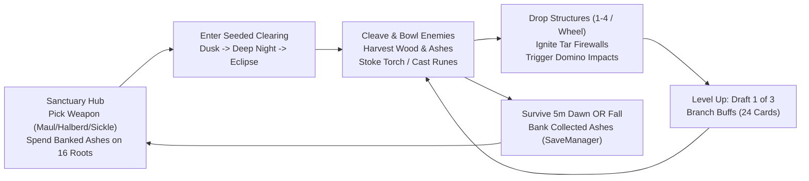
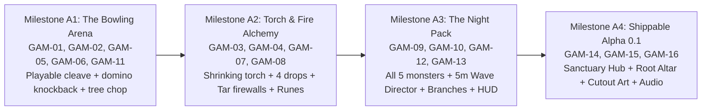

# *Umbral Physics Brawler* — First Alpha (v0.1) Game Concept & Feature Roadmap

> **Engine Readiness:** All **43 / 43** engine features in [features.md](features.md) are `DONE` and verified (`586 / 586` tests passing, 0 warnings in Debug & Release).  
> **Art Standard:** 2.5D Paper-Cutout Diorama workflow defined in [DIORAMA_ART_WORKFLOW.md](DIORAMA_ART_WORKFLOW.md).  
> **Existing Gameplay Data:** All 6 registries are already authored under `Sandbox/assets/data/` (`weapons.json`, `enemies.json`, `drops.json`, `runes.json`, `roots.json`, `branches.json`) + 4 deployable prefabs under `Sandbox/assets/prefabs/`.

---

## 1. Expanded Game Identity: What Makes *Umbral Physics Brawler* Special?

**Elevator Pitch:**  
A tactile **2.5D Paper-Cutout Roguelite Survival Brawler** (*Cult of the Lamb* diorama aesthetic × *Don't Starve* torchlight dread × *Vampire Survivors* escalation) built around **real Box2D kinetic bowling** and a **360° real-time shadow-casting Torch**.

### The 4 Gameplay Pillars (Each Powered by a Unique Engine Strength)
1. **Kinetic Pinball Brawling (`PHY-01..05` + `CAM-02`):**  
   Enemies are not weightless HP bars—they are physical bodies (`25 kg` Ghouls up to `90 kg` Wendigos). Cleaving a front-row Ghoul with a Maul sends it careening across the ground plane into 4 others for **domino impact damage**, or smashing straight through a **Splinter Barricade** to explode it into directional shrapnel. Freezing a pack in **Chronos Stasis** lets you bat them repeatedly and watch every queued impulse detonate simultaneously when time resumes.
2. **The Shrinking Circle of Light (`LGT-01..03`):**  
   Your Torch casts live 360° shadows behind every pine trunk and shrine. Its fuel burns steadily—shrinking your safe zone—and also serves as **mana for Active Runes**. Keeping the flame alive forces bold aggression: monsters caught on the **Searing Rim** burn rapidly, while stepping into darkness invites lethal Wendigo ambushes.
3. **Systemic Ground Alchemy (`TER-01..04`):**  
   The floor itself is a weapon. **Tar Bogs** slow enemies and erupt into a spreading 10 Hz cellular-automaton firewall when touched by your Torch, an Ignition Rune, or a burning enemy bowled across them. **Chalk Highlands** cut friction so knockbacks turn into long bowling slides. **Sanctuary Cobble** accelerates footwork.
4. **Mid-Combat Field Engineering (`UIX-04` + `ECS-04`):**  
   Harvesting wood from felled pines and shattered crates fuels both your **Torch** and your slow-mo **Tactical Drop Wheel**—letting you drop **Splinter Barricades**, **Flare Pegs**, **Thumper Springboards**, and **Tar Siphons** right in the path of an oncoming horde.

### The Core Minute-to-Minute & Run-to-Run Loop

---

## 2. Alpha 0.1 Feature Matrix (`GAM-01` – `GAM-16`)

| ID | Feature Name | Milestone | Priority | Status | Engine Systems & Data Used |
| :--- | :--- | :---: | :---: | :---: | :--- |
| **`GAM-01`** | **Torchbearer Controller, Dodge Roll & Surface Footwork** | A1 | **P0** | `DONE` | `INP-01/02`, `PHY-01/02`, `TER-04`, `CAM-02`, `ANI-01`, `SquashStretch` |
| **`GAM-02`** | **Data-Driven Melee Weapons & Domino Bowling Physics** | A1 | **P0** | `DONE` | `weapons.json`, `PHY-03/05`, `ECS-02` (Hit-Stop), `RND-01` (Hit-Flash) |
| **`GAM-03`** | **Torch Lifeline, Searing Rim, Stoke & Ash Frenzy** | A2 | **P0** | `DONE` | `LGT-01/03`, `PointLightComponent`, `PostProcessComponent`, `AUD-03` |
| **`GAM-04`** | **Active Torch Runes (Ignition, Chronos, Shockwave, Consecrate)** | A2 | **P1** | `DONE` | `runes.json`, `PHY-05` (`SetStasisFrozen`), `TER-04`, `LGT-03` |
| **`GAM-05`** | **Alpha Survival Arena & Procedural Biome Clearing** | A1 | **P0** | `DONE` | `TER-01/02/03`, `TerrainChunkManager`, `WorldBiomeGenerator`, `Wind` |
| **`GAM-06`** | **Harvestable Pines, Destructible Props & Bouncing Pickups** | A1 | **P0** | `DONE` | `ECS-01/04/05`, `PHY-01` (`GroundRestitutionY`), `PHY-03` (Sensors) |
| **`GAM-07`** | **Tactical Drop Wheel & 4 Functional Deployable Structures** | A2 | **P0** | `TODO` | `drops.json`, `prefabs/*.prefab`, `UIX-04`, `ECS-02` (Slow-Mo), `PHY-04` |
| **`GAM-08`** | **Systemic Tar/Firewall Ignition & Burning-Body Spreading** | A2 | **P0** | `TODO` | `TER-04` (`TerrainFireGrid`), `VFX-01/02`, `LGT-02` |
| **`GAM-09`** | **5-Archetype Monster AI Suite (Ghoul, Thrall, Jiangshi, Wisp, Wendigo)** | A3 | **P0** | `TODO` | `enemies.json`, `AIX-01` (`SteeringSystem`), `AIX-02` (`StateMachine`, `Ballistics`), `PHY-04` |
| **`GAM-10`** | **Escalating Night/Wave Director & Mood Progression** | A3 | **P0** | `TODO` | `ECS-04` (`EntityPoolManager`), `DirectionalLight`, `PostProcess`, `AUD-03` |
| **`GAM-11`** | **Unified Health, Damage, Status Effects & Impact Feel** | A1 | **P0** | `DONE` | `RND-01` (Dissolve/Flash), `VFX-01/02` (Flipbooks/Decals), `AUD-02` |
| **`GAM-12`** | **In-Run Ash XP & 3-Card Branch Upgrade Draft** | A3 | **P1** | `TODO` | `branches.json`, `UIX-01..03`, `UIButtonComponent`, `ECS-02` |
| **`GAM-13`** | **Alpha HUD & Circular Fog-of-War Minimap** | A3 | **P0** | `TODO` | `UIX-01..04`, `UICanvas`, `UIPanel`, `UILabel`, `UIMinimapComponent` |
| **`GAM-14`** | **Title -> Sanctuary Hub -> Root Altar -> Run -> Summary Loop** | A4 | **P1** | `TODO` | `roots.json`, `SAV-01/02` (`SaveManager`, `SceneManager::TransitionToScene`) |
| **`GAM-15`** | **Alpha 2.5D Paper-Cutout Art & Animation Pack** | A4 | **P1** | `TODO` | `CutoutProcessor`, `ANI-01..03`, `DIORAMA_ART_WORKFLOW.md` |
| **`GAM-16`** | **Alpha Combat Foley & 3-Stem Adaptive Music Pack** | A4 | **P1** | `TODO` | `AUD-01..03` (`AudioManager`, `MusicDirector`), `.wav` + `.ogg` stems |

---

## 3. Detailed Feature Specifications

### Pillar 1: Hero, Torch Economy & Core Combat (`GAM-01` – `GAM-04`)

#### `GAM-01` — Torchbearer Controller, Dodge Roll & Surface Footwork
- **Upgrade `PlayerController`** from the current basic walk/jump script into a full brawler controller:
  - **Locomotion:** 360° camera-relative movement (`Input::GetMoveVector`) modulated by `Scene::SampleSurfaceAtXZ` (`MaxSpeedMultiplier` & dynamic `LinearDamping`: brisk on Cobble, sluggish in Tar, slippery on Chalk).
  - **Dodge Roll (`Space` / `Shift` / Gamepad A):** Short high-impulse dash (`0.22s`, `0.65s` cooldown) with brief invulnerability frames, `SquashStretchComponent` stretch impulse, dust puff particles, and `LowObstacle` vaulting when airborne.
  - **Aim & Facing:** Continuous 360° aim vector via `Input::ResolveAimDirectionXZ`, flipping sprite (`FlipX`) and orienting the child `TorchSocket` + `WeaponSocket` (`ECS-03`).
  - **Camera Integration:** Replace legacy `CameraController` with `CameraComponent` (`CAM-02`: smooth follow, aim look-ahead, dynamic zoom-out during large packs, and directional kick + Perlin trauma shake on impact).

#### `GAM-02` — Data-Driven Melee Weapons & Domino Bowling Physics
- **Weapon Component (`WeaponController`):** Loads active weapon stats from `GameplayData::Weapons()` (`weapons.json`):
  - **Rough Iron Maul (`T1–T3`):** Wide `130°` arc, massive `22.0` knockback impulse, `45ms` hit-stop, heavy screen trauma — premier bowling weapon.
  - **Ashwood Halberd (`T1–T3`):** Narrow `90°` thrust/sweep with `3.5m` reach — excels at poking enemies inside firewalls and interrupting Jiangshi hops.
  - **Culling Sickle (`T1–T3`):** Rapid `2.0/s` attack rate, low knockback, high bleed/burn synergy — great for harvesting wood and stacking `Frenzied Strikes`.
- **Swing Lifecycle:** Windup -> Active Cleave Frame (`PhysicsQueries::OverlapArcXZ`) -> Recovery (with input buffering for snappy chaining).
- **Domino Collision Damage (`KineticBowlingComponent`):**
  - When a weapon launches an enemy (`IsLaunched = true` for `0.6s` or while speed `> 5.5 m/s`), `OnCollisionEnter2D` inspects `info.ApproachSpeed`:
    - **Enemy -> Enemy:** Deals `0.5 * Mass * ApproachSpeed` scaled collateral damage to both, transfers knockback impulse, flashes both white, and triggers a micro hit-stop (`25ms`) + crunch SFX.
    - **Enemy -> Tree / Shrine / Wall:** Deals wall-slam bonus damage + `0.6s` stun + shakes the tree (`SquashStretchComponent::TriggerImpulse`).
    - **Enemy -> Splinter Barricade:** Deals heavy structure damage and **shatters** the barricade if HP reaches 0, firing 5–7 piercing wood-splinter projectiles along the impact normal!

#### `GAM-03` — Torch Lifeline, Searing Rim, Stoke & Ash Frenzy
- **`TorchComponent` (on child `TorchSocket` entity):**
  - `Fuel` (`0..MaxFuel`, default `100.0`), passive burn rate (`~2.2 / sec`, slowed by `Slow Burn` Root), dynamically updates `PointLightComponent::Radius` (`2.5m` -> `9.5m`) and `Intensity` (`0.6` -> `2.2`) with organic flicker.
  - **Searing Rim (Outer 25% of Torch Radius):** Enemies standing in `[0.75 * R, 1.05 * R]` receive radiant burn ticks (`AuraDamage * enemy.LightVulnerability`) and rising ember sparks.
  - **Stoke Torch (`E` / `F` / Gamepad X):** Consumes `2 Wood` to restore `+25 Fuel` with a bright flare burst (`Radius` pulse + warm chime).
  - **Ash Frenzy (`Fuel <= 20%`):** Crossfades `MusicDirector` to the high-intensity 3rd stem, pulses crimson diorama vignette, and grants `+20%` attack speed / move speed (risk-reward clutch state).
  - **Darkness Dread (`Fuel <= 0%`):** Torch flickers out to `1.8m` dim ember; player takes `6 HP/sec` umbral cold damage until stoking or reaching a lit Sanctuary Brazier / Flare Peg.

#### `GAM-04` — Active Torch Runes (Fuel-Powered Spells)
- **`RuneCasterComponent` (`Q` / Right-Click / LT):** Casts the equipped `runes.json` spell by spending **Torch Fuel** (creating immediate tactical tension between spellcasting and light radius):
  1. **Rune of Ignition (`15 Fuel`, `4s CD`):** Ignites a `5m` radius of ground via `Scene::IgniteAtXZ` + applies burning DoT to enemies in circle.
  2. **Rune of Chronos (`20 Fuel`, `8s CD`):** Freezes all enemies within `7m` for `4s` via `Rigidbody2D::SetStasisFrozen(true)` (`PHY-05`) with spectral blue tint (`FlashMode::SpectralBlue`). Melee hits during stasis queue impulses that **erupt simultaneously** on unfreeze!
  3. **Rune of Shockwave (`12 Fuel`, `3.5s CD`):** Instant `6m` 360° radial impulse blast (`+28` impulse) + flat ground shockwave ring (`VFX-01`) + camera kick.
  4. **Rune of Consecration (`25 Fuel`, `10s CD`):** Places a `6s` hallowed golden light circle (`8m` `SafeLifeline`) that heals the player slightly and repels/burns darkness foes.

---

### Pillar 2: Living Diorama World, Harvesting & Tactical Drops (`GAM-05` – `GAM-08`)

#### `GAM-05` — Alpha Survival Arena & Procedural Biome Clearing
- **`AlphaRunScene` Factory (`Sandbox/src/Scene/AlphaRunScene.cpp`):**
  - Uses `TerrainChunkManager` (`TER-01/02/03`) seeded per run (with `OriginSafeRadius = 8.0m` Cobblestone clearing + central **Sanctuary Brazier** so the player starts safely lit).
  - Streams **Blackwood Thickets** (dense harvestable pines casting dramatic 360° torch shadows), **Tar Bogs** (glossy black flammable pools), **Ash Barrens**, and **Chalk Highlands** seamlessly as the player kites around the clearing.
  - Nighttime atmospheric lighting: low cool-indigo moonlight (`DirectionalLightComponent` `SunIntensity = 0.25`) so the **Hero's 360° shadow-casting Torch (`LGT-01`)** and flickering braziers visually dominate the frame.

#### `GAM-06` — Harvestable Pines, Destructible Props & Bouncing Pickups
- **`HarvestableComponent`:** Attached to pooled Pines and Bone/Crate clusters (`EntityTag::HarvestableTree`, `DestructibleProp`). Taking melee or bowling-impact damage shakes the prop, bursts wood-chip particles, and at `0 HP` dissolves/fells it, spawning `2–4` bouncing **`PickupComponent`** entities (`EntityTag::ResourcePickup`, `PhysicsLayer::Pickup` sensor) launched with `LaunchVertical(4.5f..6.5f)` + `GroundRestitutionY = 0.45f` + random XZ scatter.
- **Pickup Types:**
  - **Wood Log:** Adds `+1 Wood` (used for Stoke Torch & Drop Wheel).
  - **Ash Ember:** Magnetically accelerates toward the player within `AshAttractionRange` (`Spirit Well` Root), granting `+XP` and `+RunAshes`.
  - **Crimson Berry / Heart:** Restores `+20 HP` (rare drop from bushes/elites).

#### `GAM-07` — Tactical Drop Wheel & 4 Functional Deployable Structures
- **Placement Flow (`StructurePlacerComponent`):**
  - Hold `Tab` / `LB` to open `UIRadialWheelComponent` (slowing `Time::SetTimeScale(0.15f)`) or tap hotkeys `1–4` for instant placement at the aimed ground position (`2.2m` in front of player, validated clear of solid trunks via `OverlapCircleXZ`).
  - Deducts `WoodCost` from `drops.json`, instantiates the corresponding `.prefab`, and attaches its runtime behavior component:
    1. **`SplinterBarricadeComponent` (`4 Wood`, `120 HP`):** Blocks ground enemies (`LowObstacle`, vaultable by Jiangshi). Deals contact splinter damage; on shatter (especially from a bowled enemy!), fires a fan of `PhysicsLayer::Projectile` wood splinters.
    2. **`FlarePegComponent` (`10 Wood`, `80 HP`):** Emits a bright `SafeLifeline` `PointLightComponent` (`Radius = 7.5m`) for `35s` (or until destroyed), creating a tactical safe island to fight Wendigos and restore Darkness Dread.
    3. **`ThumperComponent` (`15 Wood`, `75 HP`):** Sensor trigger with `2.5s` reset timer; slams upward when enemies step on it, launching all enemies in `2.2m` backward + airborne (`LaunchVertical(6.0f)`, `ApplyImpulseXZ(24.0f)`) with squash-stretch + shockwave decal.
    4. **`TarSiphonComponent` (`20 Wood`, `100 HP`):** Periodically paints a `3.2m` radius of flammable **Tar** (`Scene::PaintMaterialWorld(..., layerIdx=2)`) around itself and spawns `1 Ash` every `3s`—turning any spot into an ignitable fire trap + ash farm.

#### `GAM-08` — Systemic Tar/Firewall Ignition & Burning-Body Spreading
- Wire `TorchComponent` (when dashing or stoking over Tar), `Rune of Ignition`, and burning enemies (`StatusEffectsComponent::IsBurning`) to call `Scene::IgniteAtXZ(pos, radius)`.
- `TerrainFireGrid` (`TER-04`) automatically spreads fire across contiguous Tar cells at `10 Hz`, spawns pooled flickering `TarFirewall` lights/sensors that ignite & damage crossing enemies (`14 DPS`), and scorches spent Tar into **Scorched Ash (Layer 5)** after `4.5s` so the player must relocate or deploy a new Tar Siphon.

---

### Pillar 3: Monster Roster, Wave Director & Combat Feel (`GAM-09` – `GAM-11`)

#### `GAM-09` — 5-Archetype Monster AI Suite
- **`EnemyAIController`:** Reads base stats from `GameplayData::Enemies()` (`enemies.json`) and drives `Engine::StateMachine` (`AIX-02`) + `Engine::SteeringSystem` (`AIX-01`):
  - **Shared States:** `Chase` (context-map steering avoiding obstacles & firewalls + neighbor separation), `Windup` (telegraph flash + squash crouch), `Attack`, `Stunned` (yields control to Box2D physics during knockback/bowling!), `Dying` (`RND-01` ash-dissolve `0.45s` -> release to `EntityPoolManager`).
  - **Archetype Signatures:**
    1. **Flesheater Ghoul (`35 HP`, `25 kg`):** Fast swarm pack rusher; easily bowled into crowds.
    2. **Rotting Thrall (`50 HP`, `45 kg`):** Durable frontline; prioritizes smashing player Barricades/Flare Pegs blocking its path.
    3. **Hopping Jiangshi (`65 HP`, `35 kg`):** Computes predictive parabolic jumps via `Ballistics::SolveInterceptHopArc`, launches airborne (`PHY-04` clears `LowObstacle` barricades!), draws a ground landing-ring indicator, and triggers a `1.8m` landing slam.
    4. **Blight Wisp (`20 HP`, `10 kg`, `LightVulnerability 2.0`):** Uses `SteeringParams::TargetOrbitRadius = 5.5f` to circle at the edge of torchlight, then darts in to siphon `-8 Torch Fuel` on hit before retreating.
    5. **Apex Wendigo (`180 HP`, `90 kg`):** Elite predator that queries `Scene::EvaluateIlluminationAtXZ` (`LGT-03`), circles through tree shadows, telegraph-roars before a high-speed lunge, and drops a guaranteed **Branch Chest / Ash Jackpot** on defeat.

#### `GAM-10` — Escalating Night/Wave Director & Mood Progression
- **`WaveDirectorComponent`:** Drives a tight **5-Minute Alpha Survival Arc** (with optional Endless mode):
  - **0:00 – 1:15 (Dusk):** Small Ghoul & Thrall packs (teaches cleaving, wood harvesting, stoking).
  - **1:15 – 2:45 (Deep Night):** Introduces Hopping Jiangshi (vaulting barricades) + Blight Wisps (fuel pressure) + ambient sun dims.
  - **2:45 – 4:15 (Umbral Surge):** Mixed hordes + first **Apex Wendigo** stalker event (cues dramatic music intensity & boss bar).
  - **4:15 – 5:00 (Eclipse Climax):** High-budget surge + twin Wendigo / Jiangshi pack; surviving to `5:00` triggers **Dawn Break** (golden sunrise surge, remaining shadows dissolve to ash, Victory Summary!).
- Spawns all enemies via `EntityPoolManager` (`ECS-04`) just outside the camera frustum + outside safe light zones (`LGT-03`).

#### `GAM-11` — Unified Health, Damage, Status Effects & Impact Feel
- **`HealthComponent` & `StatusEffectsComponent`:**
  - Tracks `CurrentHP`, `MaxHP`, `DamageReduction`, `KnockbackResistance`, `InvulnTimer`, `BurnTimer`/`BurnDPS`, `BlindTimer`, `StunTimer`.
  - Standardized damage pipeline: `ApplyDamage(DamageEvent{ amount, source, impulseXZ, hitStopSec, isFire, isRadiant })` automatically triggers:
    - `SpriteRenderer::SetFlashAmount(1.0f)` + `FlashMode::PureWhite` / `CrimsonImpact` (decays over `0.12s`),
    - `SquashStretchComponent::TriggerImpulse`,
    - `DecalManager::SpawnDecal` (ichor splatter / scorch mark on kill),
    - `ParticleSystem::EmitBurst` (sparks/ash),
    - `AudioManager::PlayOneShot` with `±10%` pitch jitter & 3D XZ panning,
    - `RND-01` `DissolveAmount` `0 -> 1` on death before returning entity to pool.

---

### Pillar 4: Roguelite Loop, HUD, Sanctuary & Alpha Assets (`GAM-12` – `GAM-16`)

#### `GAM-12` — In-Run Ash XP & 3-Card Branch Upgrade Draft
- **`RunProgressionComponent`:** Collecting Ashes increases `RunXP`. At each level threshold (`15, 35, 65, 105, ...`), sets `Time::SetTimeScale(0.0f)` and opens a clean 3-card UI overlay (`UIPanel` + `UIButtonComponent` with full keyboard/gamepad `NavigateFocus` + mouse hover) rolling 3 distinct upgrades from `GameplayData::Branches()` (`branches.json`) weighted by rarity (`Common 60% / Rare 28% / Epic 10% / Legendary 2%`).
- Picking a card immediately applies its `StatModifier` (plus special hooks for Alpha's standout synergistic cards: *Ignited Edges*, *Wildfire Surge*, *Cleaving Momentum*, *Vampiric Pyre*, *Solar Flare*, *Cataclysmic Quake*, *Eternal Beacon*) and resumes combat.

#### `GAM-13` — Alpha HUD & Circular Fog-of-War Minimap
- Built entirely on the engine's native screen-space UI (`UICanvas`, `UIPanel`, `UILabel`, `UIRadialWheelComponent`, `UIMinimapComponent`) so it works identically in both **Editor Play Mode** and **Standalone Distribution (`ENGINE_DIST`)**:
  - **Top-Left:** Health Bar (`HorizontalFill`), Torch Fuel Bar (shifts amber -> pulsing crimson in Ash Frenzy), Active Rune icon + `RadialSweepCW` cooldown overlay.
  - **Top-Center:** Survival Clock (`00:00 / 05:00`), Current Phase Banner (*Dusk / Deep Night / Eclipse*), Level/XP strip, and Apex Wendigo HP bar when active.
  - **Top-Right:** Circular `UIMinimapComponent` (`MinimapFogSystem` revealing explored chunks + Sanctuary/Flare Peg icons).
  - **Bottom-Left:** Wood & Run-Ash counters + quick-drop hotkey strip (`[1] Barricade 4W`, `[2] Flare 10W`, `[3] Thumper 15W`, `[4] Siphon 20W`, `[E] Stoke 2W`).
  - **Center Overlay:** Tactical Radial Drop Wheel (`Tab` / `LB`) + World-space interaction prompts.

#### `GAM-14` — Title -> Sanctuary Hub -> Root Altar -> Run -> Summary Loop
- Uses `SceneManager::TransitionToScene()` (`0.45s` fade) and `SaveManager::LoadProfile` / `SaveProfileAtomic` (`SAV-02`):
  - **Title Overlay:** Play / Continue, Settings (Master/SFX/Music volumes, Fullscreen, VSync), Quit.
  - **Sanctuary Clearing Hub (evolves existing `Village.scene`!):**
    - Walkable safe clearing with **Weapon Rack** (`[E]` swap between Maul, Halberd, Sickle), **Rune Pedestal** (`[E]` swap active Rune), **Root Altar** (`[E]` spend `BankedAshes` on the 16 permanent `roots.json` upgrades), and **Northern Umbral Gate** (walk through / `[E]` to launch a seeded `AlphaRunScene`).
  - **Run Summary Screen:** Displays Survival Time, Enemies Slain, Domino Kills, Ashes Earned -> Banks Ashes to `profile_0.json` -> `[Retry Run]` or `[Return to Sanctuary]`.

#### `GAM-15` — Alpha 2.5D Paper-Cutout Art & Animation Pack
- Following [DIORAMA_ART_WORKFLOW.md](DIORAMA_ART_WORKFLOW.md) (`CutoutProcessor` auto-key + bottom-flush + 4px alpha bleed):
  - **Reuse Existing:** `hero_lamb.png`, `pine_tree.png`, `cult_shrine.png`, `ritual_brazier.png`, `berry_bush.png`, `tall_grass_tuft.png`, `cult_banner.png`, and the 4 seamless terrain textures.
  - **New Alpha Minimum Art Set (16 assets):**
    - *5 Enemy Cutouts:* `ghoul.png`, `thrall.png`, `jiangshi.png`, `wendigo.png`, `blight_wisp.png` (2-frame hop/idle or single bold cutout + `SquashStretchComponent` waddle for fast Alpha velocity).
    - *4 Deployables:* `splinter_barricade.png`, `flare_peg.png`, `thumper_trap.png`, `tar_siphon.png`.
    - *3 Pickups + 4 VFX/Terrain:* `wood_log.png`, `ash_ember.png`, `crimson_heart.png`, `tar_seamless.png`, `chalk_seamless.png`, `torch_flame_flipbook.png`, `slash_arc.png`.

#### `GAM-16` — Alpha Combat Foley & 3-Stem Adaptive Music Pack
- **SFX (`.wav` via `AudioManager`):** `sfx_maul_swing`, `sfx_hit_heavy`, `sfx_domino_crunch`, `sfx_wood_chop`, `sfx_barricade_shatter`, `sfx_pickup_wood`, `sfx_pickup_ash`, `sfx_torch_stoke`, `sfx_fire_ignite`, `sfx_rune_cast`, `sfx_player_hurt`, `sfx_level_up`.
- **Music (`.ogg` via `MusicDirector`):** `mus_sanctuary_hub.ogg` (warm acoustic/ethereal loop) + 3 synchronized run stems (`mus_run_dread`, `mus_run_combat`, `mus_run_frenzy`) driven live by enemy proximity and Torch Ash Frenzy state.

---

## 4. Recommended 4-Milestone Alpha Delivery Order

### Alpha 0.1 "Fun-First" Exit Criteria
1. **Bowling Feel:** Cleaving 4 Ghouls with the Ironwood Maul into a Splinter Barricade shatters it into shrapnel, triggers `45ms` hit-stop + directional camera kick, and drops bouncing Wood Logs.
2. **Torch Tension:** Playing for 5 minutes creates genuine push-pull decisions between spending Wood on Stoke vs. Structures and spending Torch Fuel on Chronos/Ignition Runes vs. keeping a wide safe circle.
3. **Systemic Payoff:** Dropping a Tar Siphon, luring a Thrall + Jiangshi pack over the Tar, igniting a spreading firewall, and batting enemies back into the flames works reliably at locked `60 Hz` physics.
4. **Complete Loop:** Launching `EngineSandbox.exe` takes a player seamlessly from **Sanctuary Hub -> Weapon/Root Selection -> 5-Minute Survival Run -> Branch Level-Up Drafts -> Run Summary -> Persistent Ash Banking**.
