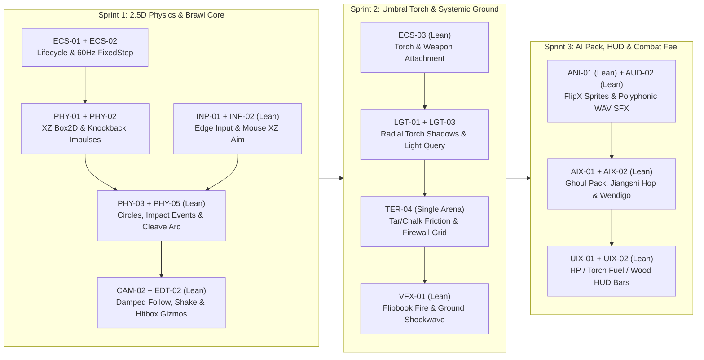

# Pre-Production Engine Feature Specifications & Dependency Architecture — *Umbral Physics Brawler*

> **Target Project:** *Umbral Physics Brawler* (2.5D Paper-Cutout Roguelite Physics Brawler)  
> **Reference Documents:** `game_concept_document.md`, `game_assets_specification.md`, `asset_directory_resolution_guide.md`, `Gemini_Generated_Image_sthr0tsthr0tsthr.jpg`  
> **Target Engine Stack:** C++20 / OpenGL 4.1 Core / SDL3 / Box2D v3 / GLM / `stb` / `nlohmann-json`

---

## 1. Baseline Assessment: Ready Capabilities vs. Critical Gaps

### 1.1 Subsystems Already Production-Ready
- **2.5D Paper-Cutout Standee Renderer:** `BillboardMode::ViewPlane`, `CylindricalY`, and `FlatGround` decals with bottom-center (`UV.y = 0`) ground pivots, Gribb-Hartmann frustum culling, Schwartzian depth sorting, ring-buffered VBOs, and multithreaded `JobSystem::ParallelFor` vertex generation.
- **Cutout Art Ingestion (`CutoutProcessor`):** Chroma-Green (`#00FF00`) and Chroma-Magenta (`#FF00FF`) auto-keying, edge color despill, bottom-flush transparent margin cropping, 4-pass 8-connected RGB alpha bleed, and async background `ResourceManager` texture uploads with trilinear mipmaps (`GL_LINEAR_MIPMAP_LINEAR`).
- **HDR Post-Processing Pipeline (`PostProcessor`):** `GL_RGBA16F` scene FBO, 5-mip Karis soft-knee Bloom pyramid, `StorybookNeutral` & `ACESFilmic` tonemapping, split-toning, diorama vignette, and bufferless fullscreen triangle execution.
- **Foliage Wind & Secondary Motion:** Synchronized CPU/GPU `WindComponent` with spatial wave gusts + spatial-hashed interactive proximity rustle, paired with volume-preserving `SquashStretchComponent` harmonic springs ($s_x \sqrt{s_y} = 1$).
- **Concurrency Core:** C++20 work-stealing `JobSystem` (`std::jthread`) wired directly into Box2D v3's `enqueueTask` / `finishTask` worker interface.

### 1.2 Summary of Critical Pre-Game Blockers
1. **Box2D Plane Mismatch (`PHY-01`):** `Scene::OnRuntimeStart()` configures side-scroller gravity `(0, -9.8)` on `(X, Y)` instead of top-down `(0, 0)` on the **3D `(X, Z)` ground plane**, and runs a conflicting legacy AABB solver in `Scene::Update()`.
2. **Mid-Frame Mutation Crash Hazard (`ECS-01`):** `CreateGameObject` and `DestroyGameObject` mutate `Scene::m_GameObjects` in-place, invalidating iterators if called during `Update()` (e.g., chopping wood or shattering barricades).
3. **Unoccluded Point Lights (`LGT-01`):** `ShadowMap` only captures directional sunlight; the Hero's mobile torch (`PointLightComponent`) shines straight through solid pine trunks, rocks, and barricades rather than casting radial 360° shadows.
4. **Finite Diffuse-Only Terrain (`TER-01`–`TER-04`):** `TerrainComponent` is a single finite quad (`4` diffuse-only layers) with no chunk streaming, Perlin worldgen, normal/height maps, 5th Cobblestone sanctuary layer, CPU surface friction queries, or systemic Tar/Firewall propagation.
5. **Untextured Particles (`VFX-01`):** `ParticleSystem` only emits untextured solid-colored quads—unable to render the 16-frame hand-drawn torch flame, 12-frame firewall, or flat ground shockwaves.
6. **WAV-Only Non-Overlapping Audio (`AUD-01`–`AUD-03`):** `AudioClip` only loads `.wav` (failing on `mus_*.ogg`), opens a separate OS stream per `AudioSource`, drops overlapping SFX, and lacks pitch randomization, 3D panning, and adaptive stem mixing.
7. **Unscaled UI & Landscape-Only FOV (`CAM-01`, `UIX-01`–`UIX-04`):** Missing Portrait (`9:16` / `10:16`) fixed `22°` horizontal FOV, DPI/anchor scaling, 9-slice borders, `.fnt` font parsing, radial gauges/wheels, and the circular fog-of-war minimap.

---

## 2. Feature Dependency Architecture

### 2.1 Global Directed Acyclic Dependency Graph (DAG)

Arrows (`A --> B`) denote a **hard prerequisite** (`A` must be implemented before `B` so `B` builds cleanly on final APIs without rework).

```mermaid
flowchart TD
    subgraph Track_ECS_PHY["Track A: Core ECS, Time, Input & 2.5D Physics"]
        ECS01["ECS-01: Deferred Lifecycle"]
        ECS02["ECS-02: FixedStep & TimeScale"]
        ECS03["ECS-03: Transform Hierarchy"]
        ECS05["ECS-05: Tags & 128b Mask"]
        ECS04["ECS-04: Prefabs & Pooling"]

        PHY01["PHY-01: XZ Box2D + Y-Arc"]
        PHY02["PHY-02: Runtime Body & Impulses"]
        PHY03["PHY-03: Contacts, Sensors & Circles"]
        PHY04["PHY-04: Filter Masks & Airborne"]
        PHY05["PHY-05: Spatial Queries & Chronos"]

        INP01["INP-01: Edge Actions & Bindings"]
        INP02["INP-02: XZ Aim & Rumble"]

        ECS01 --> ECS03
        ECS01 --> ECS04
        ECS03 --> ECS04
        ECS05 --> ECS04

        ECS01 --> PHY01
        ECS02 --> PHY01
        PHY01 --> PHY02
        PHY02 --> PHY03
        ECS05 --> PHY04
        PHY03 --> PHY04
        PHY03 --> PHY05

        INP01 --> INP02
    end

    subgraph Track_WORLD_RND["Track B: Lighting, Infinite Terrain & Shaders"]
        LGT02["LGT-02: 32 Priority PointLights"]
        LGT01["LGT-01: Radial Torch Shadows"]
        LGT03["LGT-03: CPU Light Queries"]

        TER01["TER-01: Chunk Streaming"]
        TER02["TER-02: Perlin Biomes & Scatter"]
        TER03["TER-03: Array Splat + Normals"]
        TER04["TER-04: Surface Query & Tar Fire"]

        RND01["RND-01: Dissolve, Flash & Silhouette"]
        RND02["RND-02: Sprite Atlas & Anisotropy"]
        RND03["RND-03: BC7 GPU Compression"]

        LGT02 --> LGT01
        LGT02 --> LGT03

        ECS01 --> TER01
        TER01 --> TER02
        ECS04 --> TER02
        TER01 --> TER03
        LGT01 --> TER03
        TER01 --> TER04
        TER03 --> TER04
        PHY02 --> TER04

        LGT01 --> RND01
        RND02 --> RND03
    end

    subgraph Track_FEEL_AI["Track C: Animation, VFX, Audio & AI"]
        ANI03["ANI-03: Sheet Cutout Pivot Lock"]
        ANI01["ANI-01: 4-Way Animator & FlipX"]
        ANI02["ANI-02: Frame Event Callbacks"]

        VFX01["VFX-01: Flipbook & Ground Particles"]
        VFX02["VFX-02: Ground Decal Ring Pool"]

        AUD01["AUD-01: OGG Vorbis & Streaming"]
        AUD02["AUD-02: Polyphonic Spatial Mixer"]
        AUD03["AUD-03: Multi-Stem Music Director"]

        AIX01["AIX-01: Horde Steering & Avoidance"]
        AIX02["AIX-02: FSM & Jiangshi Ballistics"]

        RND02 --> ANI01
        ANI03 --> ANI01
        ANI01 --> ANI02

        RND02 --> VFX01
        TER04 --> VFX02

        AUD01 --> AUD02
        AUD01 --> AUD03
        AUD02 --> AUD03

        PHY05 --> AIX01
        ECS05 --> AIX01
        PHY01 --> AIX02
        LGT03 --> AIX02
    end

    subgraph Track_CAM_UI_DATA["Track D: Camera, Scalable UI, Data & Editor"]
        CAM01["CAM-01: Hor+ / Vert+ Aspect FOV"]
        CAM02["CAM-02: Damped Follow & Trauma"]

        UIX01["UIX-01: DPI Canvas & Safe Area"]
        UIX02["UIX-02: 9-Slice & Radial Gauges"]
        UIX03["UIX-03: BMFont (.fnt) & Rich Text"]
        UIX04["UIX-04: Drop Wheel & Fog Minimap"]

        SAV01["SAV-01: JSON Data Registries"]
        SAV02["SAV-02: Save Profiles & Transitions"]

        EDT01["EDT-01: Aspect Viewport Simulator"]
        EDT02["EDT-02: 2.5D Physics/Light Gizmos"]
        EDT03["EDT-03: Prefab & Clip Inspector"]

        CAM01 --> CAM02
        ECS02 --> CAM02
        CAM01 --> INP02

        UIX01 --> UIX02
        UIX01 --> UIX03
        UIX02 --> UIX04
        INP01 --> UIX04
        TER01 --> UIX04
        LGT03 --> UIX04

        ECS01 --> SAV02
        SAV01 --> SAV02
        INP01 --> SAV02
        AUD02 --> SAV02

        CAM01 --> EDT01
        UIX01 --> EDT01
        PHY03 --> EDT02
        LGT02 --> EDT02
        ECS04 --> EDT03
        ANI02 --> EDT03
    end
```



---

### 2.2 Complete 43-Feature Dependency & Topological Wave Matrix

**Status Taxonomy:**
- `TODO`: Specification complete; queued for implementation according to its topological wave.
- `IN_PROGRESS`: Currently under active implementation or test integration.
- `DONE`: Implemented and fully verified with headless `EngineTests` (0 warnings).
- `BLOCKED`: Blocked pending upstream prerequisite completion.
- `DEFERRED`: Formally architected, but deferred beyond the Alpha concept-validation gate.


- **Wave 0 (Zero-Dependency Root Leaves):** Can be started immediately and developed in parallel across separate branches with zero merge conflicts (`ECS-01`, `ECS-02`, `ECS-05`, `INP-01`, `LGT-02`, `RND-02`, `ANI-03`, `CAM-01`, `UIX-01`, `AUD-01`, `SAV-01`).
- **Waves 1–4:** Unlocked sequentially as upstream dependencies land.

| Codename | Feature Title | Status | Prio | Wave | Hard Prerequisites (`Depends On`) | Soft / Synergy Couplings | Downstream Dependents (`Unlocks`) |
| :--- | :--- | :---: | :---: | :---: | :--- | :--- | :--- |
| **`ECS-01`** | Deferred Entity Spawn/Destroy & Active Flags | `DONE` | **P0** | W0 | *None (Root)* | `ECS-05` | `ECS-03`, `ECS-04`, `PHY-01`, `TER-01`, `SAV-02` |
| **`ECS-02`** | Fixed-Timestep Physics Loop & Time-Scale API | `DONE` | **P0** | W0 | *None (Root)* | `AUD-02` (pitch/pause) | `PHY-01`, `CAM-02`, `UIX-04` (wheel slow-mo) |
| **`ECS-03`** | Parent-Child Transform Hierarchy & Sockets | `DONE` | **P0** | W1 | `ECS-01` | `ANI-01` (socket flip) | `ECS-04`, Hero Torch & Weapon attachment |
| **`ECS-04`** | Prefab Templates & Entity Object Pooling | `DONE` | **P1** | W2 | `ECS-01`, `ECS-03`, `ECS-05` | `SAV-01` | `TER-02`, `EDT-03`, Horde/Pickup spawning |
| **`ECS-05`** | Entity Tags, Layers & 128-bit Component Mask | `DONE` | **P1** | W0 | *None (Root)* | `ECS-01` | `ECS-04`, `PHY-04`, `AIX-01`, `LGT-03` |
| **`PHY-01`** | XZ Ground-Plane Box2D Mapping & 2.5D Y-Arc | `DONE` | **P0** | W1 | `ECS-01`, `ECS-02` | `SquashStretchComponent` | `PHY-02`, `AIX-02` |
| **`PHY-02`** | Runtime Rigidbody Lifecycle & Force/Impulse API | `DONE` | **P0** | W2 | `PHY-01` | `ECS-04` (pool reset) | `PHY-03`, `TER-04` |
| **`PHY-03`** | Contact Events, Sensor Triggers & Circle Shapes | `DONE` | **P0** | W3 | `PHY-02` | `AUD-02` (impact SFX) | `PHY-04`, `PHY-05`, `EDT-02` |
| **`PHY-04`** | Collision Filter Masks & Elevation Pass-Through | `DONE` | **P1** | W4 | `PHY-03`, `ECS-05` | `AIX-02` (Jiangshi hop) | Airborne combat & clean pickup filtering |
| **`PHY-05`** | Spatial Physics Queries & Selective Chronos Stasis | `DONE` | **P1** | W4 | `PHY-03` | `ECS-02` | `AIX-01`, Maul cleave, Chronos Rune |
| **`INP-01`** | Edge-Triggered Input States & Action Binding Map | `DONE` | **P0** | W0 | *None (Root)* | `SAV-02` (save bindings) | `INP-02`, `UIX-04`, `SAV-02` |
| **`INP-02`** | Ground-Plane Aim Resolver & Gamepad Haptics | `DONE` | **P1** | W1 | `INP-01`, `CAM-01` | `ECS-02` (pause mute) | Directional combat swings & drop placement |
| **`LGT-01`** | Omnidirectional Point-Light Torch Shadow Casting | `TODO` | **P0** | W1 | `LGT-02` | `WindComponent` | `TER-03`, `RND-01` |
| **`LGT-02`** | Expanded Priority-Sorted Point Light Pipeline | `TODO` | **P1** | W0 | *None (Root)* | `ECS-05` | `LGT-01`, `LGT-03`, `EDT-02` |
| **`LGT-03`** | CPU Illumination & Umbral Visibility Query API | `TODO` | **P0** | W1 | `LGT-02` | `LGT-01` (line-of-light) | `AIX-02`, `UIX-04`, Torch survival rules |
| **`TER-01`** | Infinite Chunked Terrain Streaming & Stitching | `TODO` | **P0** | W1 | `ECS-01` | `JobSystem` | `TER-02`, `TER-03`, `TER-04`, `UIX-04` |
| **`TER-02`** | Seeded Perlin Biome Generator & Prop/POI Scatter | `TODO` | **P1** | W3 | `TER-01`, `ECS-04` | `SAV-01` (biome tables) | Procedural world & POI generation |
| **`TER-03`** | Array Height/Normal Splatmap & 5th Cobble Layer | `TODO` | **P1** | W2 | `TER-01`, `LGT-01` | `RND-02` (anisotropy) | `TER-04` |
| **`TER-04`** | CPU Surface Sampler & Systemic Tar/Fire Grid | `TODO` | **P1** | W3 | `TER-01`, `TER-03`, `PHY-02` | `VFX-01`, `AUD-02` | `VFX-02`, Tar Siphon, Chalk slide, Footsteps |
| **`RND-01`** | Cutout Combat Shader FX (Dissolve, Flash, Outline)| `TODO` | **P1** | W2 | `LGT-01` | `LGT-03` (Shadow Sight) | Death ash dissolve, hit-stun flash, Revenants |
| **`RND-02`** | Sprite Atlas Metadata Loader & Anisotropic Filter | `TODO` | **P1** | W0 | *None (Root)* | `ResourceManager` | `ANI-01`, `VFX-01`, `RND-03` |
| **`RND-03`** | GPU Compressed Texture Pipeline (BC7 / KTX2) | `TODO` | **P2** | W2 | `RND-02` | `ANI-03` | 4K Master ~218 MB VRAM target |
| **`ANI-01`** | Multi-Directional Animation State Machine & FlipX | `TODO` | **P0** | W1 | `RND-02`, `ANI-03` | `ECS-03` | `ANI-02` |
| **`ANI-02`** | Frame-Accurate Animation Event Callbacks | `TODO` | **P1** | W2 | `ANI-01` | `AUD-02`, `PHY-05` | `EDT-03`, Hitbox/Foley frame sync |
| **`ANI-03`** | Sprite-Sheet Cutout Normalization & Pivot Lock | `TODO` | **P1** | W0 | *None (Root)* | `CutoutProcessor` | `ANI-01` |
| **`VFX-01`** | Textured, Flipbook-Animated & Oriented Particles | `TODO` | **P0** | W1 | `RND-02` | `TER-04` (firewall) | Torch flame, shockwaves, bouncing splinters |
| **`VFX-02`** | Ring-Buffered Ground Decal Pool | `TODO` | **P1** | W4 | `TER-04` | `RND-02` | Blood/ichor splatters & scorched craters |
| **`CAM-01`** | Adaptive Hor+ (Landscape) & Vert+ (Portrait) FOV | `DONE` | **P1** | W0 | *None (Root)* | `PostProcessor` | `CAM-02`, `INP-02`, `EDT-01` |
| **`CAM-02`** | Damped Brawler Camera Rig & Perlin Trauma Shake | `TODO` | **P0** | W1 | `CAM-01`, `ECS-02` | `INP-02` (look-ahead) | Maul/Jiangshi/Wendigo impact feel |
| **`UIX-01`** | Resolution-Independent Canvas, Anchors & Safe Area| `TODO` | **P0** | W0 | *None (Root)* | `CAM-01` | `UIX-02`, `UIX-03`, `EDT-01` |
| **`UIX-02`** | 9-Slice Frames, Clipped Bars & Radial Gauges | `TODO` | **P1** | W1 | `UIX-01` | `INP-01` (gamepad nav) | `UIX-04`, HUD HP/Torch/Rune widgets |
| **`UIX-03`** | BMFont (`.fnt`) Loader & Styled Text Layout | `TODO` | **P1** | W1 | `UIX-01` | `CAM-01` (world prompts) | Gothic HUD counters, Shrine upgrade cards |
| **`UIX-04`** | Tactical Radial Drop Wheel & Fog-of-War Minimap | `TODO` | **P1** | W2 | `UIX-02`, `INP-01`, `TER-01`, `LGT-03` | `ECS-02` (wheel slow-mo) | Mid-combat building & chunk exploration |
| **`AUD-01`** | OGG Vorbis Decoder & Streaming Music Playback | `TODO` | **P0** | W0 | *None (Root)* | `JobSystem` | `AUD-02`, `AUD-03` |
| **`AUD-02`** | Polyphonic Mixer, Buses, Pitch & 3D Panning | `TODO` | **P0** | W1 | `AUD-01` | `TER-04` (surface foley) | `AUD-03`, `SAV-02` |
| **`AUD-03`** | Multi-Stem Adaptive Music Director | `TODO` | **P1** | W2 | `AUD-01`, `AUD-02` | `LGT-03` (fuel % state) | Dynamic 3-layer Ash Frenzy soundtrack |
| **`AIX-01`** | Horde Steering, Separation & Obstacle Avoidance | `TODO` | **P1** | W4 | `PHY-05`, `ECS-05` | `TER-04` (avoid fire) | 40+ Ghoul/Thrall swarm encirclement |
| **`AIX-02`** | Reusable FSM & Jiangshi Jump Ballistics | `TODO` | **P1** | W2 | `PHY-01`, `LGT-03` | `ANI-01` | Wendigo, Jiangshi, Wisp & Companion AI |
| **`SAV-01`** | Data-Driven JSON Archetype & Upgrade Registries | `TODO` | **P1** | W0 | *None (Root)* | `ECS-04` | `SAV-02`, 16 Roots / 24 Branches / 4 Runes |
| **`SAV-02`** | Persistent Profile Save System & Hub Transitions | `TODO` | **P2** | W2 | `ECS-01`, `SAV-01`, `INP-01`, `AUD-02` | `PostProcessor` (fade) | Meta-progression Ashes vault & settings |
| **`EDT-01`** | Aspect-Ratio & Safe-Area Viewport Simulator | `TODO` | **P2** | W1 | `CAM-01`, `UIX-01` | *None* | Desktop + Mobile `9:16` visual QA |
| **`EDT-02`** | 2.5D Physics, Light Radius & Hitbox Debug Gizmos | `TODO` | **P1** | W4 | `PHY-03`, `LGT-02` | `TER-01` (chunk lines) | Collider, cleave arc & torch radius tuning |
| **`EDT-03`** | Prefab & Animation Clip Inspector Authoring | `TODO` | **P2** | W3 | `ECS-04`, `ANI-02` | *None* | Visual prefab & frame-event editing |

---

## 3. Detailed Feature Engineering Specifications

### Subsystem A: Core Scene, ECS & Lifecycle (`ECS-*`)

---

#### `ECS-01` — Deferred Entity Spawn/Destroy & Active Flags
- **Status:** `DONE` | **Priority:** `P0` | **Wave:** `W0`
- **Dependencies:** Hard: `None` | Unlocks: `ECS-03`, `ECS-04`, `PHY-01`, `TER-01`, `SAV-02`
- **Current Gap:** `Scene::CreateGameObject` (`Scene.cpp:68`) appends directly to `std::vector<std::unique_ptr<GameObject>> m_GameObjects`, causing reallocation and dangling `this` / iterator UB if called from `Component::Update()`. `Scene::DestroyGameObject` (`Scene.cpp:124`) erases immediately and leaks runtime `b2BodyId` handles.
- **Proposed C++ Specification:**
  ```cpp
  // GameObject.h
  void SetActive(bool active) noexcept;
  [[nodiscard]] bool IsActive() const noexcept;          // Local active flag
  [[nodiscard]] bool IsActiveInHierarchy() const noexcept; // Respects parent chain (once ECS-03 lands)
  [[nodiscard]] bool IsPendingDestroy() const noexcept { return m_PendingDestroy; }

  // Component.h
  virtual void Start() {}     // Invoked once before first Update() when active
  virtual void FixedUpdate(float fixedDeltaTime) {} // Invoked by ECS-02
  void SetEnabled(bool enabled) noexcept { m_Enabled = enabled; }
  [[nodiscard]] bool IsEnabled() const noexcept { return m_Enabled; }

  // Scene.h
  void FlushEntityLifecycleQueues(); // Executed at end of Update() & before OnRuntimeStop()
  GameObject* FindGameObjectByUUID(uint64_t uuid) const noexcept; // O(1) via std::unordered_map<uint64_t, GameObject*>
  ```
- **Algorithm & Lifecycle Order:**
  1. Calling `CreateGameObject*` while `m_IsIteratingEntities == true` appends the `unique_ptr<GameObject>` into `m_PendingSpawnQueue` while returning the stable heap `GameObject*` immediately so callers can call `AddComponent<T>()` right away.
  2. Calling `DestroyGameObject(go)` sets `go->m_PendingDestroy = true` (idempotent; duplicate calls are no-ops) and pushes `go` onto `m_PendingDestroyQueue`.
  3. `FlushEntityLifecycleQueues()` runs at the end of `Scene::Update()`:
     - Moves `m_PendingSpawnQueue` into `m_GameObjects`, registers UUIDs in `m_EntityUUIDMap`, creates Box2D runtime bodies if `m_IsRuntimeRunning` (`PHY-02`), and invokes `Component::Start()` on unstarted components.
     - Iterates `m_PendingDestroyQueue`, fires `Component::OnDestroy()`, unregisters Box2D bodies, removes UUID entries, erases marked objects in a single `std::erase_if` pass, and sets `m_StaticCollidersDirty = true` only if a static collider changed.
- **Verification (`EngineTests`):** Spawn 100 entities and destroy 50 entities *from inside* a `Component::Update()` loop across 10 frames; verify 0 iterator crashes, exact UUID map parity, and `Start()` / `OnDestroy()` call counts = 1 per entity.

---

#### `ECS-02` — Fixed-Timestep Physics Loop & Time-Scale API
- **Status:** `DONE` | **Priority:** `P0` | **Wave:** `W0`
- **Dependencies:** Hard: `None` | Unlocks: `PHY-01`, `CAM-02`, `UIX-04`
- **Current Gap:** `Time` (`Time.h`) exposes only variable `GetDeltaTime()` and `GetTotalTime()`. `Scene::UpdateRuntime` steps Box2D with raw variable `deltaTime`, causing non-deterministic impulse launches across 60Hz vs. 240Hz monitors.
- **Proposed C++ Specification:**
  ```cpp
  class Time {
  public:
      static void Init();
      static void Update(); // Clamps raw frame delta to maxFrameDelta (0.10f) to prevent spiral-of-death

      [[nodiscard]] static float GetDeltaTime() noexcept;         // UnscaledDeltaTime * EffectiveTimeScale
      [[nodiscard]] static float GetUnscaledDeltaTime() noexcept; // Raw wall-clock frame delta (clamped <= 0.1f)
      [[nodiscard]] static float GetTotalTime() noexcept;         // Scaled gameplay time (wind, animations, shaders)
      [[nodiscard]] static float GetUnscaledTotalTime() noexcept; // Unscaled UI & trauma clock

      static void SetTimeScale(float scale) noexcept;             // [0.0f .. 4.0f]
      [[nodiscard]] static float GetTimeScale() noexcept;

      static void SetFixedDeltaTime(float fixedDt) noexcept;      // Default: 1.0f / 60.0f (0.0166667f)
      [[nodiscard]] static float GetFixedDeltaTime() noexcept;

      // Temporary impact freeze-frame (e.g., Maul heavy strike: duration = 0.045s, hitScale = 0.02f)
      static void TriggerHitStop(float unscaledDurationSeconds, float hitScale = 0.02f) noexcept;
  };
  ```
- **Accumulator & Interpolation Math (`Scene::UpdateRuntime`):**
  - Maintain `m_PhysicsAccumulator += Time::GetDeltaTime()`, clamped to `maxSteps * fixedDt` (`maxSteps = 6`).
  - While `m_PhysicsAccumulator >= fixedDt`: snapshot `Transform::prevPosition = position`, run `Component::FixedUpdate(fixedDt)`, step `b2World_Step(worldId, fixedDt, 4)`, sync `currPosition`, and subtract `fixedDt`.
  - Compute `alpha = m_PhysicsAccumulator / fixedDt` $\in [0, 1)$ for visual render interpolation (`glm::mix(prevPosition, currPosition, alpha)`) so 144Hz camera/standee motion has zero micro-stutter.
- **Verification (`EngineTests`):** Simulate a rigidbody launch at simulated `30 FPS`, `60 FPS`, and `240 FPS` frame deltas over `1.0s`; assert final `XZ` position matches within `< 1e-4m`. Test `TriggerHitStop(0.05f)` decays using `UnscaledDeltaTime` and restores prior `TimeScale`.

---

#### `ECS-03` — Parent-Child Transform Hierarchy & Attachment Sockets
- **Status:** `DONE` | **Priority:** `P0` | **Wave:** `W1`
- **Dependencies:** Hard: `ECS-01` | Unlocks: `ECS-04`
- **Current Gap:** `Transform` (`Transform.h`) only stores flat world `position`, `rotation`, `scale`. Attaching the Hero's Torch (`PointLightComponent` + `ParticleSystem`) or Weapon Arc (`wep_maul_swing`) requires manual world synchronization.
- **Proposed C++ Specification:**
  ```cpp
  class Transform : public Component {
  public:
      glm::vec3 position{ 0.0f }; // Local position relative to parent (or World if parent == nullptr)
      glm::vec3 rotation{ 0.0f }; // Local Euler degrees
      glm::vec3 scale{ 1.0f };    // Local scale

      void SetParent(Transform* newParent, bool keepWorldTransform = true);
      [[nodiscard]] Transform* GetParent() const noexcept { return m_Parent; }
      [[nodiscard]] const std::vector<Transform*>& GetChildren() const noexcept { return m_Children; }

      [[nodiscard]] glm::vec3 GetWorldPosition() const noexcept;
      void SetWorldPosition(const glm::vec3& worldPos) noexcept;
      [[nodiscard]] const glm::mat4& GetWorldMatrix() const noexcept;
  };
  ```
- **Algorithm & Destruction Rules:**
  - Reject cycles (`newParent` cannot be `this` or a descendant of `this`).
  - Cache `m_CachedWorldMatrix` + `m_WorldDirty` flag; mutating local transform marks `this` and recursive children dirty; `GetWorldMatrix()` lazily recomputes `parent->GetWorldMatrix() * GetLocalMatrix()`.
  - Destroying a parent `GameObject` in `ECS-01` automatically queues all child `GameObject`s for destruction; serialization stores `"ParentUUID": uint64_t` (`0` for root).
- **Verification (`EngineTests`):** 3-level hierarchy (`Hero -> HandSocket -> TorchFlame`); translate/rotate `Hero`, verify `TorchFlame->GetWorldPosition()`, test `keepWorldTransform = true` reparenting, cycle rejection, and cascading `DestroyGameObject`.

---

#### `ECS-04` — Prefab Templates & Entity Object Pooling
- **Status:** `DONE` | **Priority:** `P1` | **Wave:** `W2`
- **Dependencies:** Hard: `ECS-01`, `ECS-03`, `ECS-05` | Unlocks: `TER-02`, `EDT-03`
- **Current Gap:** `SceneSerializer` only serializes entire scenes; spawning 8 wood splinters on barricade break or 30 Thralls allocates heap `GameObject`s and re-parses data from scratch.
- **Proposed C++ Specification:**
  ```cpp
  class Prefab {
  public:
      explicit Prefab(nlohmann::json rootHierarchyJson);
      static std::shared_ptr<Prefab> LoadFromFile(const std::string& path);
      bool SaveToFile(const std::string& path) const;
      [[nodiscard]] const nlohmann::json& GetJson() const noexcept { return m_Json; }
  };

  // Scene methods:
  GameObject* InstantiatePrefab(const Prefab& prefab, const glm::vec3& worldPos = glm::vec3(0.0f));
  GameObject* AcquirePooled(const std::string& poolKey, const Prefab& prefab, const glm::vec3& worldPos);
  void ReleaseToPool(const std::string& poolKey, GameObject* instance);
  void PrewarmPool(const std::string& poolKey, const Prefab& prefab, uint32_t count);
  ```
- **UUID Remapping Rule:** `InstantiatePrefab` generates fresh `UUID`s for the root and every child in the prefab subtree while remapping internal `"ParentUUID"` links so multiple instances never collide in `m_EntityUUIDMap`. `ReleaseToPool` calls `SetActive(false)`, zeroes `Rigidbody2D` velocity/sleep state, and pushes onto free-list.
- **Verification (`EngineTests`):** Save a multi-child entity (`Brazier + PointLight + ParticleSystem`) to `.prefab`, prewarm 16 instances, acquire/release 50 times with 0 heap allocations during steady state and distinct UUIDs.

---

#### `ECS-05` — Entity Tags, Layers & 128-bit Component Bitmask
- **Status:** `DONE` | **Priority:** `P1` | **Wave:** `W0`
- **Dependencies:** Hard: `None` | Unlocks: `ECS-04`, `PHY-04`, `AIX-01`
- **Current Gap:** `Detail::GetComponentTypeMask<T>()` (`GameObject.h:29`) computes `1ULL << (id % 64)`—once gameplay adds >50 components alongside ~18 engine components, modulo wrap causes false-positive `HasComponent<T>()` aliasing! Also no fast entity category tags exist.
- **Proposed C++ Specification:**
  ```cpp
  enum class EntityTag : uint16_t {
      Untagged = 0, Player, Enemy, Companion, Foliage, HarvestableTree,
      DestructibleProp, TacticalStructure, SafeZoneBrazier, Shrine, ResourcePickup, Projectile
  };

  struct ComponentMask128 {
      uint64_t lo = 0, hi = 0;
      constexpr bool Intersects(const ComponentMask128& o) const noexcept { return ((lo & o.lo) | (hi & o.hi)) != 0; }
  };
  ```
- **Details:** Replace `uint64_t m_ComponentMask` with `ComponentMask128` (asserting `< 128` component types in debug builds). Add `EntityTag m_Tag` and `uint32_t m_LayerMask` on `GameObject`, serialized in `SceneSerializer`, plus `Scene::FindGameObjectsWithTag(EntityTag, std::vector<GameObject*>& out)`.
- **Verification (`EngineTests`):** Register 90 distinct dummy `Component` subclasses and verify zero bitmask collisions across `HasComponent<T>()`.

---

### Subsystem B: 2.5D Physics & Systemic Brawler Simulation (`PHY-*`)

---

#### `PHY-01` — XZ Ground-Plane Box2D Mapping & 2.5D Y-Arc Decoupling
- **Status:** `DONE` | **Priority:** `P0` | **Wave:** `W1`
- **Dependencies:** Hard: `ECS-01`, `ECS-02` | Unlocks: `PHY-02`, `AIX-02`
- **Current Gap:** `Scene::OnRuntimeStart` (`Scene.cpp:505, 534, 610`) sets `gravity = {0.0f, -9.8f}` and maps `b2Vec2(x, y)` to `Transform(x, y)`, causing dynamic bodies to fall down `-Y` instead of moving across the `XZ` ground plane, while `Scene::Update` runs `ResolveEntityCollisions()` a second time.
- **Proposed C++ & Coordinate Specification:**
  - **Ground Plane Mapping:**
    - `b2WorldDef::gravity = { 0.0f, 0.0f }` (pure top-down kinetic plane).
    - `b2Body` position `(bx, by)` $\Longleftrightarrow$ `Transform::position` `(x, z)`.
    - `b2Rot` angle $\theta$ $\Longleftrightarrow$ `Transform::rotation.y` (ground yaw; standees with `FixedRotation = true` keep yaw `0`).
    - Box collider dimensions `(size.x, size.y)` scale by `(abs(scale.x), abs(scale.z))` instead of `scale.y`!
  - **2.5D Vertical Elevation (`Y` Axis) Integrator:**
    ```cpp
    // Integrated on Rigidbody2D (or VerticalElevation fields on PhysicsComponents):
    float VerticalVelocity = 0.0f;
    float GravityY = -22.0f;       // Snappy brawler arc gravity
    float GroundRestitutionY = 0.0f; // e.g., 0.45f for bouncing Wood Log pickups!
    float GroundLevelY = 0.0f;
    void LaunchVertical(float upwardImpulseVelocity);
    [[nodiscard]] bool IsAirborne() const noexcept { return CurrentY > GroundLevelY + 1e-3f || VerticalVelocity > 0.0f; }
    ```
    When `transform.position.y <= GroundLevelY` and `VerticalVelocity < 0`: if `GroundRestitutionY > 0.05f && abs(VerticalVelocity) > 0.8f`, invert `VerticalVelocity = -VerticalVelocity * GroundRestitutionY`; otherwise clamp `y = GroundLevelY, VerticalVelocity = 0`.
  - **Solver Gating:** In `Scene::Update()`, skip `ResolveEntityCollisions()` and `ResolveTilemapCollisions()` when `m_IsRuntimeRunning == true` (routing static Tilemap non-walkable cells into merged static Box2D chain/box shapes on `OnRuntimeStart`).
- **Verification (`EngineTests`):** Start runtime on a dynamic body at `(2, 0, 5)`, apply `+Z` velocity, step 60 frames: verify `position.z > 5.0f`, `position.y == 0.0f` (does not fall through floor), and test `GroundRestitutionY = 0.45f` produces decaying vertical Y bounces.

---

#### `PHY-02` — Runtime Rigidbody Lifecycle & Force/Impulse API
- **Status:** `DONE` | **Priority:** `P0` | **Wave:** `W2`
- **Dependencies:** Hard: `PHY-01` | Unlocks: `PHY-03`, `TER-04`
- **Current Gap:** `Rigidbody2D` has no methods and is ignored if added after `OnRuntimeStart()`.
- **Proposed C++ Specification:**
  ```cpp
  class Rigidbody2D : public Component {
  public:
      BodyType Type = BodyType::Dynamic;
      bool FixedRotation = true;
      float LinearDamping = 4.5f;   // Essential for top-down stopping friction!
      float AngularDamping = 6.0f;
      float GravityScaleY = 1.0f;
      float MassMultiplier = 1.0f;  // Scaled by Physical Roots ("Anvil", "Iron Bone")
      bool IsBullet = false;        // CCD for high-speed Maul bowling-pin launches & wood shrapnel

      void ApplyImpulseXZ(const glm::vec2& impulseXZ, bool wake = true);
      void ApplyForceXZ(const glm::vec2& forceXZ, bool wake = true);
      void SetVelocityXZ(const glm::vec2& velocityXZ);
      [[nodiscard]] glm::vec2 GetVelocityXZ() const noexcept;
      void SetPositionXZ(const glm::vec2& worldXZ);
      void SetLinearDampingRuntime(float damping);
      [[nodiscard]] float GetMass() const noexcept;
  };
  ```
- **Runtime Registration:** `Scene::RegisterRuntimeBody(GameObject*)` and `Scene::UnregisterRuntimeBody(GameObject*)` called automatically on runtime `AddComponent` / `OnDestroy` / `SetActive`, storing `GameObject*` inside `b2BodyDef::userData` (`b2Body_GetUserData`) for $O(1)$ reverse lookup during contact callbacks!
- **Verification (`EngineTests`):** Spawn a dynamic `Rigidbody2D` *mid-runtime*, call `ApplyImpulseXZ({25.0f, 0.0f})` with `LinearDamping = 5.0f`, verify body decelerates smoothly to rest on XZ and cleans up `b2Body_IsValid == false` upon `DestroyGameObject`.

---

#### `PHY-03` — Contact Events, Sensor Triggers & Circle/Capsule Shapes
- **Status:** `DONE` | **Priority:** `P0` | **Wave:** `W3`
- **Dependencies:** Hard: `PHY-02` | Unlocks: `PHY-04`, `PHY-05`, `EDT-02`
- **Current Gap:** Only `BoxCollider2D` exists; `b2ContactEvents` and `b2SensorEvents` are never read, preventing weapon triggers, pickup zones, and bowling-pin collision damage.
- **Proposed C++ Specification:**
  ```cpp
  class CircleCollider2D : public Component {
  public:
      float Radius = 0.45f;
      glm::vec2 OffsetXZ{ 0.0f, 0.0f };
      float Density = 1.0f, Friction = 0.5f, Restitution = 0.15f;
      bool IsSensor = false;
      bool EnableHitEvents = true; // Sets b2ShapeDef::enableHitEvents = true & enableSensorEvents = true
      void* RuntimeShape = nullptr;
  };

  struct Collision2DInfo {
      GameObject* Other = nullptr;
      glm::vec2 ContactPointXZ{ 0.0f };
      glm::vec2 NormalXZ{ 0.0f };       // Points from this -> Other
      float ApproachSpeed = 0.0f;       // From b2ContactHitEvent::approachSpeed (m/s)
      float EffectiveImpulse = 0.0f;    // Reduced mass * ApproachSpeed for collateral damage & fence shatter!
  };

  // Component virtual hooks:
  virtual void OnCollisionEnter2D(const Collision2DInfo& info) {}
  virtual void OnCollisionExit2D(GameObject* other) {}
  virtual void OnTriggerEnter2D(GameObject* other) {}
  virtual void OnTriggerExit2D(GameObject* other) {}
  ```
- **Box2D v3 Event Pump:** Immediately after `b2World_Step` inside `Scene::UpdateRuntime`:
  1. Call `b2ContactEvents contacts = b2World_GetContactEvents(worldId)` (`beginEvents`, `endEvents`, `hitEvents`). Resolve `GameObject*` via `b2Shape_GetBody` -> `b2Body_GetUserData` (checking `b2Shape_IsValid` & `!IsPendingDestroy()`).
  2. Call `b2SensorEvents sensors = b2World_GetSensorEvents(worldId)` (`beginEvents`, `endEvents`) and dispatch `OnTriggerEnter2D` / `OnTriggerExit2D`.
- **Verification (`EngineTests`):** Launch Enemy A (`CircleCollider2D`) via `ApplyImpulseXZ` into Enemy B and into a Static Fence; assert `OnCollisionEnter2D` fires with `ApproachSpeed > 5.0f`. Move Player into a Wood Pickup (`IsSensor = true`); assert `OnTriggerEnter2D` fires without physical deflection.

---

#### `PHY-04` — Collision Filter Masks & Elevation Pass-Through
- **Status:** `DONE` | **Priority:** `P1` | **Wave:** `W4`
- **Dependencies:** Hard: `PHY-03`, `ECS-05` | Unlocks: Airborne Jiangshi hops & clean projectile/pickup layers
- **Proposed C++ Specification:**
  ```cpp
  namespace PhysicsLayer {
      constexpr uint64_t Environment   = 1ULL << 0; // Tall trees, cliffs, shrines
      constexpr uint64_t LowObstacle   = 1ULL << 1; // Fences, bone piles, barricades (vaultable when Y > 0.8m)
      constexpr uint64_t Player        = 1ULL << 2;
      constexpr uint64_t Enemy         = 1ULL << 3;
      constexpr uint64_t Companion     = 1ULL << 4;
      constexpr uint64_t PlayerHitbox  = 1ULL << 5;
      constexpr uint64_t EnemyHitbox   = 1ULL << 6;
      constexpr uint64_t Projectile    = 1ULL << 7; // Barricade shrapnel
      constexpr uint64_t Pickup        = 1ULL << 8; // Wood logs, ash, hearts
  }
  ```
- **Airborne Pass-Through Rule:** When a dynamic entity's `transform->position.y > AirborneClearanceHeight` (default `0.75m`, e.g., mid-hop Jiangshi or Maul-tossed Ghoul), clear `LowObstacle | Enemy | Pickup` from its runtime `b2Filter::maskBits` via `b2Shape_SetFilter` (keeping `Environment` tall trees solid!), and restore ground `maskBits` upon touchdown (`y <= GroundLevelY`).
- **Verification (`EngineTests`):** Hop a Jiangshi body from `(0, 0, 0)` over a `LowObstacle` fence at `(0, 0, 3)` to `(0, 0, 6)`; verify it passes cleanly while `y > 0.75m` and collides if sliding along `y == 0.0f`.

---

#### `PHY-05` — Spatial Physics Queries & Selective Chronos Stasis
- **Status:** `DONE` | **Priority:** `P1` | **Wave:** `W4`
- **Dependencies:** Hard: `PHY-03` | Unlocks: `AIX-01`, Cleave weapons, Thumper slams, Chronos Rune
- **Proposed C++ Specification:**
  ```cpp
  struct RaycastHitXZ {
      GameObject* Entity = nullptr;
      glm::vec2 PointXZ{ 0.0f }, NormalXZ{ 0.0f };
      float Fraction = 1.0f;
  };

  class PhysicsQueries {
  public:
      static void OverlapCircleXZ(const Scene& scene, glm::vec2 centerXZ, float radius,
                                  uint64_t maskBits, std::vector<GameObject*>& outHits);
      // Sector/cone filter on top of OverlapCircleXZ for Maul / Halberd / Sickle directional swings:
      static void OverlapArcXZ(const Scene& scene, glm::vec2 originXZ, glm::vec2 forwardXZ,
                               float radius, float halfAngleDegrees, uint64_t maskBits,
                               std::vector<GameObject*>& outHits);
      static bool RaycastClosestXZ(const Scene& scene, glm::vec2 startXZ, glm::vec2 endXZ,
                                   uint64_t maskBits, RaycastHitXZ& outHit);
  };

  // On Rigidbody2D (Chronos Rune support):
  void SetStasisFrozen(bool frozen);
  [[nodiscard]] bool IsStasisFrozen() const noexcept;
  ```
- **Chronos Stasis Implementation:** `SetStasisFrozen(true)` caches `{ velocityXZ, angularVel, verticalVelocity }`, switches `b2Body_SetType(bodyId, b2_kinematicBody)` (or `b2Body_Disable` / zeroed kinematic velocity so player Maul strikes can still accumulate queued impulse vectors that erupt all at once when stasis ends!), and pauses vertical `Y` integration. `SetStasisFrozen(false)` restores `b2_dynamicBody` and applies cached + accumulated impulses!
- **Verification (`EngineTests`):** Test `OverlapArcXZ` (`90°` cone) hits targets in front and ignores targets behind; test `SetStasisFrozen(true)` halts motion for 120 steps, queues an impulse mid-freeze, and launches upon `SetStasisFrozen(false)`.

---

### Subsystem C: Input & Combat Control (`INP-*`)

---

#### `INP-01` — Edge-Triggered Input States & Action Binding Map
- **Status:** `DONE` | **Priority:** `P0` | **Wave:** `W0`
- **Dependencies:** Hard: `None` | Unlocks: `INP-02`, `UIX-04`, `SAV-02`
- **Current Gap:** `Input` (`Input.h`) only exposes continuous `IsKeyPressed` / `IsMouseButtonPressed` / `IsGamepadButtonPressed` with hardcoded `SDL_SCANCODE_*` checks in gameplay scripts and no scroll wheel or active-device tracking.
- **Proposed C++ Specification:**
  ```cpp
  enum class InputDeviceMode : uint8_t { KeyboardMouse = 0, Gamepad = 1 };

  struct ActionBinding {
      SDL_Scancode PrimaryKey = SDL_SCANCODE_UNKNOWN;
      SDL_Scancode SecondaryKey = SDL_SCANCODE_UNKNOWN;
      int MouseButton = 0; // 0 = none, SDL_BUTTON_LEFT, SDL_BUTTON_RIGHT
      SDL_GamepadButton PadButton = SDL_GAMEPAD_BUTTON_INVALID;
      SDL_GamepadAxis PadTriggerAxis = SDL_GAMEPAD_AXIS_INVALID; // > 0.5f threshold for LT/RT
  };

  // Additions to Engine::Input:
  static void BeginFrame(); // Copies current state -> prev state before SDL_PollEvent
  static void OnMouseWheel(float wheelX, float wheelY);

  static bool IsKeyJustPressed(SDL_Scancode key);
  static bool IsKeyJustReleased(SDL_Scancode key);
  static bool IsMouseButtonJustPressed(int button);
  static bool IsGamepadButtonJustPressed(SDL_GamepadButton btn);
  static float GetMouseScrollDeltaY() noexcept;
  static InputDeviceMode GetActiveDeviceMode() noexcept; // Auto-switches on key/mouse move vs. stick/button

  static void BindAction(std::string_view actionName, const ActionBinding& binding);
  static bool IsActionPressed(std::string_view actionName);
  static bool IsActionJustPressed(std::string_view actionName);
  static bool IsActionJustReleased(std::string_view actionName);
  static glm::vec2 GetMoveVector(float deadzone = 0.20f); // Radial deadzone-filtered WASD / Left Stick
  ```
- **Radial Deadzone Math:** Instead of axial box deadzones (`abs(value) < 8000` in `Input.cpp:96`, which snaps diagonal movement to 4 cardinal axes!), compute radial magnitude $m = \|\mathbf{v}\|$; if $m < d$, return $(0,0)$, else return $\frac{\mathbf{v}}{m} \cdot \min\!\left(1, \frac{m - d}{1 - d}\right)$ for buttery 360° brawler locomotion.
- **Verification (`EngineTests`):** Unit-test radial deadzone remapping continuity, action binding JSON serialization round-trip, and edge transition states (`Held=false -> JustPressed=true -> Held=true -> JustReleased=true`).

---

#### `INP-02` — Ground-Plane Aim Resolver & Gamepad Haptics
- **Status:** `DONE` | **Priority:** `P1` | **Wave:** `W1`
- **Dependencies:** Hard: `INP-01`, `CAM-01` | Unlocks: Twin-stick & mouse combat parity
- **Proposed C++ Specification:**
  ```cpp
  // Converts window or Editor SceneViewportPanel mouse position to 3D world XZ on Y = planeY
  static void SetViewportRect(const glm::vec2& topLeftPx, const glm::vec2& sizePx);
  static bool GetMouseGroundHitXZ(const PerspectiveCamera& camera, float planeY, glm::vec2& outWorldXZ);

  // Unified brawler aim direction: raycasted mouse vector from originXZ in KeyboardMouse mode,
  // or right-stick (fallback to left-stick / last facing) in Gamepad mode:
  static glm::vec2 ResolveAimDirectionXZ(const PerspectiveCamera& camera,
                                         const glm::vec2& characterWorldXZ,
                                         const glm::vec2& fallbackFacingXZ);

  static void TriggerGamepadRumble(float lowFreq01, float highFreq01, uint32_t durationMs);
  ```
- **Details:** `SetViewportRect` is updated by `SceneViewportPanel` in Editor mode and by `Window` in Standalone mode so `GetMouseGroundHitXZ` maps screen pixels to `NDC [-1, 1]^2` accurately in both environments.
- **Verification (`EngineTests`):** Verify `GetMouseGroundHitXZ` at viewport center `(W/2, H/2)` hits `camera.GetFocalPoint().xz` within `1e-4m` across `16:9` and `9:16` aspect ratios.

---

### Subsystem D: Dynamic Lighting, Torch Shadows & Umbral Gameplay (`LGT-*`)

---

#### `LGT-01` — Omnidirectional Point-Light Torch Shadow Casting
- **Status:** `DONE` | **Priority:** `P0` | **Wave:** `W1`
- **Dependencies:** Hard: `LGT-02` | Unlocks: `TER-03`, `RND-01`
- **Current Gap:** `ShadowMap` only renders a single orthographic directional light (`u_ShadowMap` on texture unit `15` in `Batch2D.glsl` and unit `5` in `TerrainSplatmap.glsl`). Point lights cast zero shadows, violating the core visual & gameplay identity where the player's mobile torch casts creeping 360° shadows behind trees, rocks, and Wendigos (as seen in `Gemini_Generated_Image_sthr0tsthr0tsthr.jpg`).
- **Architectural Design (2.5D Dual-Hemisphere / 1D-Array Polar Shadow Map for OpenGL 4.1):**
  - Because *Umbral Physics Brawler* takes place on a 2.5D ground plane (`Y = 0`) with upright cutout standees (`Y` in `[0..6m]`), full 6-face cubemap rendering (6 geometry passes) is unnecessary overhead. Instead, implement **`TorchShadowMap`** using a **Dual-Paraboloid** (2 passes into a `1024x2048` depth atlas) **or** **4-Quadrant Horizontal Perspective Atlas** (`2048x512` `GL_DEPTH_COMPONENT24` texture capturing `90°` North/East/South/West frustums around `PrimaryShadowPointLight` up to `Radius <= 18m`):
    1. **Standee Orientation During Torch Shadow Pass:** Unlike directional shadows where all standees share a single `sunRightXZ`, in `DrawStandeesTorchShadowParallel`, each standee `i` computes its radial tangent `rightXZ_i = normalize(cross(standeePosXZ - torchPosXZ, +Y))` so every cutout tree and monster faces the player's torch **un-foreshortened** across all `360°`!
    2. **OpenGL 4.1 16-Sampler Hardware Budget Compliance:**
       - OpenGL 4.1 Core guarantees `16` fragment texture units (`0..15`).
       - In `Renderer2D.cpp`: adjust `MaxTextureSlots` from `15` to `13` (`0..12` = batched sprite textures; `13` = `u_ShadowMap` directional; `14` = `u_TorchShadowMap` omnidirectional; `15` = reserved for `u_DissolveNoise` in `RND-01`).
    3. **Soft Creeping Penumbra (PCF):** Sample 5–9 Poisson taps on `u_TorchShadowMap` for `PointLight[0]` (the highest-priority shadow-casting point light, i.e., Hero Torch), scaling filter radius slightly with distance from the torch (`contact-hardening` feel: crisp near the trunk base, soft creeping penumbra into the dark).
- **Proposed C++ Additions:**
  ```cpp
  // On PointLightComponent:
  bool CastShadows = false;       // Enabled on Hero Torch (and active Boss/Sanctuary Brazier)
  float ShadowSoftness = 1.6f;
  float ShadowBias = 0.0025f;
  ```
- **Verification (`EngineTests`):** Headless lifecycle & 4-quadrant frustum / radial billboard tangent math test verifying that standees at North `(0, -5)`, East `(5, 0)`, South `(0, 5)`, and West `(-5, 0)` from the torch each produce full-width perpendicular `rightXZ` vectors (`dot(rightXZ, toStandeeXZ) == 0`).

---

#### `LGT-02` — Expanded Priority-Sorted Point Light Pipeline
- **Status:** `DONE` | **Priority:** `P1` | **Wave:** `W0`
- **Dependencies:** Hard: `None` | Unlocks: `LGT-01`, `LGT-03`, `EDT-02`
- **Current Gap:** `SceneLightingData::MaxPointLights = 8` (`SceneLighting.h:17`), collected in raw `m_GameObjects` order without priority sorting—if 8 Wisps/Pegs precede the Hero in `m_GameObjects`, the Hero's Torch light is dropped!
- **Proposed C++ & GLSL Specification:**
  ```cpp
  enum class LightPriority : uint8_t {
      Low_VFX = 0,          // Fire sparks, transient flashes
      Normal_World = 1,     // Will-o'-the-Wisps, Umbral Shrines, Tar Firewall segments
      High_Tactical = 2,    // Flare Pegs, Ignited Dead Braziers
      Critical_HeroTorch = 3 // Player's Lifeline Torch (always slot 0 when CastShadows = true)
  };

  // SceneLightingData:
  static constexpr uint32_t MaxPointLights = 32;
  ```
- **Sorting & Fade Rule:**
  1. Gather all frustum-visible `PointLightComponent`s into a scratch vector; sort by `(CastShadows DESC, Priority DESC, distanceToCameraFocalSq ASC)` and take top `32`.
  2. Pack the 32 lights into a single **`std140` Uniform Buffer Object (`PointLightUBO`, binding = `0`)** shared between `Batch2D.glsl` and `TerrainSplatmap.glsl` (`32 * 2 * sizeof(vec4) = 1024 bytes`—eliminating `32 * 3 = 96` individual `glUniform*` calls per render pass!).
  3. Pack `Falloff` into `PositionAndRadius.w` sign/exponent or a 3rd `vec4` per light in `std140` (`vec4 PosRadius; vec4 ColorIntensity; vec4 Params /* x=falloff, y=castsShadow, z, w */`).
- **Verification (`EngineTests`):** Populate a `Scene` with 40 `PointLightComponent`s (putting `Critical_HeroTorch` at entity index 39); run `GatherRenderContext` and assert `PointLights[0]` is the Hero Torch and `PointLightCount == 32`.

---

#### `LGT-03` — CPU Illumination & Umbral Visibility Query API
- **Status:** `DONE` | **Priority:** `P0` | **Wave:** `W1`
- **Dependencies:** Hard: `LGT-02` | Unlocks: `AIX-02`, `UIX-04`
- **Current Gap:** Gameplay code cannot query whether the player or an enemy is standing in safe light, on the *Searing Light* rim, or lured into a false Will-o'-the-Wisp glow.
- **Proposed C++ Specification:**
  ```cpp
  enum class LightSemantic : uint8_t {
      SafeLifeline = 0,   // Hero Torch, Flare Peg, Ignited Dead Brazier (prevents Umbral death)
      NeutralShrine = 1,  // Faint Shrine ambiance (visible, not lethal-safe unless specified)
      DeceptiveHazard = 2 // Will-o'-the-Wisp false campfire lure!
  };

  struct IlluminationSample {
      float SafeIntensity = 0.0f;         // Sum of SafeLifeline smoothstep attenuations at worldXZ
      float HazardIntensity = 0.0f;       // Sum of DeceptiveHazard attenuations
      float PrimaryTorchNormalizedDist = 999.0f; // distXZ / TorchRadius (< 1.0 = inside torch circle)
      GameObject* DominantSafeSource = nullptr;
      bool IsInSafeLight(float threshold = 0.05f) const noexcept { return SafeIntensity >= threshold; }
      bool IsInSearingRim(float innerRatio = 0.82f) const noexcept {
          return PrimaryTorchNormalizedDist >= innerRatio && PrimaryTorchNormalizedDist <= 1.02f;
      }
  };

  // Scene API:
  [[nodiscard]] IlluminationSample EvaluateIlluminationAtXZ(glm::vec2 worldXZ) const noexcept;
  ```
- **Exact Shader-Matched Attenuation:** Uses the identical smoothstep falloff curve as `Batch2D.glsl:131`:
  $$x = \operatorname{clamp}\!\left(1 - \frac{\|\mathbf{p}_{xz} - \mathbf{l}_{xz}\|}{R},\, 0,\, 1\right), \quad I_{\text{eff}} = I_0 \cdot \bigl(x^2(3 - 2x)\bigr)^{\text{falloff}}$$
- **Verification (`EngineTests`):** Place a `SafeLifeline` Torch (`R = 5.0m`) at `(0,0)` and a `DeceptiveHazard` Wisp at `(12,0)`: verify `IsInSafeLight()` is `true` at `(3,0)`, `IsInSearingRim()` is `true` at `(4.5,0)`, and `IsInSafeLight()` is `false` (while `HazardIntensity > 0`) at `(12,0)`.

---

### Subsystem E: Infinite Procedural Terrain & Systemic Splatmap (`TER-*`)

---

#### `TER-01` — Infinite Chunked Terrain Streaming & Border Stitching
- **Status:** `TODO` | **Priority:** `P0` | **Wave:** `W1`
- **Dependencies:** Hard: `ECS-01` | Unlocks: `TER-02`, `TER-03`, `TER-04`, `UIX-04`
- **Current Gap:** `TerrainComponent` renders one finite rectangle (`14m x 14m`). Moving beyond `[0..14]` exposes empty void.
- **Proposed C++ Specification:**
  ```cpp
  struct ChunkCoord {
      int32_t cx = 0, cz = 0;
      bool operator==(const ChunkCoord&) const noexcept = default;
  };

  class TerrainChunkManager : public Component {
  public:
      float ChunkSizeMeters = 16.0f;     // 16m x 16m world footprint per chunk
      uint32_t SplatResolution = 65;     // 64 cells + 1 shared border texel (eliminates bilinear seams!)
      int32_t ActiveRadiusChunks = 3;    // 7x7 = 49 active chunks (~112m x 112m loaded window)
      int32_t CacheRetentionRadius = 6;  // Keeps modified splats/props cached in RAM before LRU eviction

      void UpdateStreaming(const glm::vec3& viewerWorldPos);
      TerrainChunk* GetChunk(ChunkCoord coord) noexcept;
      ChunkCoord WorldToChunk(float worldX, float worldZ) const noexcept;
  };
  ```
- **Zero-Seam Border Stitching Protocol:**
  - Each chunk has `SplatResolution = 65` (`[0..64]`), where texel `64` on `+X` equals texel `0` of neighbor `(cx + 1, cz)`, and texel `64` on `+Z` equals texel `0` of `(cx, cz + 1)`.
  - Vertex `a_SplatUV` maps `[0, 1]` across texel centers `[0.5 / 65.0 .. 64.5 / 65.0]`, guaranteeing **bit-exact C0 continuity** across chunk boundaries under `GL_LINEAR` filtering and when `PaintWorldBrush` paints across a border!
  - Background generation runs on `JobSystem::Dispatch`, pushing ready chunks to a main-thread upload ring (max `2` GPU texture uploads per frame to prevent frame spikes).
- **Verification (`EngineTests`):** Stream across `(-40m, -40m)` to `(+80m, +80m)` in headless mode; paint a circular brush directly over a chunk corner `(16.0f, 16.0f)` where 4 chunks meet, and assert border texels `(64, 64)`, `(0, 64)`, `(64, 0)`, `(0, 0)` across all 4 chunks hold identical RGBA weights.

---

#### `TER-02` — Seeded Perlin Biome Generator & Prop/POI Scatterer
- **Status:** `TODO` | **Priority:** `P1` | **Wave:** `W3`
- **Dependencies:** Hard: `TER-01`, `ECS-04` | Unlocks: Procedural roguelite runs
- **Proposed C++ Specification:**
  ```cpp
  class NoiseGenerator {
  public:
      explicit NoiseGenerator(uint64_t seed);
      [[nodiscard]] float Simplex2D(float x, float z) const noexcept; // [-1, 1]
      [[nodiscard]] float FBm2D(float x, float z, int octaves = 4, float lacunarity = 2.0f, float gain = 0.5f) const noexcept;
      [[nodiscard]] glm::vec2 DomainWarp2D(float x, float z, float amplitude = 6.0f) const noexcept;
  };

  enum class BiomeType : uint8_t {
      BlackwoodThickets = 0, // Dense trees + hiding grass, Friction = 0.75
      AshBarrens        = 1, // Safe flat soot, zero wood, Friction = 0.55
      TarBogs           = 2, // Flammable sludge, 30% slow, Friction = 0.95
      ChalkHighlands    = 3, // Slippery limestone, long knockback slides, Friction = 0.20
      SanctuaryCobble   = 4  // Origin safe ring & POI plazas, Friction = 0.65
  };
  ```
- **Deterministic Generation Rules:**
  1. **Origin Safe Clearing:** Radius `< 6.5m` around `(0, 0)` smoothly blends to `SanctuaryCobble` + `AshBarrens` free of blocking trees or hazards so the player never spawns trapped.
  2. **Whittaker 2-Axis Biome Field:** Evaluate low-frequency domain-warped `Moisture = FBm2D(x * 0.018, z * 0.018)` and `Elevation = FBm2D(x * 0.015 + 113.0, z * 0.015 - 71.0)` to compute smooth normalized weights across the 4 procedural biomes.
  3. **Bridson / Jittered-Grid Poisson Scatter:** Deterministically seeded by `HashCombine(worldSeed, cx, cz)`:
     - *Blackwood:* Conifer Pines (`minDist = 3.2m`), Berry Shrubs (`2.0m`), Tall Grass clusters (`0.9m`).
     - *Tar Bogs:* Bog Bubble emitters & Dead Snags.
     - *Ash / Chalk:* Bone Piles & Broken Fences.
     - *Macro-Grid POIs:* 1 guaranteed POI (*Dead Brazier* or *Umbral Shrine*) per `3x3` chunk super-cell (`48m x 48m`) with a `3.5m` Cobblestone apron cleared around its base.
- **Verification (`EngineTests`):** Verify deterministic repeatability (`Gen(seed=42)` twice yields identical biome weights & POI coordinates), `0` blocking props inside `r < 4.0m` spawn circle, and minimum separation invariants between scattered pines.

---

#### `TER-03` — Array Height/Normal Splatmap Shader & 5th Cobblestone Layer
- **Status:** `TODO` | **Priority:** `P1` | **Wave:** `W2`
- **Dependencies:** Hard: `TER-01`, `LGT-01` | Unlocks: `TER-04`
- **Current Gap:** `TerrainComponent` supports at most `4` diffuse-only `GL_TEXTURE_2D` layers (`TerrainComponent.h:23`), cannot blend the **5th Cobblestone Path** material alongside the 4 biomes, and ignores `_h.png` height maps and `_n.png` normal maps (`asset_directory_resolution_guide.md` Section 4).
- **Proposed OpenGL 4.1 `GL_TEXTURE_2D_ARRAY` Architecture:**
  - Allocate a `Texture2DArray` (`1024x1024 x 8 slices`, trilinear mipmaps + anisotropic filtering):
    - **`u_AlbedoHeightArray` (Sampler Slot 2, `GL_RGBA8`):** `RGB` = Diffuse (`_d.png`), `A` = Height (`_h.png`, automatically packed on CPU load!).
    - **`u_NormalRoughnessArray` (Sampler Slot 3, `GL_RGBA8`):** `RGB` = Tangent-Space Normal (`_n.png` mapped to world `(X, Y, Z)`), `A` = Glossiness/Specularity (high `0.85` on **Tar Bogs** for oily purple/amber torch sheen, `0.35` on wet **Cobblestone**, `0.08` on matte **Ash**).
  - **2-Texture Splat Weight Map (`8` Layers Total):**
    - `u_SplatWeights0` (`RGBA8`, Slot 0): Layers `0..3` (*Grass, Ash, Tar, Chalk*).
    - `u_SplatWeights1` (`RGBA8`, Slot 1): Layers `4..7` (*Cobblestone, Scorched Ash, + 2 spare*), invariant $\sum_{i=0}^{7} w_i = 255$.
  - **Fragment Fast-Path & Blinn-Phong Point-Light Specular:** Skip array fetches for any layer $i$ where $w_i < 0.004$; compute blended world normal $\mathbf{N}$ and add point-light half-vector specular highlight so the player's torch glints dramatically across dark Tar Bogs!
- **Verification (`EngineTests`):** Test 8-channel weight normalization ($\sum_{i=0}^7 w_i = 255$ across brush strokes) and CPU `RGB + Height -> RGBA8` channel packer.

---

#### `TER-04` — CPU Surface Sampler & Systemic Tar/Fire Grid
- **Status:** `TODO` | **Priority:** `P1` | **Wave:** `W3`
- **Dependencies:** Hard: `TER-01`, `TER-03`, `PHY-02` | Unlocks: `VFX-02`, Tar Siphon, Chalk physics, Footstep Foley
- **Proposed C++ Specification:**
  ```cpp
  struct SurfaceSample {
      BiomeType DominantBiome = BiomeType::AshBarrens;
      float LinearDamping = 4.5f;       // Chalk = 1.1f (icy slide!), Ash = 4.5f, Grass = 5.5f, Tar = 9.0f
      float MaxSpeedMultiplier = 1.0f;  // Tar = 0.70f (30% slow), Cobble = 1.08f
      float Flammability = 0.0f;        // Tar layer weight [0..1]
      bool IsBurning = false;
  };

  // On TerrainChunkManager:
  [[nodiscard]] SurfaceSample SampleSurfaceAtXZ(float worldX, float worldZ) const noexcept;
  void PaintMaterialWorld(glm::vec2 centerXZ, uint32_t layerIdx, float radius, float strength); // Used by Tar Siphon!
  void IgniteAtXZ(glm::vec2 centerXZ, float radius);
  ```
- **Systemic Physics & Fire Cellular Automaton:**
  - Every `FixedUpdate`, dynamic `Rigidbody2D` entities with `UseTerrainFriction = true` query `SampleSurfaceAtXZ` and update `SetLinearDampingRuntime(sample.LinearDamping)`—causing Maul strikes on **Chalk Highlands** to send enemies skidding 3x farther like curling stones!
  - **Tar Ignition Grid (`0.5m` cells on active chunks):** Calling `IgniteAtXZ` (from Torch drop, Flare Peg, Searing Light, or Molten Rune) ignites cells with `Flammability > 0.35f`. Burning cells tick at `10 Hz`, spreading to 8-connected flammable neighbors after `0.18s`, spawning pooled **Tar Firewall** (`vfx_firewall_sheet.png`) visuals + `PointLight` + burn sensor, and decaying after `4.5s` by painting `Scorched` weight + stamping `decal_burn_scars.png` (`VFX-02`).
- **Verification (`EngineTests`):** Paint a `10m` line of Tar (`layerIdx = 2`) across two chunks via simulated Tar Siphon, call `IgniteAtXZ` at one end, step `2.0s`, and assert fire propagates along the tar strip, stops at non-flammable Ash cells, and transitions expired cells to scorched state.

---

### Subsystem F: Renderer, Shaders & VRAM Pipeline (`RND-*`)

---

#### `RND-01` — Cutout Combat Shader FX (Ash Dissolve, Hit-Flash & Silhouette)
- **Status:** `TODO` | **Priority:** `P1` | **Wave:** `W2`
- **Dependencies:** Hard: `LGT-01` | Unlocks: Monster death dissolves, hit-stun flashes, *Shadow Sight*, Revenants
- **Current Gap:** `QuadVertex` (`Renderer2D.h:19`) and `Batch2D.glsl` have no dissolve threshold, solid flash mix, or occluded silhouette pass.
- **Proposed `QuadVertex` & `Batch2D.glsl` Extension:**
  ```cpp
  struct QuadVertex {
      glm::vec3 Position;
      glm::vec4 Color;         // Multiplicative tint (e.g., Revenant spectral blue {0.45, 0.85, 1.35, 1.0})
      glm::vec2 TexCoord;
      float TexIndex;          // [0..12]
      float AlphaCutoff;
      float Emissive;
      float ShadowOffset;
      glm::vec3 WindParams;
      glm::vec4 CutoutFX;      // x = DissolveAmount [0..1], y = FlashAmount [0..1],
                               // z = FlashColorPackedRGB / Mode, w = DissolveEdgeWidth (default 0.08)
  };
  ```
  - **Ash Dissolve Math (`Batch2D.glsl`, sampler slot `15` = `u_DissolveNoise`):**
    If `v_CutoutFX.x > 0.001`: sample `float n = texture(u_DissolveNoise, v_WorldPos.xz * 1.4 + vec2(0.0, v_WorldPos.y * 1.4)).r;`
    If `n < v_CutoutFX.x` -> `discard;`
    Else if `n < v_CutoutFX.x + v_CutoutFX.w` -> blend `finalRGB` into glowing HDR ember orange `vec3(3.2, 0.85, 0.15)` (automatically picked up by HDR Karis Bloom!).
  - **Hit-Stun Flash:** `finalRGB = mix(finalRGB, flashTargetRGB, v_CutoutFX.y)` (applied *after* lighting so `FlashAmount = 1.0` produces a crisp unlit pure-white or crimson impact frame even in dark shadows!).
  - **Shadow Sight & Canopy Occlusion Pass:** Optional second lightweight draw state (`glDepthFunc(GL_GREATER)`, `glDepthMask(GL_FALSE)`) for entities flagged `RenderSilhouette = true`, drawing sprite alpha mask in faint indigo/crimson (`alpha = 0.28`) when behind tall Blackwood pines, plus rim glow when *Shadow Sight* Branch is active.
- **Verification (`EngineTests`):** Verify `StandeeRenderCommand` and `QuadVertex` layout stride/offsets (`sizeof(QuadVertex) == 80 bytes`, 16-byte aligned) and `SpriteRenderer` FX property getters/setters.

---

#### `RND-02` — Sprite Atlas Metadata Loader & Anisotropic Filtering
- **Status:** `TODO` | **Priority:** `P1` | **Wave:** `W0`
- **Dependencies:** Hard: `None` | Unlocks: `ANI-01`, `VFX-01`, `RND-03`
- **Current Gap:** `Texture.cpp` lacks anisotropic filtering (blurring `40°` pitched terrain & decals), and there is no `.atlas.json` sprite-sheet loader.
- **Proposed C++ Specification:**
  ```cpp
  struct AtlasFrame {
      std::shared_ptr<SubTexture2D> SubTex;
      glm::vec2 OriginalCanvasSizePx{ 1024.0f };
      glm::vec2 TrimmedSizePx{ 1024.0f };
      glm::vec2 PivotNormalized{ 0.5f, 0.0f }; // Bottom-center ground contact pivot!
      float DurationMs = 100.0f;
  };

  class SpriteAtlas {
  public:
      static std::shared_ptr<SpriteAtlas> LoadFromJSON(const std::string& jsonPath);
      [[nodiscard]] const AtlasFrame* GetFrame(std::string_view frameName) const noexcept;
      [[nodiscard]] std::vector<const AtlasFrame*> GetFramesByPrefix(std::string_view prefix) const;
      [[nodiscard]] const std::shared_ptr<Texture>& GetTexture() const noexcept { return m_AtlasTexture; }
  };
  ```
- **Anisotropic Filtering (`Texture.cpp`):** Query `GL_MAX_TEXTURE_MAX_ANISOTROPY` (`0x84FF`) once when OpenGL initializes; apply `min(8.0f, maxAniso)` via `glTexParameterf(GL_TEXTURE_2D, GL_TEXTURE_MAX_ANISOTROPY, aniso)` whenever `m_HasMipmaps == true`.
- **Verification (`EngineTests`):** Parse both Aseprite/TexturePacker JSON Hash and JSON Array `.json` fixtures in headless mode; verify UV bounds (accounting for OpenGL vertical flip!) and prefix sorting (`spr_hero_run_d_00`..`07`).

---

#### `RND-03` — GPU Compressed Texture Pipeline (BC7 / KTX2 / DDS)
- **Status:** `TODO` | **Priority:** `P2` | **Wave:** `W2`
- **Dependencies:** Hard: `RND-02` | Unlocks: Shipping 4K asset suite within `~218 MB` VRAM
- **Current Gap:** `stbi_load` decodes everything to `32-bit RGBA8` (`4 MB` + `1.33 MB` mips per `1024x1024` sheet).
- **Proposed C++ Specification:**
  - Parse standard **DX10-header `.dds`** (`DXGI_FORMAT_BC7_UNORM = 98`, `DXGI_FORMAT_BC5_UNORM = 83` for normals) directly in a 120-line zero-dependency parser inside `Texture.cpp`:
    - Upload pre-baked mip chains directly via `glCompressedTexImage2D(GL_TEXTURE_2D, mip, GL_COMPRESSED_RGBA_BPTC_UNORM, w, h, 0, size, data)` (`GL_ARB_texture_compression_bptc`, core in GL 4.2 & universally exposed on GL 4.1 Windows/Linux drivers, with software decode fallback if extension absent).
  - In `ResourceManager::LoadTexture(".../foo.png")`: automatically check if a pre-compressed sibling `foo.dds` exists with newer mtime in shipping builds, falling back seamlessly to `.png` during artist iteration!
- **Verification (`EngineTests`):** Parse a synthetic valid `BC7` `.dds` header + mip chain in headless mode and verify mip dimensions, block byte sizes (`ceil(w/4) * ceil(h/4) * 16`), and PNG fallback behavior.

---

### Subsystem G: Directional Animation, Events & Cutout Sheets (`ANI-*`)

---

#### `ANI-01` — Multi-Directional Animation State Machine & Horizontal Flip
- **Status:** `TODO` | **Priority:** `P0` | **Wave:** `W1`
- **Dependencies:** Hard: `RND-02`, `ANI-03` | Unlocks: `ANI-02`
- **Current Gap:** `SpriteRenderer` (`SpriteRenderer.h`) has no `FlipX` / `FlipY` flag; `Animator` (`Animator.h`) only maps flat string names to uniform-rate loops with no directional resolution, speed scaling, or one-shot completion transitions.
- **Proposed C++ Specification:**
  ```cpp
  // Additions to SpriteRenderer:
  void SetFlipX(bool flip) noexcept { m_FlipX = flip; }
  [[nodiscard]] bool GetFlipX() const noexcept { return m_FlipX; }

  // AnimationClip.h:
  struct AnimationFrame {
      std::shared_ptr<SubTexture2D> SubTex;
      float DurationSeconds = 0.0833f; // Supports variable hold frames (e.g., Maul windup anticipation!)
  };

  enum class DirectionalScheme : uint8_t {
      Omni_1Way = 0, // Death disintegration, Wisps
      FrontBack_2Way = 1, // Wendigo ("Front", "Back" + auto FlipX for East/West)
      Cardinal_4Way = 2   // Hero & Jiangshi ("Down", "Side" + auto FlipX, "Up", "Diag")
  };

  // Animator extensions:
  void SetPlaybackSpeed(float speedMultiplier) noexcept; // Scales Run cadence with Tar slow / Sprint buffs
  void PlayState(std::string_view stateName, const glm::vec2& facingXZ, bool forceRestart = false);
  void PlayOneShot(std::string_view stateName, const glm::vec2& facingXZ,
                   std::string_view fallbackLoopState = "Idle", int priority = 10);
  [[nodiscard]] bool IsOneShotPlaying() const noexcept;
  ```
- **Hysteresis Facing Selector:** Add a `7°` angular hysteresis deadband around quadrant boundaries (`45°`, `135°`, `225°`, `315°`) when resolving `facingXZ` relative to `activeCam.GetRightXZ()` / `GetForwardXZ()` so moving diagonally never flickers rapidly between `Down` and `Side` clips!
- **Verification (`EngineTests`):** Test `Cardinal_4Way` facing resolution across 8 compass angles with hysteresis, verify left-facing `Side` sets `SpriteRenderer::GetFlipX() == true`, and verify `PlayOneShot("Chop", dir, "Idle")` automatically returns to `"Idle"` after the final frame duration elapses.

---

#### `ANI-02` — Frame-Accurate Animation Event Callbacks
- **Status:** `TODO` | **Priority:** `P1` | **Wave:** `W2`
- **Dependencies:** Hard: `ANI-01` | Unlocks: `EDT-03`, Combat hitbox & foley synchronization
- **Proposed C++ Specification:**
  ```cpp
  struct AnimationEvent {
      uint32_t FrameIndex = 0;
      std::string EventID;         // e.g., "HitboxActive", "HitboxEnd", "Footstep", "ChopImpact", "Slam"
      glm::vec2 SocketOffset{0.0f}; // Optional local spawn offset for sparks/hitboxes
  };

  // On Animator:
  using AnimEventCallback = std::function<void(std::string_view eventID, const AnimationEvent& ev)>;
  uint32_t AddEventListener(AnimEventCallback callback);
  void RemoveEventListener(uint32_t handle);
  ```
- **Frame-Skip Guarantee:** If a slow frame (`deltaTime > 2 * frameDuration`) advances `m_CurrentFrameIndex` across multiple frames (e.g., `1 -> 3`), iterate through every crossed intermediate frame `(2, 3)` in order so critical combat events (`"HitboxActive"` on frame `2`) are **never skipped**!
- **Verification (`EngineTests`):** Attach `"ChopImpact"` on frame `3` of a `6`-frame clip (`0.05s`/frame); advance `Animator::Update(0.22f)` in a single large step and verify `"ChopImpact"` still fires exactly once.

---

#### `ANI-03` — Sprite-Sheet Cutout Normalization & Pivot Lock
- **Status:** `TODO` | **Priority:** `P1` | **Wave:** `W0`
- **Dependencies:** Hard: `None` | Unlocks: `ANI-01`
- **Current Gap:** `CutoutProcessor::ProcessRGBAInPlace` (`CutoutProcessor.h`) independently crops each image to its tightest opaque pixel box. Running it independently on `8` frames of `spr_hero_chop` (where the axe swings wide right on frame 4) shifts the character's torso horizontally and alters aspect ratio per frame.
- **Proposed C++ Specification:**
  ```cpp
  struct SheetCutoutSettings {
      CutoutProcessSettings BaseSettings;
      uint32_t Columns = 1, Rows = 1; // Or vector of input frame files to pack into a single strip/grid
      bool LockSharedUnionBounds = true; // Computes union [minX..maxX, minY..maxY] across ALL frames in set!
      bool LockBottomFootPivot = true;   // Aligns union maxY (lowest foot row across idle/stand) to cell bottom
  };

  static CutoutProcessResult ProcessAnimationStrip(
      const std::vector<std::filesystem::path>& inputFrameFiles,
      const std::filesystem::path& outputSheetPng,
      const std::filesystem::path& outputAtlasJson,
      const SheetCutoutSettings& settings = {});
  ```
- **Verification (`EngineTests`):** Feed 4 synthetic frames with varying horizontal weapon reach on a `#00FF00` chroma-green background into `ProcessAnimationStrip`; assert all 4 output atlas cells share identical cell dimensions, locked X-center pivot, bottom-flushed feet, 4px RGB alpha bleed, and valid `.json` metadata.

---

### Subsystem H: Particles, Flipbooks & Ground Decals (`VFX-*`)

---

#### `VFX-01` — Textured, Flipbook-Animated & Oriented Particles
- **Status:** `TODO` | **Priority:** `P0` | **Wave:** `W1`
- **Dependencies:** Hard: `RND-02` | Unlocks: Torch fire flipbook, flat shockwaves, weapon trails, wood splinters
- **Current Gap:** `ParticleSystem` (`ParticleSystem.h`) has no `Texture` reference, no UV animation, and forces all quads to face `camRight` / `camUp` (`Scene.cpp:1077`).
- **Proposed C++ Specification:**
  ```cpp
  enum class ParticleOrientation : uint8_t {
      CameraBillboard = 0, // Torch flames, embers, wisps, smoke
      FlatGroundXZ    = 1, // Kinetic impact shockwaves (vfx_impact_ring), weapon cleave arcs
      VelocityAligned = 2  // Directional sparks, blood streaks, flying wood splinters
  };

  struct FlipbookConfig {
      bool Enabled = false;
      uint32_t Columns = 1, Rows = 1, TotalFrames = 1;
      float CyclesOverLifetime = 1.0f; // 1.0 = play once (impact ring); >1.0 = loop (firewall/torch)
      bool RandomStartFrame = false;   // Desynchronizes multiple burning tar walls!
  };

  // Additions to ParticleSystem:
  std::shared_ptr<Texture> ParticleTexture = nullptr;
  ParticleOrientation Orientation = ParticleOrientation::CameraBillboard;
  FlipbookConfig Flipbook{};
  float GravityY = 0.0f;           // e.g., -18.0f for vfx_wood_splinters
  float LinearDrag = 0.0f;         // Air resistance slowing burst chips
  bool CollideGroundY = false;     // Bounces particles at Y = 0.02f with GroundBounceRestitution (0.4f)

  void EmitBurst(const ParticleProps& props, uint32_t count);
  ```
- **Parallel Renderer Integration:** Extend `Renderer2D::DrawParticlesParallel` to accept `Texture*`, `ParticleOrientation`, and `FlipbookConfig`, computing per-particle sub-cell `UV` coordinates from `(1.0f - lifeRemaining / lifeTime) * TotalFrames * CyclesOverLifetime` across worker threads with zero heap allocation.
- **Verification (`EngineTests`):** Emit a burst of `32` `vfx_wood_splinters` particles with `GravityY = -18.0f, CollideGroundY = true`; step `1.0s` and verify `0` particles fall below `Y = 0.0f` and flipbook frame indices advance monotonically `[0 .. TotalFrames - 1]`.

---

#### `VFX-02` — Ring-Buffered Ground Decal Pool
- **Status:** `TODO` | **Priority:** `P1` | **Wave:** `W4`
- **Dependencies:** Hard: `TER-04` | Unlocks: High-volume blood splatters & scorched craters
- **Current Gap:** Spawning persistent ground splatters (`vfx_blood_splatter_*`, `decal_burn_scars.png`) as `GameObject`s pollutes scene entity iteration and component lookup tables.
- **Proposed C++ Specification:**
  ```cpp
  struct GroundDecal {
      glm::vec3 Position{ 0.0f }; // Y auto-lifted +0.005f + subtle index micro-offset to prevent Z-fighting
      glm::vec2 SizeXZ{ 1.2f };
      float RotationYRadians = 0.0f;
      glm::vec4 Color{ 1.0f };
      std::shared_ptr<SubTexture2D> SubTex;
      float Age = 0.0f, MaxLifetime = 45.0f, FadeOutDuration = 4.0f;
  };

  class DecalManager {
  public:
      explicit DecalManager(uint32_t maxDecals = 512);
      void SpawnDecal(const GroundDecal& decal); // Overwrites oldest slot in O(1) when full
      void Update(float deltaTime);
      void Render(const Frustum& camFrustum);    // Called inside Scene::RenderPassGroundPlane
      void ClearInChunk(int32_t cx, int32_t cz, float chunkSize);
  };
  ```
- **Verification (`EngineTests`):** Spawn `1,000` decals into a `512`-capacity `DecalManager`; verify active count caps at `512` (oldest overwritten), alpha fades smoothly over final `4.0s`, and expired decals compact cleanly.

---

### Subsystem I: Multi-Aspect Camera & Brawler Feel (`CAM-*`)

---

#### `CAM-01` — Adaptive Hor+ (Landscape) & Vert+ (Portrait) FOV Projection
- **Status:** `TODO` | **Priority:** `P1` | **Wave:** `W0`
- **Dependencies:** Hard: `None` | Unlocks: `CAM-02`, `INP-02`, `EDT-01`
- **Current Gap:** `PerspectiveCamera::RecalculateProjection()` (`PerspectiveCamera.cpp:74`) always locks vertical FOV (`32°`), crushing horizontal visibility in `9:16` / `10:16` Portrait orientations (`game_assets_specification.md` Section 2.2).
- **Exact Projection Math (`PerspectiveCamera.cpp`):**
  ```cpp
  enum class FOVAdaptationMode : uint8_t {
      FixedVertical = 0,         // Legacy Hor+
      LandscapeVert_PortraitHorz = 1 // Spec 2.2: Lock vFOV (32°) when aspect >= 1.0; Lock hFOV (22°) when aspect < 1.0
  };
  ```
  When `Mode == LandscapeVert_PortraitHorz`:
  - If `m_AspectRatio >= 1.0f` (*Landscape 16:9, 16:10, 21:9*):
    $$\theta_y = \operatorname{radians}(\text{LandscapeVerticalFOV}) \quad (32.0^\circ)$$
  - If `m_AspectRatio < 1.0f` (*Portrait 9:16, 10:16*):
    $$\theta_x = \operatorname{radians}(\text{PortraitHorizontalFOV}) \quad (22.0^\circ), \qquad \theta_y = 2 \arctan\!\left(\frac{\tan(\theta_x / 2)}{\text{AspectRatio}}\right)$$
    *(At `9:16 = 0.5625`, $\theta_x = 22.0^\circ \implies \theta_y \approx 38.07^\circ$, preserving horizontal arena width while expanding North-South Z sightlines against hopping Jiangshi!)*
- **Verification (`EngineTests`):** Set aspect to `1920x1080` (`16:9`) and `1080x1920` (`9:16`); unproject left/right NDC edges `(-1, 0)` and `(+1, 0)` in `9:16` mode and assert exact `22.0°` horizontal ray cone angle.

---

#### `CAM-02` — Damped Brawler Camera Rig & Perlin Trauma Shake
- **Status:** `TODO` | **Priority:** `P0` | **Wave:** `W1`
- **Dependencies:** Hard: `CAM-01`, `ECS-02` | Unlocks: Heavy kinetic impact feel
- **Proposed C++ Specification (on `CameraComponent`):**
  ```cpp
  bool SmoothFollow = true;
  float FollowSmoothTime = 0.11f;    // Exponential decay / critically damped spring constant
  float AimLookAheadDistance = 1.15f;// Shifts focal point slightly toward combat aim / velocity
  float DynamicZoomOutMax = 1.8f;    // Expands Distance slightly during blazing >80% Torch or Boss roar

  // Additive non-destructive trauma shake (never mutates logical Transform::position!):
  void AddTrauma(float amount01, glm::vec2 directionalKickXZ = glm::vec2(0.0f));
  ```
- **Trauma Formula:** Maintain `m_Trauma = clamp(m_Trauma - TraumaDecay * unscaledDt, 0, 1)`. Compute `shake = m_Trauma * m_Trauma` (quadratic falloff feels punchy at peak and settles smoothly):
  $$\Delta \mathbf{f}_{xz} = \mathbf{k}_{\text{kick}} + A_{\max} \cdot \text{shake} \cdot \bigl(\text{Noise1D}(t \cdot 28.0),\, \text{Noise1D}(t \cdot 28.0 + 37.0)\bigr)$$
  Apply $\Delta \mathbf{f}_{xz}$ only to `Camera.SetFocalPoint(smoothedFocal + shakeOffset)` during render sync so gameplay raycasts never jitter!
- **Verification (`EngineTests`):** Trigger `AddTrauma(0.8f)`, step `1.5s` using `UnscaledDeltaTime` (even while `TimeScale == 0.02f` during hit-stop!), and assert trauma decays cleanly back to `0.0f`.

---

### Subsystem J: Scalable UI, 9-Slice HUD, Fonts & Minimap (`UIX-*`)

---

#### `UIX-01` — Resolution-Independent Canvas, Anchors & 5% Safe Area
- **Status:** `TODO` | **Priority:** `P0` | **Wave:** `W0`
- **Dependencies:** Hard: `None` | Unlocks: `UIX-02`, `UIX-03`, `EDT-01`
- **Current Gap:** `UIPanel` (`UIPanel.h`) and `UILabel` (`UILabel.h`) interpret `position` and `size` as raw bottom-left pixels (`120x44` looks tiny at `4K` and huge at `720p`) with no edge anchoring or `5%` bezel inset (`game_assets_specification.md` Section 2.1–2.2).
- **Proposed C++ Specification:**
  ```cpp
  enum class UIAnchor : uint8_t {
      BottomLeft = 0, BottomCenter, BottomRight,
      MiddleLeft,     Center,       MiddleRight,
      TopLeft,        TopCenter,    TopRight
  };

  struct UIRectTransform {
      UIAnchor Anchor = UIAnchor::TopLeft;
      UIAnchor PortraitAnchorOverride = UIAnchor::TopLeft; // Optional reflow when aspect < 1.0!
      bool UsePortraitOverride = false;
      glm::vec2 Pivot{ 0.0f, 1.0f };       // Normalized [0..1] pivot inside widget rect
      glm::vec2 AnchoredOffset{ 0.0f };    // Offset in 1080p Reference Units!
      glm::vec2 Size{ 100.0f, 40.0f };     // Dimensions in 1080p Reference Units!
      int32_t ZOrder = 0;                  // Deterministic back-to-front UI layer sorting
  };

  class UICanvas {
  public:
      static constexpr glm::vec2 ReferenceLandscape = { 1920.0f, 1080.0f };
      static constexpr glm::vec2 ReferencePortrait  = { 1080.0f, 1920.0f };
      static constexpr float SafeAreaMarginRatio = 0.05f; // 5% inset on all 4 edges

      static float ComputeScaleFactor(uint32_t viewportW, uint32_t viewportH) noexcept;
      static void ResolveScreenRect(const UIRectTransform& rect, uint32_t viewportW, uint32_t viewportH,
                                    glm::vec2& outBottomLeftPx, glm::vec2& outSizePx) noexcept;
  };
  ```
- **Exact Scaling Multiplier Verification:** At `3840x2160` (`4K`), `ComputeScaleFactor` returns `2.00f`; at `2560x1440` (`1440p`), `1.3333f`; at `1920x1080` (`1080p`), `1.00f`; at `1280x720` (`720p`), `0.6667f`—matching the exact pixel tables in `asset_directory_resolution_guide.md`!
- **Verification (`EngineTests`):** Assert `ResolveScreenRect` for `ui_hud_health_frame` (`240x32` @ `1080p`) produces `480x64` at `4K`, `320x42.6` at `1440p`, and `160x21.3` at `720p`, inset by `5%` from `TopLeft`.

---

#### `UIX-02` — 9-Slice Frames, Clipped Progress Bars & Radial Sweep Gauges
- **Status:** `TODO` | **Priority:** `P1` | **Wave:** `W1`
- **Dependencies:** Hard: `UIX-01` | Unlocks: `UIX-04`, All ornate HUD frames & cooldowns
- **Proposed C++ Specification (extending `UIPanel` / `UIWidgets`):**
  ```cpp
  enum class UIRenderMode : uint8_t {
      StretchQuad = 0,
      NineSlice   = 1, // Emits 9 quads preserving unscaled corner borders (Left, Right, Top, Bottom px)
      HorizontalFill = 2, // Clips quad width & UV.x by FillAmount [0..1] (HP bar)
      VerticalFill   = 3, // Clips quad height & UV.y by FillAmount [0..1] (Liquid fire Torch Vessel!)
      RadialSweepCW  = 4  // Triangle-fan polar clip [0..2*PI * FillAmount] (Rune Cooldown Sockets!)
  };

  glm::vec4 NineSliceBordersPx{ 16.0f }; // Left, Right, Top, Bottom in source texture pixels
  float FillAmount = 1.0f;               // [0.0f .. 1.0f]
  ```
  - Also add `UIButtonComponent` with `{ NormalTint, HoverTint, PressedTint, OnClick }` + keyboard/gamepad directional focus graph (`Up/Down/Left/Right` neighbor links) for choosing *Spiritual / Physical Branch* cards mid-run!
- **Verification (`EngineTests`):** Generate 9-slice vertex quads for a `512x512` plaque with `32px` borders scaled to `800x200`; verify the 4 corner quads remain exact scaled `32x32` proportions without aspect distortion, and verify `RadialSweepCW` at `FillAmount = 0.25f` covers exactly one quadrant.

---

#### `UIX-03` — BMFont (`.fnt`) Loader & Styled Text Layout
- **Status:** `TODO` | **Priority:** `P1` | **Wave:** `W1`
- **Dependencies:** Hard: `UIX-01` | Unlocks: `font_gothic_diorama.fnt` typography & world prompts
- **Current Gap:** `Font` (`Font.h`) has no `.fnt` file parser, kerning table, multi-line wrapping, alignment, or text drop-shadow.
- **Proposed C++ Specification:**
  ```cpp
  enum class TextAlignH : uint8_t { Left = 0, Center = 1, Right = 2 };

  class Font {
  public:
      // Parses AngelCode BMFont text (.fnt) format (`info`, `common`, `page`, `char id=...`, `kerning first=...`)
      static std::shared_ptr<Font> LoadBMFont(const std::string& fntFilepath);
      [[nodiscard]] float GetKerning(uint32_t firstCodepoint, uint32_t secondCodepoint) const noexcept;
      [[nodiscard]] glm::vec2 MeasureText(std::string_view utf8Text, float scale, float maxWrapWidth = 0.0f) const;
      [[nodiscard]] float GetLineHeight() const noexcept { return m_LineHeight; }
  };

  // Additions to UILabel:
  TextAlignH Alignment = TextAlignH::Left;
  float MaxWrapWidth = 0.0f;         // > 0 enables greedy word-wrapping in Reference Units
  bool DropShadow = true;
  glm::vec2 ShadowOffset{ 2.0f, -2.0f };
  glm::vec4 ShadowColor{ 0.04f, 0.02f, 0.06f, 0.85f };
  ```
- **World-to-Screen Projection Helper:** `UICanvas::WorldToCanvasPosition(worldPos, camera, viewportW, viewportH)` for floating contextual prompts (*"[E] Feed 10 Wood (0/10)"* above Dead Braziers).
- **Verification (`EngineTests`):** Parse a sample AngelCode `.fnt` text file in headless mode; verify glyph UV slicing, kerning pair lookup (`'A'`->`'V'`), multi-line word wrapping width bounds, and `Center` alignment offsets.

---

#### `UIX-04` — Tactical Radial Drop Wheel & Circular Fog-of-War Minimap
- **Status:** `TODO` | **Priority:** `P1` | **Wave:** `W2`
- **Dependencies:** Hard: `UIX-02`, `INP-01`, `TER-01`, `LGT-03` | Soft: `ECS-02`
- **Proposed C++ Specification:**
  - **`UIRadialWheelComponent`:**
    - Renders `ui_hud_drop_wheel.png` + 4 quadrant item icons (*[1] Splinter Barricade, [2] Flare Peg, [3] Thumper, [4] Tar Siphon*), wood cost badges, and affordability tinting.
    - Resolves active wedge `0..3` from cursor delta angle `atan2(dy, dx)` or Gamepad Right/Left Stick when `magnitude > 0.35f` (plus instant `1..4` / D-pad shortcuts).
  - **`MinimapFogSystem`:**
    - Maintains a world-aligned low-res `GL_RGBA8` exploration texture (`256x256`, `1 texel = 1.5m`, centered as a toroidal scrolling window around the player):
      - `R` = Biome color ID, `G` = Permanently Discovered flag (`0.35` dim fog), `B` = Currently Illuminated live intensity (`1.0` bright around Hero Torch, Flare Pegs, and Ignited Dead Braziers), `A` = Circular vignette mask!
    - Overlays discovered POI pins (Dormant vs. Ignited Braziers, Umbral Shrines) clamped to the circular rim (`ui_hud_minimap_frame.png`) so players can navigate back to safe zones through the dark.
- **Verification (`EngineTests`):** Test 4-quadrant angle selection math (including deadzone stick release confirmation) and toroidal fog-map texel stamping as viewer moves `(0,0) -> (100, 100)`.

---

### Subsystem K: Audio Engine & Adaptive Music (`AUD-*`)

---

#### `AUD-01` — OGG Vorbis Decoder & Streaming Music Playback
- **Status:** `TODO` | **Priority:** `P0` | **Wave:** `W0`
- **Dependencies:** Hard: `None` | Unlocks: `AUD-02`, `AUD-03`
- **Current Gap:** `AudioClip` (`AudioClip.h:14`) only calls `SDL_LoadWAV`. All music tracks in the spec (`mus_explore_ambience.ogg`, `mus_combat_frenzy.ogg`, `mus_sanctuary_hub.ogg`) are **320 kbps OGG Vorbis**!
- **Proposed C++ Specification (`stb_vorbis` + `SDL3`):**
  - Compile `stb_vorbis.c` (shipped inside `vcpkg` `stb` include tree—zero new dependencies!).
  - **Short SFX (`AudioClip`):** Detect `.wav` vs. `.ogg` by file extension / magic bytes (`"OggS"`). For `.ogg` SFX, decode interleaved 16-bit/float32 PCM via `stb_vorbis_decode_filename` and cache inside `ResourceManager::LoadAudioClip(path)`.
  - **Long Music Tracks (`AudioStreamTrack`):** Open `stb_vorbis_open_filename` and decode incrementally in `4096`-frame chunks on demand (feeding an `SDL_AudioStream` ring buffer with seamless sample-accurate loop-back `stb_vorbis_seek_start`), keeping RAM footprint `< 256 KB` per stem instead of `~45 MB`!
- **Verification (`EngineTests`):** Generate or load a tiny embedded valid `.ogg` & `.wav` test buffer in headless mode; verify sample rate, channel count, decoded frame count > 0, and `ResourceManager` cache hit reuse.

---

#### `AUD-02` — Polyphonic Mixer, Buses, Pitch Variance & 3D Spatial Panning
- **Status:** `TODO` | **Priority:** `P0` | **Wave:** `W1`
- **Dependencies:** Hard: `AUD-01` | Unlocks: `AUD-03`, `SAV-02`
- **Current Gap:** `AudioSource` (`AudioSource.h:36, 49`) opens a dedicated OS `SDL_OpenAudioDeviceStream` per component and aborts `Play()` if the previous sound is still playing (`SDL_GetAudioStreamAvailable > 0`).
- **Proposed `AudioManager` Voice-Pool Architecture:**
  ```cpp
  enum class AudioBus : uint8_t { Master = 0, Music, SFX, Ambience, UI, Count };

  struct SoundPlayParams {
      AudioBus Bus = AudioBus::SFX;
      float Volume = 1.0f;
      float PitchMin = 0.94f, PitchMax = 1.06f; // Randomized via SDL_SetAudioStreamFrequencyRatio!
      bool Loop = false;
      bool SpatializedXZ = false;
      glm::vec3 WorldPos{ 0.0f };
      float MinDistance = 3.0f, MaxDistance = 24.0f;
  };

  using VoiceHandle = uint32_t;

  class AudioManager {
  public:
      static void Init(uint32_t maxVoices = 48);
      static void Shutdown();
      static void Update(const glm::vec3& listenerWorldPos, const glm::vec3& listenerRightXZ);

      static void SetBusVolume(AudioBus bus, float volume01);
      [[nodiscard]] static float GetBusVolume(AudioBus bus) noexcept;

      // Fire-and-forget polyphonic playback + random variation picker (e.g., 4 axe chops, 4 footsteps):
      static VoiceHandle PlayOneShot(const std::shared_ptr<AudioClip>& clip, const SoundPlayParams& params = {});
      static VoiceHandle PlayRandomVariation(std::span<const std::shared_ptr<AudioClip>> variations,
                                             const SoundPlayParams& params = {});
      static void StopVoice(VoiceHandle handle);
  };
  ```
- **Single-Device SDL3 Implementation:**
  1. `AudioManager::Init` opens **one** logical `SDL_AudioDeviceID` (`SDL_OpenAudioDevice(SDL_AUDIO_DEVICE_DEFAULT_PLAYBACK, nullptr)`)—gracefully operating as a silent no-op in headless CI if no audio hardware exists.
  2. Pre-allocate `48` `SDL_AudioStream*` voices bound to that device (`SDL_BindAudioStreams`).
  3. **3D XZ Spatialization (`Update`):** Compute `distXZ = length(voicePos.xz - listenerPos.xz)`, inverse-clamped smooth attenuation `atten = clamp(1 - (dist - minD)/(maxD - minD), 0, 1)^2`, and stereo pan `pan = clamp(dot(toSourceXZ, listenerRightXZ) / 10.0f, -0.85f, +0.85f)` applied via `SDL_SetAudioStreamGain` / 2-channel L/R gain matrix (`cos/sin` constant-power pan law!).
- **Verification (`EngineTests`):** Test constant-power L/R pan law (`L^2 + R^2 == 1`), distance attenuation curve, bus gain multiplication (`Master * SFX * Voice`), and voice-stealing priority when >48 sounds trigger simultaneously.

---

#### `AUD-03` — Multi-Stem Adaptive Music Director
- **Status:** `TODO` | **Priority:** `P1` | **Wave:** `W2`
- **Dependencies:** Hard: `AUD-01`, `AUD-02` | Unlocks: Dynamic 3-layer Ash Frenzy soundtrack
- **Proposed C++ Specification:**
  ```cpp
  class MusicDirector {
  public:
      // Starts 3 sample-aligned streaming OGG stems simultaneously on the Music bus:
      // Stem 0: Pitch-Black Ambience | Stem 1: Medium Torch Exploration | Stem 2: 80%+ Ash Frenzy Combat
      static void PlaySynchronizedStems(const std::array<std::string, 3>& oggFilepaths, float fadeInSec = 1.5f);
      static void PlaySingleTrack(const std::string& oggFilepath, float crossfadeSec = 1.5f); // Sanctuary Hub
      static void UpdateCombatState(float torchFuel01, uint32_t nearbyEnemyCount, float unscaledDt);
  };
  ```
- **Crossfade Logic:** Feed identical PCM frame counts per refill tick across all 3 `AudioStreamTrack`s so drum beats stay 100% phase-locked across 30-minute runs, smoothly slewing stem gains (`slewRate = 0.8f / sec`):
  - `torchFuel01 < 0.25f`: Stem 0 (`1.0`), Stem 1 (`0.15`), Stem 2 (`0.0`).
  - Exploration (`0.25..0.80`, low threat): Stem 0 (`0.3`), Stem 1 (`1.0`), Stem 2 (`0.0`).
  - Ash Frenzy (`torchFuel01 >= 0.80f` or `nearbyEnemyCount >= 6`): Stem 0 (`0.1`), Stem 1 (`0.6`), Stem 2 (`1.0`).
- **Verification (`EngineTests`):** Step `MusicDirector::UpdateCombatState` across fuel/threat transitions and verify stem gain weights converge smoothly within `[0, 1]` without step discontinuities.

---

### Subsystem L: AI Steering, Navigation & Ballistics (`AIX-*`)

---

#### `AIX-01` — Horde Steering, Separation & Local Obstacle Avoidance
- **Status:** `TODO` | **Priority:** `P1` | **Wave:** `W4`
- **Dependencies:** Hard: `PHY-05`, `ECS-05` | Unlocks: 40+ Thrall/Ghoul swarm combat without snagging
- **Proposed C++ Specification:**
  ```cpp
  struct SteeringParams {
      float MaxSpeed = 4.2f;
      float SeparationRadius = 1.15f;
      float SeparationWeight = 1.65f;
      float ObstacleWhiskerLength = 1.6f;
      float AvoidanceWeight = 2.2f;
      float TargetOrbitRadius = 0.0f; // > 0 for Wisps orbiting just outside Torch edge!
  };

  class SteeringSystem {
  public:
      // Context-map (8 or 12 radial interest/danger slots) steering solver:
      static glm::vec2 ComputeContextSteeringXZ(
          const Scene& scene,
          const GameObject* agent,
          const glm::vec2& targetXZ,
          std::span<const glm::vec2> neighborPositionsXZ,
          const SteeringParams& params);
  };
  ```
- **Context-Steering Algorithm (Superior to naive ray-repulsion):**
  Evaluate a `12`-direction polar ring (`30°` increments): populate `Interest[i] = max(0, dot(dir_i, toTarget))` (or tangent ring for Wisp orbiters), populate `Danger[i]` from short `Scene::m_StaticGrid` obstacle proximity + burning tar cells (`TER-04`) + neighbor separation, mask out dangerous slots, and interpolate peak direction—eliminating oscillation behind pine trunks at `< 0.01 ms` for 60 agents!
- **Verification (`EngineTests`):** Place a static tree collider at `(0, 5)` directly between 10 agents at `(0, 10)` and target `(0, 0)`; step 180 frames and assert all 10 agents split cleanly around the trunk and reach `(0, 0)` without overlapping (`dist >= 0.7m`).

---

#### `AIX-02` — Reusable Finite State Machine & Jiangshi Jump Ballistics
- **Status:** `TODO` | **Priority:** `P1` | **Wave:** `W2`
- **Dependencies:** Hard: `PHY-01`, `LGT-03` | Unlocks: Wendigo, Jiangshi, Wisp & Companion AI brains
- **Proposed C++ Specification:**
  ```cpp
  template<typename TContext>
  class StateMachine {
  public:
      struct State {
          std::function<void(TContext&)> OnEnter;
          std::function<void(TContext&, float dt)> OnUpdate;
          std::function<void(TContext&)> OnExit;
      };
      void RegisterState(int stateID, State state);
      void TransitionTo(int nextStateID, TContext& ctx);
      void Update(TContext& ctx, float dt);
      [[nodiscard]] int GetCurrentState() const noexcept { return m_CurrentState; }
      [[nodiscard]] float GetStateElapsedTime() const noexcept { return m_ElapsedInState; }
  };

  namespace Ballistics {
      // Computes exact (velXZ, initialVelY) so a hopping Jiangshi lands at predicted targetXZ + targetVelXZ * leadFactor * flightTime:
      struct JumpArcSolution {
          glm::vec2 VelocityXZ{ 0.0f };
          float InitialVelocityY = 0.0f;
          glm::vec2 LandingSpotXZ{ 0.0f };
          float FlightDuration = 0.65f;
      };

      [[nodiscard]] JumpArcSolution SolveInterceptHopArc(
          glm::vec2 jumperXZ, glm::vec2 targetXZ, glm::vec2 targetVelXZ,
          float maxHopRange, float flightDuration, float gravityY, float leadFactor = 0.75f) noexcept;
  }
  ```
- **Exact Ballistic Equations:**
  $$\mathbf{p}_{\text{land}} = \mathbf{p}_{\text{jumper}} + \operatorname{clampLength}\!\bigl((\mathbf{p}_{\text{target}} + \lambda \mathbf{v}_{\text{target}} T) - \mathbf{p}_{\text{jumper}},\, R_{\max}\bigr)$$
  $$\mathbf{v}_{xz} = \frac{\mathbf{p}_{\text{land}} - \mathbf{p}_{\text{jumper}}}{T}, \qquad v_{y,0} = -\frac{1}{2} g_y T \quad (g_y < 0 \implies y(0)=0,\, y(T)=0,\, y_{\max} = -\tfrac{1}{8}g_y T^2)$$
  *(Note: During flight, set `Rigidbody2D::LinearDamping = 0.0f` so horizontal velocity $\mathbf{v}_{xz}$ hits $\mathbf{p}_{\text{land}}$ with sub-centimeter precision!)*
- **Verification (`EngineTests`):** Solve a `0.70s` hop intercepting a target moving at `(3.0, 0.0) m/s`, integrate `PHY-01` kinematics for `42` fixed steps (`1/60s`), and assert touchdown position matches `LandingSpotXZ` within `0.02m`.

---

### Subsystem M: Data Registries & Roguelite Persistence (`SAV-*`)

---

#### `SAV-01` — Data-Driven JSON Archetype & Upgrade Registries
- **Status:** `TODO` | **Priority:** `P1` | **Wave:** `W0`
- **Dependencies:** Hard: `None` | Unlocks: `SAV-02`, Rapid Designer Balancing without Recompiling C++
- **Proposed C++ Specification:**
  ```cpp
  template<typename TDef>
  class DataRegistry {
  public:
      using ParserFn = std::function<bool(const nlohmann::json&, TDef&)>;
      bool LoadDirectoryOrFile(const std::string& virtualAssetPath, ParserFn parser);
      bool ReloadAll(); // Hot-reload keybind (F5 in Editor!)
      [[nodiscard]] const TDef* Find(std::string_view id) const noexcept;
      [[nodiscard]] const std::vector<TDef>& GetAll() const noexcept { return m_OrderedDefs; }
  };
  ```
  - Supports structured JSON schemas under `Sandbox/assets/data/`: `roots.json` (16 permanent nodes), `branches.json` (24 in-run buffs with stat modifiers & tags), `runes.json` (4 active spells & fuel costs), `weapons.json` (Maul, Halberd, Sickle x 3 tiers), `drops.json` (4 structures & wood costs), and `enemies.json`.
- **Verification (`EngineTests`):** Load a test JSON table with 5 upgrade entries, verify `Find("root_anvil")`, test schema validation warning on malformed fields (graceful skip without crash), and test `ReloadAll()`.

---

#### `SAV-02` — Persistent Profile Save System & Scene Transition Manager
- **Status:** `TODO` | **Priority:** `P2` | **Wave:** `W2`
- **Dependencies:** Hard: `ECS-01`, `SAV-01`, `INP-01`, `AUD-02` | Unlocks: Full Sanctuary Hub <-> Run Roguelite Loop
- **Proposed C++ Specification:**
  ```cpp
  struct PlayerProfileData {
      uint32_t SchemaVersion = 1;
      uint64_t BankedAshes = 0;
      uint32_t TotalRuns = 0, BestSurvivalSeconds = 0;
      std::unordered_map<std::string, uint32_t> UnlockedRootRanks; // 16 Physical/Spiritual Roots
      std::vector<std::string> DiscoveredRunes;
      std::vector<std::string> RescuedCompanions;
      // User Settings:
      std::array<float, 5> BusVolumes{ 1.0f, 0.8f, 1.0f, 0.85f, 1.0f };
      bool Fullscreen = false, VSync = true;
      nlohmann::json CustomActionBindings;
  };

  class SaveManager {
  public:
      static std::filesystem::path GetSaveDirectory(std::string_view appName = "UmbralPhysicsBrawler");
      static bool SaveProfileAtomic(uint32_t slotIndex, const PlayerProfileData& data);
      static bool LoadProfile(uint32_t slotIndex, PlayerProfileData& outData);
  };
  ```
- **Atomic Crash-Safe Write Protocol:**
  1. Serialize JSON + CRC32/FNV-1a checksum to `profile_0.json.tmp` inside `SDL_GetPrefPath`.
  2. Flush stream; if `profile_0.json` exists, copy/rename it to `profile_0.json.bak`.
  3. `std::filesystem::rename("profile_0.json.tmp", "profile_0.json")`.
  4. On `LoadProfile`: if primary file is truncated/corrupt, automatically recover from `.bak`!
- **Async Fade Transition (`SceneManager`):** Add `SceneManager::TransitionToScene(nextSceneFactory, fadeDurationSec = 0.45f)` so switching from Sanctuary Hub to a seeded Procedural Run fades smoothly through black without dangling old `Scene` pointers mid-frame.
- **Verification (`EngineTests`):** Round-trip save/load `PlayerProfileData` in a temp test directory; corrupt `profile_0.json` mid-bytes and verify automatic `.bak` recovery succeeds without data loss.

---

### Subsystem N: Editor & Production QA Tooling (`EDT-*`)

---

#### `EDT-01` — Aspect-Ratio & Safe-Area Viewport Simulator
- **Status:** `TODO` | **Priority:** `P2` | **Wave:** `W1`
- **Dependencies:** Hard: `CAM-01`, `UIX-01` | Unlocks: Artist Checklist Step 7 (`game_assets_specification.md` line 468)
- **Proposed Editor Enhancement (`SceneViewportPanel`):**
  - Add toolbar combo box: **`[Aspect: Free | 16:9 Landscape | 16:10 Landscape | 9:16 Portrait | 10:16 Portrait]`** + **`[x] Show 5% Safe Area`**.
  - When a fixed ratio is chosen, letterbox/pillarbox the FBO display inside the ImGui dock panel at exact aspect proportions, resize the scene FBO accordingly (triggering `CAM-01` Hor+/Vert+ switch and `UIX-01` Portrait anchor reflow live!), and draw a dashed amber `5%` safe-area rectangle overlay.

---

#### `EDT-02` — 2.5D Physics, Light Radius & Hitbox Debug Gizmos
- **Status:** `TODO` | **Priority:** `P1` | **Wave:** `W4`
- **Dependencies:** Hard: `PHY-03`, `LGT-02` | Unlocks: Visual collider, cleave cone & torch radius debugging
- **Proposed C++ Specification (`Renderer2D` Debug Overlay API):**
  ```cpp
  static void DrawDebugLine3D(const glm::vec3& p0, const glm::vec3& p1, const glm::vec4& color);
  static void DrawDebugWireCircleXZ(const glm::vec3& center, float radius, const glm::vec4& color, uint32_t segments = 32);
  static void DrawDebugWireBoxXZ(const glm::vec3& center, const glm::vec2& sizeXZ, float yawRad, const glm::vec4& color);
  static void DrawDebugWireArcXZ(const glm::vec3& origin, const glm::vec2& forwardXZ, float radius, float halfAngleDeg, const glm::vec4& color);
  ```
  - Color-coded in Editor Viewport when `[x] Debug Gizmos` is active: Green = Static Colliders, Cyan = Dynamic Colliders, Yellow = Sensors/Pickups, Red = Active Weapon Hitboxes, Orange/Gold = Torch Inner Safe & Searing Rim Radii, Dim Grey = `16m x 16m` Terrain Chunk Borders.

---

#### `EDT-03` — Prefab & Animation Clip Inspector Authoring
- **Status:** `TODO` | **Priority:** `P2` | **Wave:** `W3`
- **Dependencies:** Hard: `ECS-04`, `ANI-02` | Unlocks: Visual prefab drag-and-drop & event marker tuning
- **Proposed Editor Enhancement (`InspectorPanel` & `ContentBrowserPanel`):**
  - Dragging any entity from `SceneHierarchyPanel` into `ContentBrowserPanel` writes `<name>.prefab`; dragging `<name>.prefab` onto `SceneViewportPanel` raycasts `Y = 0` and calls `Scene::InstantiatePrefab`.
  - Add collapsible `Animator` inspector widget displaying live directional clip scrub bar, `FlipX` preview, and clickable frame event badges (`+ Add Event on Frame N`).

---

## 4. Parallel Execution Schedule & Pre-Game Readiness Checklist

Because dependencies were explicitly decoupled above, work can proceed across **5 topological waves** (or 4 parallel engineering lanes):

### Wave-by-Wave Implementation Sequence
1. **Wave 0 — Independent Root Foundations (11 Leaf Features, Zero Mutual Coupling):**
   - *Core & Input:* `ECS-01` (Deferred Lifecycle), `ECS-02` (FixedStep & TimeScale), `ECS-05` (Tags & 128-bit Mask), `INP-01` (Edge Actions & Radial Deadzone)
   - *Graphics & Assets:* `LGT-02` (32 Priority PointLights UBO), `RND-02` (SpriteAtlas & Anisotropic Filtering), `ANI-03` (Sheet Cutout Pivot Lock), `CAM-01` (Hor+ / Vert+ FOV)
   - *UI, Audio & Data:* `UIX-01` (Scaled Canvas & 5% Safe Area), `AUD-01` (OGG Vorbis & Streaming), `SAV-01` (JSON Data Registries)
2. **Wave 1 — Core 2.5D Simulation, Torch Shadows & Audiovisual Playback (13 Features):**
   - `ECS-03` (Transform Sockets), `PHY-01` (XZ Box2D + Y-Arc), `INP-02` (XZ Mouse/Stick Aim & Rumble), `LGT-01` (Radial Torch Shadow Map), `LGT-03` (CPU Light Queries), `TER-01` (Infinite Chunk Streaming), `ANI-01` (4-Way Animator & FlipX), `VFX-01` (Textured Flipbook & Ground Particles), `CAM-02` (Damped Follow & Trauma Shake), `UIX-02` (9-Slice & Radial Gauges), `UIX-03` (`.fnt` BMFont Loader), `AUD-02` (Polyphonic Spatial Mixer), `EDT-01` (Aspect Simulator).
3. **Wave 2 — Systemic Materials, Cutout Shaders, Adaptive Music & Persistence (10 Features):**
   - `ECS-04` (Prefabs & Entity Pooling), `PHY-02` (Runtime Bodies & Impulse API), `TER-03` (8-Layer Array Height/Normal Splatmap), `RND-01` (Ash Dissolve, Hit-Flash & Shadow Sight), `RND-03` (BC7 DDS Compression), `ANI-02` (Frame Events), `UIX-04` (Radial Drop Wheel & Fog Minimap), `AUD-03` (3-Stem Music Director), `AIX-02` (FSM & Jiangshi Ballistics), `SAV-02` (Atomic Save Profiles & Scene Transitions).
4. **Wave 3 — Contact Physics, Biome Generation & Tar/Fire Simulation (4 Features):**
   - `PHY-03` (Contacts, Sensors, Hit Impulses & Circle Colliders), `TER-02` (Perlin Biomes & Poisson Prop/POI Scatter), `TER-04` (CPU Surface Friction & Tar/Firewall Cellular Grid), `EDT-03` (Prefab & Clip Inspector).
5. **Wave 4 — Advanced Brawler Queries, Horde Steering & Polish (5 Features):**
   - `PHY-04` (Collision Layers & Airborne Elevation Pass-Through), `PHY-05` (Arc Overlaps, Raycasts & Chronos Stasis), `VFX-02` (Ground Decal Ring Pool), `AIX-01` (Context-Map Horde Steering), `EDT-02` (2.5D Debug Gizmos).

### Pre-Game "Ready to Build *Umbral Physics Brawler*" Gate
Before writing gameplay scripts for the Torchbearer, Weapons, Roots/Branches, and Monsters, verify:
- [ ] All **16 `P0` features** (`ECS-01..03`, `PHY-01..03`, `INP-01`, `LGT-01`, `LGT-03`, `TER-01`, `ANI-01`, `VFX-01`, `CAM-02`, `UIX-01`, `AUD-01..02`) pass headless unit tests in `EngineTests` (Debug & Release, 0 warnings).
- [ ] A test sandbox scene runs at locked `60 Hz` fixed physics / unlocked render FPS where a placeholder character carrying a **shadow-casting radial torch (`LGT-01`)** walks across **streamed seamless terrain chunks (`TER-01`)**, pushes & launches `CircleCollider2D` targets on the **`XZ` plane (`PHY-01..03`)**, emits **flipbook fire particles (`VFX-01`)**, plays **overlapping spatial SFX + `.ogg` stems (`AUD-01..02`)**, and scales its **HUD cleanly across `16:9` and `9:16` (`CAM-01`, `UIX-01`)**.


---

## 5. Alpha Concept-Validation Scope ("Minimum Playable Concept")

To validate whether *Umbral Physics Brawler* is genuinely fun before committing to full production, the **Alpha Prototype** only needs to test the **4 Core Gameplay Hypotheses**:
1. **Heavy Physics Bowling:** Does launching a front-row Ghoul with a Maul so its body ragdolls into 5 other Ghouls or shatters a wooden barricade feel visceral and emergent?
2. **Umbral Light & Torch Economy:** Does fighting inside a shrinking 360° shadow-casting torch circle—burning enemies on the searing rim and harvesting splintered wood mid-combat to keep the flame alive—create compelling tension?
3. **Systemic Surface Chain Reactions:** Does kiting a horde over a Tar pool and igniting it into a spreading firewall (or sliding across Chalk) create satisfying tactical payoffs?
4. **Swarm + Light-Reactive Elite Loop:** Does juggling a 30-Ghoul pack alongside a hopping Jiangshi or light-fleeing Wendigo hold up over a 5–10 minute survival session?

By testing inside a **single bounded `128m × 128m` clearing** (using the existing `TerrainComponent`), we can cut **more than 50% of the 43 features** out of the critical path for Alpha.

---

### 5.1 Alpha Feature Triage (43 Features → 15 Core + 7 Lean Subsets)

#### Tier 1: Strictly Required for Alpha (15 Features — The "No-Compromise" Core)
Without these 15 features, the core physics + torch shadow + surface interaction loop cannot execute:

| Codename | Status | Alpha Scope & Why It Is Mandatory for Concept Testing |
| :--- | :---: | :--- |
| **`ECS-01`** | `DONE` | **Full:** Deferred spawn/destroy & active flags. Smashing crates into wood pickups and killing enemies mid-frame will crash `Scene::m_GameObjects` without this. |
| **`ECS-02`** | `DONE` | **Full:** `60 Hz` `FixedUpdate` + `Time::SetTimeScale()`. Required for deterministic Box2D knockback impulses and `50ms` heavy-hit freeze frames (hit-stop). |
| **`ECS-03`** | `DONE` | **Lean:** Parent-child transform or socket offset so the Hero's Torch light, flame emitter, and weapon hitbox follow the Hero cleanly. |
| **`ECS-05`** | `DONE` | **Full:** `EntityTag` enum, `EntityLayer` bitflags, 128-bit `ComponentMask128` (zero collision across 128 components), `Scene` tag/layer queries, and JSON serialization. |
| **`PHY-01`** | `DONE` | **Full:** Remap Box2D `(x, y)` to world `(X, Z)` with `(0, 0)` gravity, disable legacy `ResolveEntityCollisions()`, and add vertical `Y` parabola for knock-ups & hops. |
| **`PHY-02`** | `DONE` | **Full:** Runtime `b2BodyId` spawn/destroy + `ApplyLinearImpulseXZ`, `SetLinearVelocityXZ`, and `LinearDamping` (powers all knockback bowling). |
| **`PHY-03`** | `DONE` | **Full:** `CircleCollider2D` (prevents crowd snagging), sensor triggers (pickups/torch rim), and `b2ContactEvents` with `approachSpeed` (domino body-slam damage). |
| **`PHY-05`** | `DONE` | **Lean:** `OverlapCircleXZ` and `OverlapArcXZ` for melee weapon cleave cones and ground-slam shockwaves. *(Defer raycasts & Chronos stasis rune).* |
| **`INP-01`** | `DONE` | **Lean:** `WasKeyPressedThisFrame` / `WasMouseButtonPressedThisFrame` edge states. *(Defer JSON rebinding until Beta).* |
| **`INP-02`** | `DONE` | **Lean:** Mouse ray to `Y = 0` ground plane intersection for 360° directional swing & dash aiming. *(Defer gamepad rumble).* |
| **`LGT-01`** | `DONE` | **Full:** Omnidirectional 2.5D Torch Shadow Map. The signature visual and tactical hook: trees and pillars must cast real-time radial shadows from the Hero's torch. |
| **`LGT-03`** | `DONE` | **Full:** CPU `GetIlluminationAt(posXZ)` & `IsWithinTorchSafeRadius(posXZ)` to drive darkness vulnerability, searing-rim burn ticks, and monster light reactions. |
| **`TER-04`** | `TODO` | **Single-Arena Mode:** Run the CPU splatmap sampler (`Grass`, `Ash`, `Tar`, `Chalk`) and `0.5m` Tar/Firewall cellular grid directly on the **existing single `TerrainComponent`**—validating surface friction and fire propagation *without* waiting for `TER-01..03`! |
| **`CAM-02`** | `TODO` | **Full:** Damped top-down camera follow, aim look-ahead, and Perlin trauma screen shake (`AddTrauma`) to sell heavy weapon impacts. |
| **`AUD-02`** | `TODO` | **Lean WAV Mixer:** Multi-voice polyphonic `.wav` playback with `±10%` random pitch variation so overlapping melee hits and crate shatters don't cut each other off. |

---

#### Tier 2: Lean Alpha Enablers (7 Features — Implement Minimal Subset Only)
These 7 features only need a **20–30% minimal implementation** to make the Alpha readable and playable:

| Codename | Status | Minimal Alpha Subset | What to Defer to Post-Alpha |
| :--- | :---: | :--- | :--- |
| **`ANI-01`** | `TODO` | Basic frame-stepping + `FlipX` mirror for Left/Right movement & attack clips. | Full 4-way directional state graph & blend parameters. |
| **`VFX-01`** | `TODO` | Textured/flipbook particle quads + `FlatGround` shockwave ring orientation. | Bouncing `Y`-floor debris physics (use simple gravity particles first). |
| **`UIX-01`** | `TODO` | Basic top-left/bottom-center anchor math on `16:9` desktop viewport. | Portrait `9:16` layout switching & `5%` mobile safe-area inset. |
| **`UIX-02`** | `TODO` | Simple `UIFillBar` UV cropping for HP bar, Torch Fuel bar, and Wood counter. | 9-slice ornate gothic frames and radial cooldown shader sweeps. |
| **`AIX-01`** | `TODO` | Simple seek toward player + neighbor separation vector (prevents enemy stacking). | 16-ray context-map obstacle avoidance & flank slot assignment. |
| **`AIX-02`** | `TODO` | 4-state FSM (`Chase`, `Windup`, `Attack`, `Stunned`) + Jiangshi hop parabola. | Companion AI and complex multi-phase boss behaviors. |
| **`EDT-02`** | `TODO` | `DrawDebugWireCircleXZ` & `DrawDebugWireArcXZ` for hitbox and torch-radius tuning. | Full Editor gizmo toolbar & terrain chunk grid overlays. |

---

#### Tier 3: Explicitly Deferred Beyond Alpha (21 Features — Zero Impact on Core Concept Test)
Do **not** build these before playtesting the Alpha arena (all 21 features marked `DEFERRED` for Alpha):

- **Infinite World & Advanced Terrain (`TER-01`, `TER-02`, `TER-03` — `DEFERRED`):** A single `128m × 128m` hand-painted 4-layer `TerrainComponent` arena tests 100% of the combat, torch, and tar/chalk mechanics without chunk streaming, Perlin worldgen, or 8-layer `GL_TEXTURE_2D_ARRAY` normal/height shaders.
- **Tactical Wheel & Minimap (`UIX-04`, `UIX-03` — `DEFERRED`):** Bind structure drops directly to number keys (`1` = Spike Barricade, `2` = Fire Beacon, `3` = Tar Siphon) instead of building the slow-mo Radial Drop Wheel; skip the Fog-of-War Minimap inside a single clearing; use existing `.ttf` font rendering instead of `.fnt` BMFont.
- **Data Registries, Prefabs & Save System (`SAV-01`, `SAV-02` — `DEFERRED`; `ECS-04` — `DONE`):** Configure the Alpha Hero, 2 Weapons (Maul, Halberd), 3 Enemies (Ghoul, Jiangshi, Wendigo), and 6 test Branch buffs directly in C++ factory functions; skip persistent Ashes saves and Sanctuary Hub transitions.
- **Streaming OGG & 3-Stem Music (`AUD-01`, `AUD-03` — `DEFERRED`):** Use `.wav` assets for Alpha combat SFX and a single looping ambient `.wav` track.
- **Portrait Aspect & Editor Tooling (`CAM-01`, `EDT-01`, `EDT-03` — `DEFERRED`):** Playtest Alpha exclusively in desktop `16:9` landscape.
- **Production Visual Polish & VRAM Compression (`LGT-02`, `RND-01`, `RND-02`, `RND-03`, `ANI-02`, `ANI-03`, `VFX-02`, `PHY-04` — `DEFERRED`):** The current engine's `8` point lights (`MaxPointLights = 8`) already support 1 Hero Torch + 4 Beacons + 3 Wisps; skip BC7 DDS compression, custom ash-dissolve shaders, and ground decal pools until the core loop is proven fun.

---

### 5.2 Fast-Track Alpha Implementation Roadmap (3 Focused Sprints)



### 5.3 Alpha Playtest Exit Criteria ("Is the Concept Fun?")
Once the **15 Core + 7 Lean** features above are in place, build a single `AlphaArenaScene` (`128m × 128m`) and evaluate:
1. **The Bowling Test:** Can the player cleave 5 Ghouls with the Ironwood Maul, send them careening into a wooden barricade (`PHY-02`, `PHY-03`), shatter it on impact (`hitEvent.approachSpeed`), and scoop up the dropped Wood (`ECS-01`) to refuel the Torch—all at locked `60 Hz` with punchy hit-stop (`ECS-02`) and screen shake (`CAM-02`)?
2. **The Shadow Tension Test:** Does walking through a dense grove of pine trunks cast dramatic sweeping radial shadows (`LGT-01`) that hide encroaching Ghouls until they step into the torch's searing rim (`LGT-03`)?
3. **The Systemic Fire Test:** Can the player press a hotkey to drop a Tar Siphon (`TER-04`), dash through it with the Torch to ignite a roaring firewall (`VFX-01`), and knock a hopping Jiangshi (`AIX-02`) into the flames?
