# Architectural Analysis of `GAM-01` – `GAM-16` Implementations

An audit of all 26 gameplay scripts in `Sandbox/src/Scripts/` and scene factories in `Sandbox/src/Scene/` (~5,500 LOC across header-only scripts).

> [!IMPORTANT]
> **Engine ECS Constraint (`ComponentMask128`)**: `Engine/include/Engine/Scene/ComponentTypeRegistry.h` (L18–35) enforces a hard **128 component-type ceiling** (`std::abort()` on overflow). Because every `Engine::Component` subclass consumes a bit, the right way to introduce inheritance and polymorphism in `Sandbox` is **non-Component C++ interfaces & strategies** composed inside thin controller components (**0 new mask bits**, and actually *reclaims* 5+ bits).

---

## 1. Critical Live Bugs Caused by Missing Abstractions

Before refactoring structure, the audit surfaced **9 real runtime/data bugs** directly resulting from duplicated damage/stat pipelines and string/enum switch sprawl:

| # | Bug | Location | Impact |
|---|---|---|---|
| 1 | **Bowling & Barricade Splinters Deal 0 Damage** | `Sandbox/src/Scripts/KineticBowlingComponent.h:122-196`, `Sandbox/src/Scripts/SplinterProjectileComponent.h:78-80` | Both query legacy `CombatTargetComponent`, whereas `EnemyAIController` and all 4 deployables attach `HealthComponent`. Enemy dominoes, wall slams, and shattered barricade splinters deal **0 damage** and never shatter barricades. |
| 2 | **Torch Ash Frenzy Clobbers All Speed Upgrades** | `Sandbox/src/Scripts/TorchComponent.h:206-212` | Overwrites `stats->MoveSpeedMultiplier = mult` and `AttackSpeedMultiplier = mult` (`1.0f` / `1.2f`) every frame, wiping out `Swift Stride`, `Fleetfoot`, and `Blade Dance`. |
| 3 | **Weapon Rack & Session IDs Don't Match `weapons.json`** | `Sandbox/src/Scripts/SanctuaryHubComponents.h:105-107`, `Sandbox/src/Scripts/RunSessionManager.h:31` | Hardcodes `"rough_iron_maul"` / `"ashwood_halberd"` / `"culling_sickle"`, while `weapons.json` uses `"weapon_maul_t1"` / `"weapon_halberd_t1"` / `"weapon_sickle_t1"`. `WeaponController::EquipWeapon` silently falls back to default Maul stats every time. |
| 4 | **22 Data-Driven Roots & Branches Silently No-Op** | `Sandbox/src/Scripts/RunSessionManager.h:129-151`, `Sandbox/src/Scripts/RunProgressionComponent.h:119-152` | **11 / 16** roots in `roots.json` (e.g. `MaxTorchFuel`, `FuelDepletionRate`, `BaseDamage`, `RuneCooldownReduction`, `SecondChanceRevive`) and **11 / 24** branches in `branches.json` don't match the hardcoded `if/else if` modifier strings. |
| 5 | **Player Missing `HealthComponent` & Dual HP State** | `Sandbox/src/Scene/AlphaRunScene.cpp:254-300`, `Sandbox/src/Scripts/TorchComponent.h:221-229` | Player never receives `HealthComponent` in `AlphaRunScene`, so `DamageReduction` and `KnockbackResistance` upgrades no-op; meanwhile `TorchComponent` applies Darkness Dread damage to *both* `PlayerStatsComponent` and `HealthComponent`. |
| 6 | **Chronos Stasis Permanent Freeze on Pooled Enemies** | `Sandbox/src/Scripts/RuneEffectsComponents.h:58-130` | `ChronosStasisTrackerComponent::Refresh()` doesn't reset `m_Released = false` and never hooks `OnPoolAcquire()`/`OnPoolRelease()`, permanently freezing re-frozen or recycled enemies. |
| 7 | **`SanctuaryHub` Misclassified as Run Arena** | `Sandbox/src/Scene/AlphaRunScene.cpp:368-379`, `Sandbox/src/Editor/EditorLayer.cpp:194-198` | `IsAlphaScene()` returns `true` for `"SanctuaryHub"`, causing Play Mode / `RuntimeLayer` to inject `WaveDirectorComponent` (spawning enemies!) and combat music into the peaceful hub. Also `CreateSanctuaryHubScene()` creates an invisible player (no `SpriteRenderer`/`CameraComponent`). |
| 8 | **Raw Boss Pointer UAF & Twin-Boss Overwrite** | `Sandbox/src/Scripts/WaveDirectorComponent.h:58-63` | `EclipseClimax` overwrites a single raw `GameObject* m_ActiveBoss` when spawning twin Wendigos, and `GetActiveBoss()` dereferences it without UUID validation. |
| 9 | **Hardcoded `1/60` Step & Leaked Vignette** | `Sandbox/src/Scripts/EnemyAIController.h:400-401`, `Sandbox/src/Scripts/TorchComponent.h:335-366` | Non-RB fallback movement uses `1.0f / 60.0f` instead of `dt` without `SetDirty()`; `TorchComponent` lacks `OnDestroy()` to restore `PostProcessComponent` vignette. |

---

## 2. Target Architecture: Composition + Non-Component Polymorphism

```mermaid
flowchart TD
    subgraph ECS["Thin Engine::Component Hosts (Minimal ComponentMask128 Bits)"]
        EAI["EnemyAIController"]
        RC["RuneCasterComponent"]
        WC["WeaponController"]
        DS["DeployableStructureComponent"]
        IC["InteractableComponent"]
        UIH["UIOverlayHostComponent"]
        HC["HealthComponent (Single Damageable)"]
        SE["StatusEffectsComponent (+ Stasis)"]
    end

    subgraph Strat["Plain C++ Interfaces & Strategies (0 Extra Mask Bits)"]
        IEA["IEnemyArchetype\n(Ghoul / Thrall / Jiangshi / Wendigo / Wisp)"]
        IRS["IRuneStrategy\n(Ignition / Chronos / Shockwave / Consecration)"]
        IWB["WeaponArchetypeConfig + IWeaponBehavior\n(Maul / Halberd / Sickle)"]
        IDB["IDeployableBehavior + DeployableRegistry\n(Barricade / Flare / Thumper / TarSiphon)"]
        IIB["IInteractableBehavior\n(WeaponRack / RunePedestal / RootAltar / UmbralGate)"]
        IUO["IUIOverlay + UI::WidgetBuilder\n(Title / BranchDraft / RunSummary)"]
        IMR["IModifierEffect + ModifierEffectRegistry\n(Unified roots.json & branches.json)"]
        ISB["ISceneBootstrapper\n(AlphaRun / SanctuaryHub / DemoVillage)"]
    end

    EAI --> IEA
    RC --> IRS
    WC --> IWB
    DS --> IDB
    IC --> IIB
    UIH --> IUO
    HC --> SE
    IMR --> HC
    IMR --> WC
```

---

## 3. High-Impact Abstraction & Inheritance Improvements

### A. Unified Damageable Pipeline (`CombatDamage` + Retire `CombatTargetComponent`)
- **Current Problem**: 3 competing HP systems (`HealthComponent`, `CombatTargetComponent`, `PlayerStatsComponent`) force 15–30 line fallback ladders in `WeaponController`, `RuneCasterComponent`, `RuneEffectsComponents`, `DeployableStructures`, and `FireHazardComponent` — and left `KineticBowlingComponent` & `SplinterProjectileComponent` broken.
- **Improvement**:
  - Move `DamageEvent` out of `Sandbox/src/Scripts/StatusEffectsComponent.h:17-26` into a tiny `CombatTypes.h`.
  - Standardize **all** damageable entities (Player, Enemies, Deployables, Harvestables) onto `HealthComponent` (retiring `CombatTargetComponent`, **reclaiming 1 mask bit**).
  - Add a single `CombatDamage::Apply(GameObject* target, const DamageEvent& evt, const StatusApplication& status)` facade.

### B. `IEnemyArchetype` Strategy (`EnemyAIController.h` — 607 LOC)
- **Current Problem**: 8 separate `EnemyId == "..."` if-else chains for texture, windup, targeting, chase behavior, attack execution, and death drops; `EnemyDefinition::Archetype` from `enemies.json` is ignored.
- **Improvement**: Inject a non-component `IEnemyArchetype` strategy via `EnemyArchetypeRegistry` (`GetTexturePath`, `GetWindupSpec`, `SelectTarget`, `ModifyChaseTarget`, `OnEnterAttack`, `OnUpdateAttack`, `OnKilled`). Keeps **1** `Component` bit while making adding new enemies Open/Closed compliant.

### C. `IRuneStrategy` + Fold Stasis into `StatusEffectsComponent`
- **Current Problem**: `RuneCasterComponent.h` hardcodes 4 fallback runes, dispatches via string `if/else if`, and implements all 4 casts inline. `RuneEffectsComponents.h` burns 3 component mask bits.
- **Improvement**:
  - Extract `IRuneStrategy` (`Cast(const RuneCastContext&) const`) + `RuneRegistry`.
  - Fold `ChronosStasisTrackerComponent` into `StatusEffectsComponent::ApplyStasis(float)` with proper `OnPoolAcquire()`/`OnPoolRelease()` reset (**reclaims 1 mask bit** and fixes the permanent freeze bug).

### D. `DeployableRegistry` + `IDeployableBehavior` (`DeployableStructures.h` & `StructurePlacerComponent.h`)
- **Current Problem**: 4 separate `Component` classes copy-paste `Awake()` boilerplate and ignore `DropDefinition::Health` from `drops.json`; `StructurePlacerComponent.h` has **6 separate switches** over `Engine::RadialWheelItem`. Barricade splinter spawning is copy-pasted between `DeployableStructures.h:84-134` and `KineticBowlingComponent.h:201-240`.
- **Improvement**:
  - Single `DeployableRegistry` descriptor table replacing all 6 switches.
  - Consolidate the 4 deployables into `DeployableStructureComponent` + `IDeployableBehavior` (**reclaims 3 mask bits**), or extract a shared `DeployableStructureBase` helper + `SplinterProjectileComponent::SpawnBurst(...)`.

### E. `WeaponArchetypeConfig` / `IWeaponBehavior` (`WeaponController.h`)
- **Current Problem**: `m_Weapon.WeaponType` string checks scattered across `StartSwing()` and `ExecuteActiveCleave()`, plus hardcoded `"sfx_maul_swing.wav"` for all weapons.
- **Improvement**: Key a `WeaponArchetypeConfig` table + optional `IWeaponBehavior` hooks (`OnTargetHit`, `OnSwingConnected`) by weapon type (`Maul`, `Halberd`, `Sickle`).

### F. `ModifierEffectRegistry` + Layered `StatAccumulator` (`RunProgressionComponent`, `RunSessionManager`, `PlayerStatsComponent`)
- **Current Problem**: Two divergent `if/else if` string ladders drop 22 JSON-defined modifiers, and `TorchComponent` overwrites flat `MoveSpeedMultiplier`/`AttackSpeedMultiplier` every frame.
- **Improvement**:
  - Introduce a typed `StatModifierKey` enum + `ModifierEffectRegistry` shared by both roots (`roots.json`) and branches (`branches.json`), with unit-test validation that **every** key in both JSON files resolves to a registered effect.
  - Replace raw multiplier floats on `PlayerStatsComponent` with a `StatAccumulator` (base + permanent + run + transient buff layers) so Ash Frenzy multiplies *on top of* upgrades instead of overwriting them.

### G. `IUIOverlay` + `UI::WidgetBuilder` + `IInteractableBehavior`
- **Current Problem**:
  - `AlphaHUDController.h` (464 LOC), `RunProgressionComponent.h` (316 LOC), and `SanctuaryHubComponents.h` (249 LOC) duplicate ~150 lines of `UIPanel`/`UILabel`/`UIButtonComponent` creation and fight over global `Time::SetTimeScale` without ref-counting.
  - `SanctuaryStationComponent` mixes 4 world stations with `TitleOverlay` (`using TitleOverlayComponent = SanctuaryStationComponent`), and `RunSummaryController.h` aliases `AlphaHUDController`.
- **Improvement**:
  - Extract `Sandbox::UI::WidgetBuilder` + `IUIOverlay` (`TitleMenuOverlay`, `BranchDraftOverlay`, `RunSummaryOverlay`) hosted by a single overlay coordinator with a **ref-counted pause stack**.
  - Extract `IInteractableBehavior` (`WeaponRackBehavior`, `RunePedestalBehavior`, `RootAltarBehavior`, `UmbralGateBehavior`) + `PlayerInteractionSensor` that selects the single nearest interactable and feeds the HUD prompt.

### H. `ISceneBootstrapper` + `ScenePrefabs` + `RunTransitionService`
- **Current Problem**: `EditorLayer.cpp` and `RuntimeLayer.cpp` branch with `if (IsAlphaScene) ... else DemoScene...`; `AlphaRunScene.cpp` and `DemoScene.cpp` duplicate Player/Torch/Atmosphere setup; scripts include `"Scene/AlphaRunScene.h"` directly for scene transitions.
- **Improvement**:
  - Introduce `ISceneBootstrapper` (`AlphaRunBootstrapper`, `SanctuaryHubBootstrapper`, `DemoVillageBootstrapper`) so `SanctuaryHub` gets hub bindings instead of enemy waves.
  - Extract `ScenePrefabs::CreateDefaultPlayer()` / `CreateAtmosphere()` (also fixing the invisible Hub player) and `RunTransitionService` to break upward script→scene header dependencies.

### I. Data-Driven `NightPhaseConfig` & `PickupSpec`
- Replace hardcoded switches in `Sandbox/src/Scripts/WaveDirectorComponent.h:216-325` with a `std::vector<NightPhaseConfig>` table and `std::vector<uint64_t>` boss UUIDs.
- Replace 3 `PickupKind` switches in `Sandbox/src/Scripts/PickupComponent.h:43-176` with a `PickupSpec` table + entity pooling.

---

## 4. Performance, Duplication & Build Hygiene

| Category | Specific Findings | Concrete Fix |
|---|---|---|
| **O(E·N) Per-Frame Heap Scans** | `EnemyAIController.h:384` calls allocating `FindGameObjectsWithTag(Enemy)` *per enemy per frame*; `ArenaStreamingDriver.h:52` runs `BindHarvestableProps` over *all* scene GameObjects every frame; `StructurePlacerComponent.h:158`, `TorchComponent.h:337,368`, `AlphaHUDController.h:56,61`, `PickupComponent.h:121` linearly scan the scene every frame. | Add a `Sandbox::SceneContext` UUID-backed cache (Player, Torch, WaveDirector, PostProcess, TerrainChunkManager), use the zero-alloc `FindGameObjectsWithTag(tag, scratch)` overload or `PhysicsQueries::OverlapCircleXZ`, and bind harvestables only when chunks load. |
| **Repeated Disk/Resource Loads** | `StructurePlacerComponent.h:236-248` re-parses prefab JSON from disk on every placement; `EnemyAIController.h:69,102` reloads textures on every pool acquire; `AudioCueHelper.h` queries `ResourceManager` on every SFX. | Cache parsed `Prefab`s by `DropId`, track `m_ConfiguredId` on pooled enemies, and add `Sandbox::PlaySpatialSfx(...)` with cached clip handles. |
| **Duplicated Helpers & PRNGs** | 11 copies of XZ vector normalization; 4 copies of `ResolveTorch`; 3 separate unseeded xorshift PRNGs (`WaveDirector`, `RunProgression`, `Harvestable`) ignoring run seed. | Extract `CombatMath::SafeNormalizeXZ`, `TorchComponent::FindOnEntityOrChildren`, and a shared `Sandbox::SplitMixRng` seeded from the run seed. |
| **Namespace & Dead Code** | 12 scripts live in global namespace while 4 live in `namespace Sandbox`; `CameraController.h` is superseded by `Engine::CameraComponent`. | Standardize all scripts into `namespace Sandbox`; deprecate `CameraController.h`. |
| **Header-Only Compile Bloat** | All 26 scripts (~5,500 LOC) are header-only because `Tests/CMakeLists.txt` compiles `AlphaRunScene.cpp` directly instead of linking a shared Sandbox library. | Extract a `SandboxGameplay` static library in CMake linked by both `EngineSandbox` and `EngineTests`, then move heavy implementations (`EnemyAIController`, `AlphaHUDController`, `WeaponController`, `TorchComponent`, `WaveDirectorComponent`) into `.cpp` files. |

---

## 5. Recommended Phased Refactoring Roadmap

1. **Phase 1 — Correctness & Core Foundations (Fixes all 9 live bugs, reclaims 2 mask bits)**
   - Extract `CombatTypes.h`, `CombatMath.h`, `CombatDamage::Apply`, and `Sandbox::Rng`.
   - Unify damage onto `HealthComponent` (attach to Player, fix `KineticBowlingComponent` & `SplinterProjectileComponent`, retire `CombatTargetComponent`).
   - Fold `ChronosStasisTrackerComponent` into `StatusEffectsComponent`.
   - Fix `WeaponRack`/`RunSessionManager` weapon IDs, `TorchComponent` speed clobbering (`StatAccumulator`) + `OnDestroy()` vignette restore, `SanctuaryHub` bootstrapper misclassification, and `WaveDirectorComponent` boss UUID tracking.
2. **Phase 2 — Strategy & Registry Abstractions (0 new mask bits, reclaims 3 more bits)**
   - `ModifierEffectRegistry` (reconciling all 16 roots & 24 branches against JSON with automated validation test).
   - `IEnemyArchetype`, `IRuneStrategy`, `WeaponArchetypeConfig`, `DeployableRegistry` + `IDeployableBehavior`, `NightPhaseConfig`, `PickupSpec`.
3. **Phase 3 — UI, Interactables & Scene Architecture**
   - `UI::WidgetBuilder`, `IUIOverlay` + ref-counted pause stack (`Title`, `BranchDraft`, `RunSummary`).
   - `IInteractableBehavior` + `PlayerInteractionSensor`.
   - `ISceneBootstrapper` + `ScenePrefabs` + `RunTransitionService`.
4. **Phase 4 — Performance & Build Modularization**
   - `Sandbox::SceneContext` cache + zero-alloc spatial queries + chunk-event harvestable binding + prefab caching.
   - `SandboxGameplay` static library in CMake, `.h`/`.cpp` split, and uniform `namespace Sandbox`.
