# Post-Audit Remediation, Optimization & Documentation Architecture — *Umbral Physics Brawler*

> **Target Project:** *Umbral Physics Brawler* (`GameEngineCPP` — 2.5D Paper-Cutout Roguelite Physics Brawler)  
> **Reference Documents:** [features.md](file:/docs/features.md), [DIORAMA_ART_WORKFLOW.md](file:/docs/DIORAMA_ART_WORKFLOW.md), [repo_audit_report.md](file:///C:/Users/Alin/.gemini/antigravity/brain/2ed1eb1e-e5f2-4e70-b83d-9865645bf61d/repo_audit_report.md)  
> **Target Engine Stack:** C++20 / OpenGL 4.1 Core / SDL3 / Box2D v3 / GLM / `stb` / `nlohmann-json` / ImGui / GTest

---

## 1. Baseline Assessment: Audit Findings & Documentation Gaps

### 1.1 Current Codebase Baseline
- **Feature Completeness:** All 55 pre-production features (`ECS`, `PHY`, `INP`, `LGT`, `TER`, `RND`, `ANI`, `VFX`, `CAM`, `UIX`, `AUD`, `AIX`, `SAV`, `EDT`) are implemented and pass `436/436` unit tests in `Debug` and `Release` (`0` warnings under MSVC `/W4`).
- **Audit Summary** Line-by-line inspection across all subsystems uncovered **22 Critical issues**, **59 High-severity bugs/spec gaps**, **24 Medium edge-case defects**, and **12 high-leverage performance optimizations** concentrated in cross-subsystem interactions, reentrancy, concurrency, OpenGL texture-unit state, and UI/Editor wiring.

### 1.2 Summary of Critical Remediation & Documentation Blockers
1. **Memory Safety, Reentrancy & Concurrency Races (`FIX-CORE-01`, `FIX-ECS-01`, `FIX-PHY-02`, `FIX-EDT-01`):** Worker-thread OpenGL `Texture` destruction in `ResourceManager`, `JobSystem::Init/Shutdown` UAF race, Box2D ≥64-worker index collision & `Box2DTask` UAF, `ProcessPhysicsEvents` callback UAF, `RemoveComponent<Component>()` destroying `m_Transform`, `Animator` & `StateMachine` reentrancy crashes, and raw `GameObject*` UAF in `EditorLayer` selection and drag-drop payloads.
2. **Broken Runtime Prefab Physics & Yaw Handedness (`FIX-PHY-01`, `FIX-PHY-03`):** `Scene::InstantiatePrefab` creates Box2D bodies at `(0,0,0)` during Pass 1 before deserializing fields or setting `worldPos`, leaving every runtime-spawned static collider stuck at `(0,0)` with default filters/mass, while 3D `Transform` yaw (`+Y` CCW) is mirrored relative to Box2D `(X, Z)` rotation.
3. **SDL3 Shared Audio Device Freeze & Save Backup Corruption (`FIX-AUD-01`, `FIX-SAV-01`):** `SDL_PauseAudioStreamDevice` freezes the entire shared playback device whenever any single voice or `AudioSource` stops/pauses; `SaveManager::LoadProfile` overwrites the valid `.bak` file with the corrupt primary file during recovery.
4. **OpenGL 4.1 Core, Torch Shadow Clobber & UI Pass Defects (`FIX-RND-01`, `FIX-RND-02`, `FIX-UIX-01`, `FIX-UIX-02`):** `#version 450 core` in `Renderer2D` line shader violates OpenGL 4.1 Core; mid-pass chunk splatmap upload unbinds `u_TorchShadowMap` (`GL_TEXTURE6`); `SpriteAtlas` divides UVs by `1×1` async placeholders; `UIMinimapComponent` and `UIRadialWheelComponent` bind one texture across all pins/icons/frames with inverted North/South Z; `Font` never decodes UTF-8.
5. **Documentation Coverage Gap (`DOC-01`–`DOC-08`):** `docs/` currently contains only [features.md](file://docs/features.md) (pre-production spec) and [DIORAMA_ART_WORKFLOW.md](file://docs/DIORAMA_ART_WORKFLOW.md) (cutout art ingestion). There is no unified Engine Architecture Reference, Frame Execution Lifecycle Guide, Subsystem API Manual, Data-Driven JSON Schema Reference, Editor Workflow Guide, or Gameplay Scripting Cookbook.

---

## 2. Five Approaches for Writing & Structuring the Documentation

Before executing Track G (`DOC-01`–`DOC-08`), below are **5 industry-proven ways to write and organize the documentation** for `GameEngineCPP`:

| # | Approach | Philosophy & Structure | Best For | Trade-Offs |
| :-: | :--- | :--- | :--- | :--- |
| **1** | **Diátaxis 4-Quadrant Framework** *(Recommended Core Structure)* | Splits docs by reader intent into 4 clean folders:<br>• `docs/architecture/` (*Explanation*: deep design, math, Mermaid diagrams)<br>• `docs/guides/` (*How-To Cookbooks*: task-oriented recipes)<br>• `docs/reference/` (*Reference*: C++ APIs, JSON schemas, GLSL uniforms)<br>• `docs/tutorials/` (*Tutorials*: end-to-end "Build a Boss Arena") | Keeping reference tables separate from narrative tutorials so docs stay scannable and easy to maintain. | Requires discipline not to mix long architectural prose into quick lookup tables. |
| **2** | **Chronological "Life of a Frame" Pipeline Guide** | Follows execution order from `main()` & `Application::Initialize()` through a single `16.67 ms` frame (`PollEvents` → `60 Hz FixedUpdate & Box2D` → `Update & AI/Animator` → `LateUpdate` → `FlushEntityLifecycleQueues` → `Shadow/Terrain/Standee/Bloom/UI Render Passes` → `ProcessPendingUploads`) to `Shutdown()`. | Systems programmers debugging frame timing, transform sync, or render-pass ordering. | Harder to use as a quick dictionary when looking up a single component's JSON fields. |
| **3** | **Role / Persona-Based Handbooks** | Organizes docs into 3 persona manuals:<br>1. **Engine & RHI Programmer Manual** (ECS, Box2D, JobSystem, OpenGL 4.1)<br>2. **Gameplay & AI Scripter's Guide** (FSM, Steering, Ballistics, Light/Surface Queries)<br>3. **Technical Artist & Level Designer Guide** (Cutout CLI, Inspector, Prefabs, JSON Data) | Multi-disciplinary work where level designers/artists don't want to wade through Box2D task-pool internals. | Shared concepts (like `Prefab` or `Animator`) must be cross-linked across manuals. |
| **4** | **Test-Backed "Living / Executable" Documentation** | Every subsystem section links directly to its canonical GTest file in `Tests/src/**` as verified sample code, paired with a CTest doc-validation check that verifies all documented file paths, JSON keys (`Sandbox/assets/data/*.json`), and shader uniforms exist. | Guaranteeing zero documentation drift as the engine evolves into gameplay production. | Requires keeping doc links synchronized when test files or JSON keys are renamed. |
| **5** | **Doxygen Header Comments + Static Docs Portal (`MkDocs Material` / `mdBook`)** | Standardizes `///` Doxygen docstrings on public classes/methods in `Engine/include/Engine/**` and compiles `docs/*.md` into a searchable local HTML site with KaTeX math and interactive Mermaid graphs. | Instant IDE hover tooltips in VS / VS Code / CLion plus a browsable web manual. | Adds a small doc-build config (`Doxyfile` / `mkdocs.yml`) if HTML output is desired. |

> [!TIP]
> **Recommended Hybrid Strategy (Used in Track G Below):**  
> Combine **Approach 1 (Diátaxis structure)** with **Approach 2 ("Life of a Frame" master architecture overview)** and **Approach 4 (direct `file:///` links to headers, shaders, JSON tables, and `Tests/src/**` verification suites)**, written in the exact same rich Markdown + KaTeX + Mermaid + C++ specification style as [features.md](file://docs/features.md).

---

## 3. Global Remediation & Documentation Dependency Architecture

### 3.1 Directed Acyclic Dependency Graph (DAG)

Arrows (`A --> B`) denote a **hard prerequisite** (`A` must land before `B` so `B` builds and tests against final, bug-free behavior and documentation captures the post-fix contracts).

```mermaid
flowchart TD
    subgraph Track_A["Track A: Core, Concurrency, Audio & Data"]
        FCORE01["FIX-CORE-01: JobSystem & Async Texture Thread Safety"]
        FCORE02["FIX-CORE-02: Application, Window, Logger & ImGui Lifecycle"]
        FCORE03["FIX-CORE-03: Time HitStop/Pause & Input Gamepad/ActionMap"]
        FCORE04["FIX-CORE-04: CutoutProcessor Cell Bleed & Bounds"]

        FAUD01["FIX-AUD-01: SDL3 Stream Unbind/Bind, SIOF & Track Race"]
        FAUD02["FIX-AUD-02: WAV PCM Normalization, Live Pan & QueuedFrames"]
        FAUD03["FIX-AUD-03: MusicDirector Phase-Lock, Slew Rates & AudioSource"]

        FSAV01["FIX-SAV-01: SaveManager Atomic Backup Recovery & Settings"]
        FSAV02["FIX-SAV-02: DataRegistry Single-Object, Path & Deterministic Load"]

        FCORE01 --> FCORE02
        FAUD01 --> FAUD02
        FAUD01 --> FAUD03
        FAUD02 --> FAUD03
        FCORE01 --> FSAV02
        FCORE03 --> FSAV01
        FAUD02 --> FSAV01
    end

    subgraph Track_B["Track B: ECS, Lifecycle, Serialization, Animation & AI"]
        FECS01["FIX-ECS-01: GameObject Component Safety, LateUpdate & UUID Map"]
        FECS02["FIX-ECS-02: Transform Hierarchy Active Sync & Safe Inverse"]
        FECS03["FIX-ECS-03: EntityPoolManager Key Validation & Component Reset"]

        FSER01["FIX-SER-01: SceneSerializer & Prefab Full Fidelity"]
        FANI01["FIX-ANI-01: Animator Event Generation Guard & FlipX Retention"]
        FAIX01["FIX-AIX-01: StateMachine Queue, Steering Whiskers & Ballistics"]
        FLGT01["FIX-LGT-01: LightQuerySystem Enabled/Occlusion & Camera Pause"]

        FECS01 --> FECS02
        FECS02 --> FECS03
        FECS02 --> FSER01
        FANI01 --> FECS03
        FANI01 --> FSER01
    end

    subgraph Track_C["Track C: 2.5D Physics, Prefab Runtime & Particles"]
        FPHY01["FIX-PHY-01: Runtime Prefab Deferred Body Reg & Static Transform Sync"]
        FPHY02["FIX-PHY-02: Box2D Worker Lease, Task Lifetime & Event Snapshot"]
        FPHY03["FIX-PHY-03: Yaw Handedness, Offset Scale & Tilemap/Stasis Fixes"]
        FPHY04["FIX-PHY-04: PhysicsQueries Raycast Callback & Fallback Parity"]
        FVFX01["FIX-VFX-01: Particle Rest Threshold, Swap-Remove & Decal O(1) Pop"]

        FECS01 --> FPHY01
        FSER01 --> FPHY01
        FCORE01 --> FPHY02
        FPHY01 --> FPHY03
        FPHY03 --> FPHY04
        FPHY04 --> FAIX01
        FPHY04 --> FLGT01
    end

    subgraph Track_D["Track D: Renderer, OpenGL 4.1 RHI & Shaders"]
        FRND01["FIX-RND-01: GL 4.1 Line Shader, VAO/EBO State & Headless Guards"]
        FRND02["FIX-RND-02: DDS Bounds/MAX_LEVEL, Anisotropy & SpriteAtlas UVs"]
        FRND03["FIX-RND-03: TorchShadow GL_TEXTURE6 Guard, Light Sort & Hitbox GC"]
        FRND04["FIX-RND-04: TerrainSplatmap textureGrad/NaN & Batch2D Flat FX"]

        FCORE01 --> FRND02
        FRND01 --> FRND03
        FRND03 --> FRND04
    end

    subgraph Track_E["Track E: Infinite Terrain, Fire Grid & Scalable UI"]
        FTER01["FIX-TER-01: Thread-Local stbi Flip, Duplicate Header & Bounds"]
        FTER02["FIX-TER-02: Cross-Chunk Poisson Biome Lookup & Surface Sampler"]
        FTER03["FIX-TER-03: FireGrid Lifecycle, Finite Terrain Fire & Firewall VFX"]

        FUIX01["FIX-UIX-01: UIQuad Per-Quad Textures, Minimap Z & Fog Window"]
        FUIX02["FIX-UIX-02: UIButton Single-Frame Nav, UAF Guard & Z-Order Hit"]
        FUIX03["FIX-UIX-03: BMFont UTF-8 Decoder, Wrap Trim & Baseline Origin"]
        FUIX04["FIX-UIX-04: RadialWheel TimeScale Guard, Viewport Coords & 9-Slice"]

        FTER01 --> FTER02
        FTER02 --> FTER03
        FVFX01 --> FTER03
        FRND01 --> FUIX01
        FCORE03 --> FUIX02
        FCORE03 --> FUIX04
    end

    subgraph Track_F["Track F: Sandbox, Editor, Gameplay Data & Optimizations"]
        FEDT01["FIX-EDT-01: Editor UUID Selection & Drag-Drop Payload Safety"]
        FEDT02["FIX-EDT-02: Viewport Play-Paint Guard, Hotkeys & Inspector Sync"]
        FEDT03["FIX-EDT-03: ContentBrowser Drop Target & Animator Inspector"]
        FSBX01["FIX-SBX-01: RuntimeLayer Init, SceneManager Transitions & PlayerController"]
        FSBX02["FIX-SBX-02: DemoScene Layer 4 Cobble & drops.json Prefabs"]
        FOPT01["OPT-01: Terrain TextureArray Slice Update, Light/Steering/Minimap Fast-Paths"]

        FECS01 --> FEDT01
        FEDT01 --> FEDT02
        FANI01 --> FEDT03
        FSAV02 --> FSBX01
        FPHY03 --> FSBX01
        FTER03 --> FSBX02
        FUIX04 --> FSBX02
        FRND04 --> FOPT01
        FAIX01 --> FOPT01
    end

    subgraph Track_G["Track G: Engine & Gameplay Documentation Suite"]
        DOC01["DOC-01: Master Architecture & 'Life of a Frame' Execution Guide"]
        DOC02["DOC-02: Core, Concurrency, Time, Input & Resource Reference"]
        DOC03["DOC-03: ECS, Transform Hierarchy, Prefabs, Pooling & Serialization Guide"]
        DOC04["DOC-04: 2.5D Box2D Physics, Spatial Queries & Particle/Decal Manual"]
        DOC05["DOC-05: 2.5D Cutout Renderer, Lighting, Shaders & Infinite Terrain Manual"]
        DOC06["DOC-06: Audio Mixer, Adaptive Music, AI Steering/FSM & Ballistics Guide"]
        DOC07["DOC-07: Scalable UI Canvas, Widgets, BMFont, Minimap & Drop Wheel Manual"]
        DOC08["DOC-08: Editor Workflow, JSON Data Schemas & Gameplay Cookbook"]

        FCORE02 --> DOC01
        FECS02 --> DOC01
        FCORE03 --> DOC02
        FSER01 --> DOC03
        FECS03 --> DOC03
        FPHY04 --> DOC04
        FVFX01 --> DOC04
        FRND04 --> DOC05
        FTER03 --> DOC05
        FAUD03 --> DOC06
        FAIX01 --> DOC06
        FUIX03 --> DOC07
        FUIX04 --> DOC07
        FEDT03 --> DOC08
        FSBX02 --> DOC08
    end
```



---

### 3.2 Complete 36-Package Dependency & Topological Wave Matrix

- **Wave 0 (12 Root Stabilization Packages):** Zero upstream dependencies; fixes the most severe memory-safety, concurrency, RHI state, and parser bugs first.
- **Wave 1 (11 Core Pipeline & Subsystem Fixes):** Builds on Wave 0 to fix runtime prefab physics, audio streaming, serialization, terrain biomes, and UI widgets.
- **Wave 2 (7 Gameplay Integration, Editor & Optimization Packages):** Wires fixed subsystems into `Sandbox`, `EditorLayer`, `RuntimeLayer`, `DemoScene`, and hot-path caches.
- **Wave 3 (8 Documentation Packages — `DOC-01`..`DOC-08`):** Captures the 100% stabilized architecture, public C++ APIs, shader contracts, JSON schemas, and editor workflows.

| Codename | Work Package Title | Status | Prio | Wave | Hard Prerequisites | Audit Findings Covered | Downstream Dependents (`Unlocks`) |
| :--- | :--- | :---: | :---: | :---: | :--- | :--- | :--- |
| **`FIX-CORE-01`** | `JobSystem` Lifecycle/Overflow & `ResourceManager` Thread-Safe GL Teardown | `DONE` | **P0** | W0 | *None (Root)* | `C-02`, `C-03`,Core `#1–#3`, `#6` | `FIX-CORE-02`, `FIX-PHY-02`, `FIX-RND-02`, `FIX-SAV-02` |
| **`FIX-CORE-02`** | `Application`, `Window` DPI, `Logger` Exception Guard & `ImGuiLayer` Safety | `DONE` | **P1** | W1 | `FIX-CORE-01` | Core `#4`, `#12`, `#14`, Med `Window` | `DOC-01`, `DOC-02` |
| **`FIX-CORE-03`** | `Time` Hit-Stop/Pause Invariants & `Input` Gamepad/ActionMap Hardening | `DONE` | **P0** | W0 | *None (Root)* | Core `#5`, `#6`, Med `InputActionMap` | `FIX-SAV-01`, `FIX-UIX-02`, `FIX-UIX-04`, `DOC-02` |
| **`FIX-CORE-04`** | `CutoutProcessor` Per-Cell Alpha Bleed, Dynamic Frame Names & Bounds | `DONE` | **P1** | W0 | *None (Root)* | Core `#13`, Med `CutoutProcessor` | `DOC-08` |
| **`FIX-AUD-01`** | SDL3 Shared-Device Stream Unbind/Bind, SIOF Fix & Track Thread Safety | `DONE` | **P0** | W0 | *None (Root)* | `C-13`, `C-14`, Audio `#9` | `FIX-AUD-02`, `FIX-AUD-03` |
| **`FIX-AUD-02`** | WAV S16 Normalization, Dynamic Spatial Pan & `GetQueuedFrames` Fix | `DONE` | **P0** | W1 | `FIX-AUD-01` | `C-15`, Audio `#7`, Med `AudioClip` | `FIX-AUD-03`, `FIX-SAV-01` |
| **`FIX-AUD-03`** | `MusicDirector` Phase-Locked Pre-Buffer, Fade Slew & `AudioSource` WorldPos | `DONE` | **P1** | W2 | `FIX-AUD-01`, `FIX-AUD-02` | Audio `#8`, Med `AudioSource` | `DOC-06` |
| **`FIX-SAV-01`** | `SaveManager` Non-Destructive `.bak` Recovery, Atomic Replace & Settings | `DONE` | **P0** | W1 | `FIX-CORE-03`, `FIX-AUD-02` | `C-01`, Core `#10`, Med `SaveManager` | `FIX-SBX-01`, `DOC-08` |
| **`FIX-SAV-02`** | `DataRegistry` Single-Object Parse, Path Resolution & Deterministic Order | `DONE` | **P1** | W1 | `FIX-CORE-01` | Core `#11`, Med `GameplayData`, Imp `#8` | `FIX-SBX-01`, `DOC-08` |
| **`FIX-ECS-01`** | `GameObject` Transform Removal Guard, Reentrancy, `LateUpdate` & UUID Map | `DONE` | **P0** | W0 | *None (Root)* | `C-07`, ECS `#15`, `#16`, `#19`, Med `HasComponent` | `FIX-ECS-02`, `FIX-PHY-01`, `FIX-EDT-01` |
| **`FIX-ECS-02`** | `Transform` Reparent Active Sync, Zero-Scale Guard & `SquashStretch` WorldPos | `TODO` | **P0** | W1 | `FIX-ECS-01` | ECS `#17`, `#18`, Med `SquashStretch` | `FIX-ECS-03`, `FIX-SER-01`, `DOC-01` |
| **`FIX-ECS-03`** | `EntityPoolManager` Key/Parent Safety & Pooled Component State Reset | `TODO` | **P0** | W2 | `FIX-ECS-02`, `FIX-ANI-01` | `C-08`, Med `EntityPoolManager`, Physics `#28` | `DOC-03` |
| **`FIX-SER-01`** | `SceneSerializer` & `Prefab` Full Component/Active Fidelity & Safe JSON | `TODO` | **P0** | W1 | `FIX-ECS-02`, `FIX-ANI-01` | ECS `#23`, `#25` (`SceneManager` unscaled dt) | `FIX-PHY-01`, `DOC-03` |
| **`FIX-ANI-01`** | `Animator` PlayGeneration Reentrancy Guard, `FlipX` Retention & Finite `dt` | `TODO` | **P0** | W0 | *None (Root)* | `C-09`, ECS `#21`, Med `PlayOneShot` | `FIX-ECS-03`, `FIX-SER-01`, `FIX-EDT-03` |
| **`FIX-AIX-01`** | `StateMachine` Iterative Transition Queue, `SteeringSystem` & `Ballistics` Guards | `TODO` | **P0** | W1 | `FIX-PHY-04` | `C-10`, ECS `#26`, Med `Ballistics`, `StateMachine` | `OPT-01`, `DOC-06` |
| **`FIX-LGT-01`** | `LightQuerySystem` Enabled/Occlusion Order & `CameraComponent` Pause Hold | `TODO` | **P1** | W1 | `FIX-PHY-04` | ECS `#20`, `#24` (`CameraComponent`) | `OPT-01`, `DOC-05` |
| **`FIX-PHY-01`** | Deferred Prefab Body Registration, Static Transform Sync & Shape Filter/Mass | `TODO` | **P0** | W1 | `FIX-ECS-01`, `FIX-SER-01` | `C-12` (Static `(0,0)`, filters, density, velocity) | `FIX-PHY-03`, `FIX-PHY-04` |
| **`FIX-PHY-02`** | `Box2D` 64-Worker Lease Bitmask, `Box2DTask` Lifetime & Event Buffer Copy | `TODO` | **P0** | W0 | `FIX-CORE-01` | `C-04`, `C-05`, `C-06`, Physics `#31` | `FIX-PHY-03`, `DOC-04` |
| **`FIX-PHY-03`** | 2.5D Yaw Handedness (`-θ`), Collider Offset Scale, Stasis & Tilemap Safety | `TODO` | **P0** | W1 | `FIX-PHY-01`, `FIX-PHY-02` | Physics `#27–#30`, `#32`, Med `Rigidbody2D`/`Tilemap` | `FIX-PHY-04`, `FIX-SBX-01`, `DOC-04` |
| **`FIX-PHY-04`** | `PhysicsQueries` Custom Raycast Filter, `OverlapArcXZ` & Fallback Parity | `TODO` | **P1** | W1 | `FIX-PHY-03` | Physics `#33` | `FIX-AIX-01`, `FIX-LGT-01`, `DOC-04` |
| **`FIX-VFX-01`** | `ParticleSystem` Rest Threshold, Swap-Remove Cleanup, PRNG & `DecalManager` | `TODO` | **P1** | W0 | *None (Root)* | Physics `#30`, `#34`, Med `Flipbook`, Imp `#5`, `#10` | `FIX-TER-03`, `DOC-04` |
| **`FIX-RND-01`** | OpenGL 4.1 `#version 410` Line Shader, VAO/EBO Protection & `GL_BOOL` Fix | `TODO` | **P0** | W0 | *None (Root)* | `C-16`, RND `#35`, `#36`, `#41`, Med `glLineWidth` | `FIX-RND-03`, `FIX-UIX-01` |
| **`FIX-RND-02`** | `DDSLoader` Overflow Guards, `GL_TEXTURE_MAX_LEVEL`, Anisotropy & `SpriteAtlas` | `TODO` | **P0** | W0 | `FIX-CORE-01` | `C-18`, `C-20`, RND `#37`, `#40`, Med `SubTexture2D`/`BC2` | `DOC-05` |
| **`FIX-RND-03`** | `TerrainRenderer` `GL_TEXTURE6` Guard, Transitive Light Sort & Hitbox GC | `TODO` | **P0** | W1 | `FIX-RND-01` | `C-17`, `C-19`, RND `#39`, Med `GL state`/`WorldPos` | `FIX-RND-04` |
| **`FIX-RND-04`** | `TerrainSplatmap.glsl` `textureGrad`/NaN Guards & `Batch2D.glsl` Flat FX | `TODO` | **P1** | W1 | `FIX-RND-03` | RND `#38`, Med `FlashColor`, `Silhouette`, `Vignette` | `OPT-01`, `DOC-05` |
| **`FIX-TER-01`** | Thread-Local `stbi` Flip, Delete Orphan `Scene/TerrainChunkManager.h` & Bounds | `TODO` | **P0** | W0 | *None (Root)* | Terrain `#49`, Med `Duplicate Header`, `Bounds` | `FIX-TER-02` |
| **`FIX-TER-02`** | Cross-Chunk Poisson True Biome Lookup & `SampleSurfaceAtXZ` Hardening | `TODO` | **P1** | W1 | `FIX-TER-01` | Terrain `#48`, Med `SampleSurfaceAtXZ`, `ToSplatRGBA8` | `FIX-TER-03` |
| **`FIX-TER-03`** | `TerrainFireGrid` Reset/Corner Fix, Finite Terrain Fire & Firewall VFX/Decals | `TODO` | **P1** | W2 | `FIX-TER-02`, `FIX-VFX-01` | ECS `#22`, Terrain `#47`, Med `FireGrid`, `TER-04 VFX` | `FIX-SBX-02`, `DOC-05` |
| **`FIX-UIX-01`** | Per-Quad `UIQuad` Texture Binding, Minimap Z-Axis Flip & Active-Window Guard | `TODO` | **P0** | W1 | `FIX-RND-01` | `C-21`, UI `#45` | `DOC-07` |
| **`FIX-UIX-02`** | `UIButtonComponent` Single-Frame Focus Step, Dangling Pointer Guard & Z-Order | `TODO` | **P0** | W1 | `FIX-CORE-03` | `C-22` (Part 1), UI `#42`, Med `UIButton`/`UICanvas` | `DOC-07` |
| **`FIX-UIX-03`** | `Font` UTF-8 Decoder, `.fnt` Input Validation, Wrap Space Trim & Baseline | `TODO` | **P0** | W0 | *None (Root)* | `C-22` (Part 2), UI `#46` | `DOC-07` |
| **`FIX-UIX-04`** | `UIRadialWheel` TimeScale Teardown, Viewport Coords & `UIPanel` 9-Slice/Winding | `TODO` | **P1** | W1 | `FIX-CORE-03` | UI `#43`, `#44` | `FIX-SBX-02`, `DOC-07` |
| **`FIX-EDT-01`** | UUID-Backed `EditorLayer` Selection & `"HIERARCHY_ENTITY"` Drag-Drop Payload | `TODO` | **P0** | W1 | `FIX-ECS-01` | `C-11`, Sandbox `#53`, `#55`, Med `EditMode active` | `FIX-EDT-02`, `FIX-EDT-03` |
| **`FIX-EDT-02`** | `SceneViewportPanel` Play-Mode Paint Guard, Scrollbar/Hotkeys & Inspector Sync | `TODO` | **P1** | W2 | `FIX-EDT-01` | Sandbox `#51`, Med `Viewport`, `Inspector` | `DOC-08` |
| **`FIX-EDT-03`** | `ContentBrowserPanel` Child Drop Target/Sanitizer & `DrawAnimator` Inspector | `TODO` | **P1** | W2 | `FIX-EDT-01`, `FIX-ANI-01` | Sandbox `#56`, `#57`, Med `ContentBrowser` | `DOC-08` |
| **`FIX-SBX-01`** | `RuntimeLayer` `GameplayData::Init`, `SceneManager` Transitions & `PlayerController` | `TODO` | **P0** | W2 | `FIX-SAV-01`, `FIX-SAV-02`, `FIX-PHY-03` | Sandbox `#50`, `#52`, `#54`, Med `CameraController` | `DOC-08` |
| **`FIX-SBX-02`** | `DemoScene` Layer 4 Cobble Plaza, Anchored HUD & `drops.json` Prefab Alignment | `TODO` | **P1** | W2 | `FIX-TER-03`, `FIX-UIX-04` | Sandbox `#58`, `#59`, Med `DemoScene overwrite` | `DOC-08` |
| **`OPT-01`** | Hot-Path Optimizations: Terrain Array Slice Update, Light/Steering/Minimap LUT | `TODO` | **P2** | W2 | `FIX-RND-04`, `FIX-AIX-01`, `FIX-LGT-01` | Section 5 Improvements `#1–#12` | `DOC-05`, `DOC-06` |
| **`DOC-01`** | Master Engine Architecture & *"Life of a Frame"* Execution Guide | `TODO` | **P1** | W3 | `FIX-CORE-02`, `FIX-ECS-02` | Architecture Overview & Frame Pipeline | Onboarding & System Map |
| **`DOC-02`** | Core, JobSystem Concurrency, Time, Input & ResourceManager Reference | `TODO` | **P1** | W3 | `FIX-CORE-02`, `FIX-CORE-03` | `Core/`, `Utils/`, `ImGui/` Docs | Engine Core Reference |
| **`DOC-03`** | ECS Lifecycle, Transform Sockets, Prefabs, Object Pooling & Serialization Guide | `TODO` | **P1** | W3 | `FIX-ECS-03`, `FIX-SER-01` | `Scene/`, `Serialization/` Docs | Entity & Prefab Authoring |
| **`DOC-04`** | 2.5D Box2D Physics (`XZ` + `Y`-Arc), Spatial Queries & Particle/Decal Manual | `TODO` | **P1** | W3 | `FIX-PHY-04`, `FIX-VFX-01` | `Physics/`, `Particles/` Docs | Combat & Physics Scripting |
| **`DOC-05`** | 2.5D Cutout Renderer, Torch Shadows, Shaders & Infinite Terrain/Fire Manual | `TODO` | **P1** | W3 | `FIX-RND-04`, `FIX-TER-03`, `OPT-01` | `Renderer/`, `Terrain/`, `shaders/` Docs | Graphics & World Pipeline |
| **`DOC-06`** | Polyphonic Audio Mixer, Adaptive Stems, AI Context Steering, FSM & Ballistics | `TODO` | **P1** | W3 | `FIX-AUD-03`, `FIX-AIX-01`, `OPT-01` | `Audio/`, `Animation/`, `AI/` Docs | Audio & Monster AI Brains |
| **`DOC-07`** | Scalable UI Canvas, 9-Slice/Radial Widgets, BMFont, Minimap & Drop Wheel Manual | `TODO` | **P1** | W3 | `FIX-UIX-01`..`04` | `UI/` Docs | HUD & Menu Engineering |
| **`DOC-08`** | Editor Tooling Workflow, JSON Data Schema Reference & Gameplay Cookbook | `TODO` | **P1** | W3 | `FIX-EDT-03`, `FIX-SBX-01`, `FIX-SBX-02` | `Data/`, `Sandbox/`, `assets/data/` Docs | Designer & Scripter Handbook |

---

## 4. Detailed Engineering & Documentation Specifications

### Track A: Core, Concurrency, Audio & Data (`FIX-CORE-*`, `FIX-AUD-*`, `FIX-SAV-*`)

---

#### `FIX-CORE-01` — `JobSystem` Lifecycle/Overflow & `ResourceManager` Thread-Safe GL Teardown
- **Status:** `DONE` | **Priority:** `P0` | **Wave:** `W0`
- **Dependencies:** Hard: `None` | Unlocks: `FIX-CORE-02`, `FIX-PHY-02`, `FIX-RND-02`, `FIX-SAV-02`
- **Current Defects:**
  1. [ResourceManager.cpp](file://Engine/src/Core/ResourceManager.cpp#L415-L508): Worker lambda captures `std::shared_ptr<Texture> placeholder` by value; on decode failure or `ClearType<Texture>()`, the last reference can drop on a worker thread, calling `glDeleteTextures` without an OpenGL context (`C-02`).
  2. [ResourceManager.cpp](file://Engine/src/Core/ResourceManager.cpp#L49-L86), [lines 416-462](file://Engine/src/Core/ResourceManager.cpp#L416-L462), [lines 584-586](file://Engine/src/Core/ResourceManager.cpp#L584-L586): `GetPendingUploadCount()` ignores `s_PendingUploads.size()`; `~ActiveLoadGuard` notifies `s_AsyncLoadCV` without holding `s_AsyncWaitMutex`; corrupt `.dds` files do not fall back to `.png` (`RND-03`); `ResolvePathWithRoot` allows `../` escape outside `s_AssetRoot` and caches non-existent paths.
  3. [JobSystem.cpp](file://Engine/src/Core/JobSystem.cpp#L66-L127), [lines 399-434](file://Engine/src/Core/JobSystem.cpp#L399-L434), [JobSystem.h](file://Engine/include/Engine/Core/JobSystem.h#L199-L300): Concurrent `Init()` during `Shutdown()` causes UAF/double-join (`C-03`); `ExecuteJobState` never resets `jobState->jobFunction = nullptr`; `ParallelForImpl` overflows signed `end - start` and `chunkStart + chunkSize` and fails to compile on narrow integer types; unused `m_GlobalQueue` mutex is locked on every `FindWork()` call.
- **Proposed C++ Specification:**
  ```cpp
  // ResourceManager.cpp — Main-thread deferred reclamation & full pending count:
  static std::mutex s_DeferredGarbageMutex;
  static std::vector<std::shared_ptr<Texture>> s_DeferredTextureGarbage; // Drained on main thread in ProcessPendingUploads() / Clear()

  uint32_t ResourceManager::GetPendingUploadCount() {
      std::lock_guard<std::mutex> lock(s_PendingUploadsMutex);
      return s_ActiveAsyncLoads.load(std::memory_order_acquire) + static_cast<uint32_t>(s_PendingUploads.size());
  }

  // JobSystem.h — Overflow-safe ParallelFor chunk bounds:
  using UnsignedDiff = std::make_unsigned_t<IndexType>;
  const size_t totalItems = static_cast<size_t>(static_cast<UnsignedDiff>(end) - static_cast<UnsignedDiff>(start));
  const size_t step = std::min(chunkSize, totalItems - c * chunkSize);
  const IndexType chunkEnd = static_cast<IndexType>(chunkStart + static_cast<IndexType>(step));
  ```
- **Verification (`EngineTests`):**
  - Stress test 50 rapid `JobSystem::Init` / `Shutdown` cycles and `ParallelFor` with `int8_t`, `int16_t`, and negative-to-positive ranges; verify `jobFunction` captures (`std::weak_ptr` observer) expire immediately when a job completes even while `JobHandle` remains in scope.
  - Queue an async load of a corrupt `.dds` alongside a valid `.png` fallback and a failing texture where the caller drops its `shared_ptr` immediately; verify PNG fallback succeeds and `~Texture()` never executes on a worker thread.

---

#### `FIX-CORE-02` — `Application`, `Window` DPI, `Logger` Exception Guard & `ImGuiLayer` Safety
- **Status:** `DONE` | **Priority:** `P1` | **Wave:** `W1`
- **Dependencies:** Hard: `FIX-CORE-01` | Unlocks: `DOC-01`, `DOC-02`
- **Current Defects:**
  1. [Application.cpp](file://Engine/src/Core/Application.cpp#L61-L82), [lines 196-211](file://Engine/src/Core/Application.cpp#L196-L211): `Initialize()` continues when `!m_Window->IsInitialized()`; `Shutdown()` clears GPU/audio caches *before* `JobSystem::Shutdown()` and misses `Shader`/`Font`/`SpriteAtlas`/`Prefab` caches; `Application::Update()` double-calls `Input::Update()`.
  2. [Window.cpp](file://Engine/src/Core/Window.cpp#L78-L89): `SDL_EVENT_WINDOW_RESIZED` and `SDL_EVENT_WINDOW_PIXEL_SIZE_CHANGED` overwrite the same `m_Width`/`m_Height` and overwrite Editor `Input::SetViewportRect`.
  3. [Logger.cpp](file://Engine/src/Utils/Logger.cpp#L78-L157): `InitLocked()` can throw `filesystem_error` through `noexcept` callers, and post-`Shutdown()` logging re-opens `logs/Engine.log` with `truncate = true`, wiping the session log.
  4. [ImGuiLayer.cpp](file://Engine/src/ImGui/ImGuiLayer.cpp#L41-L60): `Shutdown()` segfaults if called without a valid ImGui context.
- **Proposed Fix:** Abort `Application::Initialize()` cleanly on window failure; call `JobSystem::Shutdown()` and `ResourceManager::WaitForPendingUploads()` before `ResourceManager::Clear()`; track `s_ShutDown` in `Logger` (open with `truncate = !s_HasInitializedOnce` inside `try/catch`); guard `ImGuiLayer` with `s_Initialized`.
- **Verification (`EngineTests`):** Call `ImGuiLayer::Shutdown()` twice when uninitialized (0 crashes); log a message after `Logger::Shutdown()` and verify `logs/Engine.log` retains pre-shutdown lines.

---

#### `FIX-CORE-03` — `Time` Hit-Stop/Pause Invariants & `Input` Gamepad/ActionMap Hardening
- **Status:** `DONE` | **Priority:** `P0` | **Wave:** `W0`
- **Dependencies:** Hard: `None` | Unlocks: `FIX-SAV-01`, `FIX-UIX-02`, `FIX-UIX-04`, `DOC-02`
- **Current Defects:**
  1. [Time.h](file://Engine/include/Engine/Core/Time.h#L19-L21), [Time.cpp](file://Engine/src/Core/Time.cpp#L71-L78), [lines 132-145](file:/Engine/src/Core/Time.cpp#L132-L145): `GetTimeScale()` returns `s_HitStopTimeScale` (`0.02f`) while paused (`SetTimeScale(0.0f)`); `s_HitStopTimer` decays while paused; overlapping short `TriggerHitStop` truncates a longer active hit-stop.
  2. [Input.cpp](file://Engine/src/Core/Input.cpp#L51-L71), [lines 311-334](file://Engine/src/Core/Input.cpp#L311-L334), [lines 417-L423](file://Engine/src/Core/Input.cpp#L417-L423), [Window.cpp](file://Engine/src/Core/Window.cpp#L111-L119): `ResetBuffers()` and `OnGamepadRemoved()` fail to clear `Latched*` arrays; `OnGamepadRemoved()` leaves `ActiveDeviceMode == Gamepad` when no gamepad remains; `IsGamepadButtonJustReleased()` swallows release edges on disconnect; `Window::PollEvents()` doesn't filter gamepad events by active `SDL_JoystickID`.
  3. [InputActionMap.cpp](file://Engine/src/Core/InputActionMap.cpp#L42-L64), [lines 166-195](file://Engine/src/Core/InputActionMap.cpp#L166-L195): `"primaryKey": 0` blocks `"primaryKeyName"` fallback; `.get<int>()` runs outside `try/catch` and truncates 64-bit ints.
- **Verification (`EngineTests`):** Test `TriggerHitStop(0.10f)` followed by `TriggerHitStop(0.02f)` and `SetTimeScale(0.0f)` pause; verify `GetTimeScale() == 0.0f` while paused and remaining hit-stop duration is preserved across pause. Test gamepad disconnect while button is held fires `IsGamepadButtonJustReleased` and reverts `ActiveDeviceMode` to `KeyboardMouse`.

---

#### `FIX-CORE-04` — `CutoutProcessor` Per-Cell Alpha Bleed, Dynamic Frame Names & Bounds
- **Status:** `DONE` | **Priority:** `P1` | **Wave:** `W0`
- **Dependencies:** Hard: `None` | Unlocks: `DOC-08`
- **Current Defects:** [CutoutProcessor.cpp](file://Engine/src/Utils/CutoutProcessor.cpp#L491-L530), [lines 640-780](file://Engine/src/Utils/CutoutProcessor.cpp#L640-L780): `char buf[64]` truncates stems `>= 61` chars (colliding frame names in JSON); `ApplyAlphaBleedDilation` runs on the composite `sheetRGBA`, bleeding bottom-locked feet from row $r$ into row $r+1$; `LockHorizontalCenter` / `LockBottomFootPivot` are ignored when `LockSharedUnionBounds == false`; `jsonFile.good()` and empty `parent_path()` are unchecked.
- **Proposed Fix:** Run `ApplyAlphaBleedDilation` per individual `[cellW × cellH]` frame buffer before blitting into `sheetRGBA`; use `std::string` formatting for frame names; honor pivot flags in both union-bound modes; guard `parent_path()` and `jsonFile.good()`.
- **Verification (`EngineTests`):** Process a 2-row 4-frame strip with bottom-flush opaque red pixels in row 0 and transparent top pixels in row 1; assert row 1's top scanline contains zero red bleed from row 0.

---

#### `FIX-AUD-01` — SDL3 Shared-Device Stream Unbind/Bind, SIOF Fix & Track Thread Safety
- **Status:** `DONE` | **Priority:** `P0` | **Wave:** `W0`
- **Dependencies:** Hard: `None` | Unlocks: `FIX-AUD-02`, `FIX-AUD-03`
- **Current Defects:**
  1. [AudioManager.cpp](file://Engine/src/Audio/AudioManager.cpp#L173), [lines 361-403](file://Engine/src/Audio/AudioManager.cpp#L361-L403), [lines 528-573](file://Engine/src/Audio/AudioManager.cpp#L528-L573): Calls `SDL_PauseAudioStreamDevice(slot.Stream)` which pauses the entire shared `s_PlaybackDevice` for all 48 voices and all music tracks (`C-13`).
  2. [MusicDirector.cpp](file://Engine/src/Audio/MusicDirector.cpp#L25-L30), [AudioStreamTrack.cpp](file://Engine/src/Audio/AudioStreamTrack.cpp#L16-L23), [AudioManager.cpp](file://Engine/src/Audio/AudioManager.cpp#L313-L320): TU-global `s_Stems` and `s_SingleTrack` register in their default constructors (SIOF) and `AudioManager::Update()` updates raw `AudioStreamTrack*` unlocked, racing with `s_MusicMutex` on `s_SingleTrack` (`C-14`).
  3. [AudioManager.cpp](file://Engine/src/Audio/AudioManager.cpp#L75), [lines 274-301](file://Engine/src/Audio/AudioManager.cpp#L274-L301), [lines 468-509](file://Engine/src/Audio/AudioManager.cpp#L468-L509): Unlocked `s_ListenerPos` read in `Update()`; 8-bit voice slot overflow if `maxVoices > 256`; `Generation` 24-bit wrap; unchecked `AudioBus` index; headless voice expiration by elapsed duration.
- **Proposed C++ Specification:**
  ```cpp
  // Per-stream pause/resume on a shared SDL_AudioDeviceID without pausing the device:
  static void SetStreamPaused(SDL_AudioStream* stream, bool paused) noexcept {
      if (!stream || s_PlaybackDevice == 0) return;
      if (paused) {
          SDL_UnbindAudioStream(stream);
      } else if (SDL_GetAudioStreamDevice(stream) == 0) {
          SDL_BindAudioStream(s_PlaybackDevice, stream);
      }
  }
  ```
- **Verification (`EngineTests`):** Play 2 voices on `AudioBus::SFX` and 1 music stream on `AudioBus::Music`; call `PauseVoice` on Voice 1 and `PauseBus(AudioBus::SFX)`; assert `SDL_AudioDevicePaused(device) == false` and the Music stream remains bound and playing.

---

#### `FIX-AUD-02` — WAV S16 Normalization, Dynamic Spatial Pan & `GetQueuedFrames` Fix
- **Status:** `DONE` | **Priority:** `P0` | **Wave:** `W1`
- **Dependencies:** Hard: `FIX-AUD-01` | Unlocks: `FIX-AUD-03`, `FIX-SAV-01`
- **Current Defects:**
  1. [AudioManager.cpp](file://Engine/src/Audio/AudioManager.cpp#L131-L166): `PutVoiceData` `reinterpret_cast`s arbitrary WAV buffers (`F32`, `U8`, `S32`, >2ch) to `const int16_t*` when `SpatializedXZ == true` (`C-15`).
  2. [AudioStreamTrack.cpp](file://Engine/src/Audio/AudioStreamTrack.cpp#L421-L431): `GetQueuedFrames()` divides `SDL_GetAudioStreamAvailable` (converted output bytes) by input `channels * sizeof(int16_t)`, overestimating buffered frames by 2×–4×.
- **Proposed Fix:** Normalize decoded WAV clips in `AudioClip::DecodeWav*` to `SDL_AUDIO_S16` (1 or 2 channels) via `SDL_ConvertAudioSamples`; use `SDL_GetAudioStreamQueued(m_Stream)` in `AudioStreamTrack::GetQueuedFrames()`.
- **Verification (`EngineTests`):** Load a 32-bit float (`SDL_AUDIO_F32`) WAV clip and play it with `SpatializedXZ = true`; verify normalized `S16` PCM samples have zero distortion and `GetQueuedFrames()` matches exact input frame count.

---

#### `FIX-AUD-03` — `MusicDirector` Phase-Locked Pre-Buffer, Fade Slew & `AudioSource` WorldPos
- **Status:** `DONE` | **Priority:** `P1` | **Wave:** `W2`
- **Dependencies:** Hard: `FIX-AUD-01`, `FIX-AUD-02` | Unlocks: `DOC-06`
- **Current Defects:** [MusicDirector.cpp](file://Engine/src/Audio/MusicDirector.cpp#L91-L95), [lines 173-227](file://Engine/src/Audio/MusicDirector.cpp#L173-L227), [AudioSource.h](file://Engine/include/Engine/Audio/AudioSource.h#L51-L61): `PlaySynchronizedStems*` binds and starts Stem 0 before Stems 1–2 load from disk and double-pumps `24,576` frames; `fadeInSec`/`crossfadeSec`/`fadeOutSec` durations are ignored; switching to `SingleTrack` never stops `s_Stems`; `AudioSource::Play` uses local `transform->position` instead of `GetWorldPosition()` and leaks active looping voices.
- **Proposed Fix:** Open and pre-buffer (`PumpFrames`) all 3 stems *before* binding all 3 streams together; compute transition slew rates as `1.0f / fadeDurationSec`; stop `s_Stems` when their weight hits `0.0f` in `SingleTrack` mode; use `GetWorldPosition()` in `AudioSource::Play()`.
- **Verification (`EngineTests`):** Start 3 synchronized stems with `fadeInSec = 0.25f`, step `0.125s`, and assert weight reaches `0.50f ± 0.02f` with identical `GetQueuedFrames()` across all 3 stems.

---

#### `FIX-SAV-01` — `SaveManager` Non-Destructive `.bak` Recovery, Atomic Replace & Settings
- **Status:** `DONE` | **Priority:** `P0` | **Wave:** `W1`
- **Dependencies:** Hard: `FIX-CORE-03`, `FIX-AUD-02` | Unlocks: `FIX-SBX-01`, `DOC-08`
- **Current Defects:** [SaveManager.cpp](file://Engine/src/Data/SaveManager.cpp#L132-L273): `LoadProfile` backup recovery calls `SaveProfileAtomic`, which copies the **corrupt** primary onto the **valid** `.bak` (`C-01`); `SaveProfileAtomic` deletes `primaryPath` before `rename` and ignores `copy_file` errors; `Apply/CaptureAudioAndVideoSettings` ignore `Fullscreen`, `VSync`, and `CustomActionBindings`.
- **Proposed Fix:** Split `WriteAndReplacePrimaryAtomic(slotIndex, data, preserveExistingBackup)` so `.bak` recovery heals `primaryPath` without overwriting `.bak`; replace `primaryPath` atomically (`MoveFileExW(..., MOVEFILE_REPLACE_EXISTING | MOVEFILE_WRITE_THROUGH)` on Windows, `std::filesystem::rename` on POSIX); wire `InputActionMap` bindings and window settings into `Apply/CaptureAudioAndVideoSettings`.
- **Verification (`EngineTests`):** Corrupt `profile_0.json`, write valid `profile_0.json.bak`, call `LoadProfile(0, out)`, and assert BOTH `profile_0.json` and `profile_0.json.bak` contain the valid recovered JSON afterward.

---

#### `FIX-SAV-02` — `DataRegistry` Single-Object Parse, Path Resolution & Deterministic Order
- **Status:** `DONE` | **Priority:** `P1` | **Wave:** `W1`
- **Dependencies:** Hard: `FIX-CORE-01` | Unlocks: `FIX-SBX-01`, `DOC-08`
- **Current Defects:** [DataRegistry.h](file://Engine/include/Engine/Data/DataRegistry.h#L24-L56), [lines 98-104](file://Engine/include/Engine/Data/DataRegistry.h#L98-L104), [lines 170-182](file://Engine/include/Engine/Data/DataRegistry.h#L170-L182): Single-object JSON with an array field (`{"Id": "b1", "Tags": ["Fire"]}`) misidentifies `"Tags"` as a record wrapper array and fails; `LoadDirectoryOrFile` never calls `ResourceManager::ResolvePath`; `directory_iterator` order is non-deterministic; `Find(string_view) noexcept` heap-allocates `std::string`.
- **Proposed Fix:** Check `if (root.contains("Id") && root["Id"].is_string())` first in `ParseJsonString`; resolve paths via `ResourceManager::ResolvePath`; sort directory `.json` paths alphabetically; use transparent `StringHash`/`std::equal_to<>` on `m_Lookup`.
- **Verification (`EngineTests`):** Parse a single-object `BranchDefinition` JSON containing `"Tags": ["Fire", "Melee"]` and verify `Count() == 1`.

---

### Track B: ECS, Lifecycle, Serialization, Animation & AI (`FIX-ECS-*`, `FIX-SER-01`, `FIX-ANI-01`, `FIX-AIX-01`, `FIX-LGT-01`)

---

#### `FIX-ECS-01` — `GameObject` Transform Removal Guard, Reentrancy, `LateUpdate` & UUID Map
- **Status:** `DONE` | **Priority:** `P0` | **Wave:** `W0`
- **Dependencies:** Hard: `None` | Unlocks: `FIX-ECS-02`, `FIX-PHY-01`, `FIX-EDT-01`
- **Current Defects:**
  1. [GameObject.h](file://Engine/include/Engine/Scene/GameObject.h#L410-L445): `RemoveComponent<Component>()` destroys `m_Transform` at `m_Components[0]`, leaving `m_Transform` dangling (`C-07`).
  2. [GameObject.h](file://Engine/include/Engine/Scene/GameObject.h#L119-L142), [lines 466-532](file://Engine/include/Engine/Scene/GameObject.h#L466-L532): Reentrant `RemoveComponent` inside `Awake()`/`OnEnable()`/`OnDisable()` causes UAF; `m_PendingRemoval` is set *after* `NotifyPhysicsComponentRemoved`; `HasComponent<BaseT>()` disagrees with `GetComponent<BaseT>()`.
  3. [Scene.cpp](file://Engine/src/Scene/Scene.cpp#L540-L616), [lines 249-306](file://Engine/src/Scene/Scene.cpp#L249-L306): `Scene::Update` never calls `GameObject::LateUpdate(deltaTime)`; `m_EntityUUIDMap.erase(uuid)` doesn't check `it->second == go`; `OnDestroy()` component loop lacks `ScopedComponentIterationGuard`.
- **Verification (`EngineTests`):** Assert `go->RemoveComponent<Component>()` never removes `Transform` (`go->GetTransform() != nullptr`); verify `Component::LateUpdate` executes once per frame after all `Update` calls; verify reentrant self-removal in `Awake()`/`OnDisable()`/`OnDestroy()` causes zero UAF.

---

#### `FIX-ECS-02` — `Transform` Reparent Active Sync, Zero-Scale Guard & `SquashStretch` WorldPos
- **Status:** `TODO` | **Priority:** `P0` | **Wave:** `W1`
- **Dependencies:** Hard: `FIX-ECS-01` | Unlocks: `FIX-ECS-03`, `FIX-SER-01`, `DOC-01`
- **Current Defects:**
  1. [Transform.cpp](file://Engine/src/Scene/Transform.cpp#L127-L172), [lines 208-219](file://Engine/src/Scene/Transform.cpp#L208-L219): `SetParent` never calls `NotifyHierarchyActiveChanged()` when moving an active child into/out of an inactive parent (desyncing Box2D bodies and audio); `glm::inverse(parentWorld)` produces `NaN` when parent scale is `0`.
  2. [GameObject.h](file://Engine/include/Engine/Scene/GameObject.h#L145-L226): `SetActive()` fires duplicate `OnDisable()` when an ancestor is already inactive.
  3. [SquashStretchComponent.h](file://Engine/include/Engine/Scene/Components/SquashStretchComponent.h#L68-L115): Uses local `position` and divides un-clamped `frameDelta` by `clampedDt`.
- **Verification (`EngineTests`):** Reparent an active entity with a `Rigidbody2D` under an inactive parent during runtime; assert `OnDisable()` fires once and `b2Body_IsEnabled(bodyId) == false`. Test `SetActive(true)` while parent is inactive fires zero spurious `OnDisable()` calls.

---

#### `FIX-ECS-03` — `EntityPoolManager` Key/Parent Safety & Pooled Component State Reset
- **Status:** `TODO` | **Priority:** `P0` | **Wave:** `W2`
- **Dependencies:** Hard: `FIX-ECS-02`, `FIX-ANI-01` | Unlocks: `DOC-03`
- **Current Defects:** [EntityPoolManager.cpp](file://Engine/src/Scene/EntityPoolManager.cpp#L90-L137), [Rigidbody2D.cpp](file://Engine/src/Physics/Rigidbody2D.cpp#L77): `ReleaseToPool(wrongKey, instance)` corrupts `freeList` with a pointer not cleaned up on destroy (`C-08`) and leaves `instance` parented to external entities; `AcquirePooled` fires `OnEnable` twice on pool growth and fails to reset `SpriteRenderer` combat FX (`DissolveAmount`, `FlashAmount`, `FlipX`), `Animator::m_PlaybackSpeed`, and `Rigidbody2D::InitialLinearVelocityXZ`.
- **Verification (`EngineTests`):** Acquire a pooled enemy, set `DissolveAmount = 0.9f`, `PlaybackSpeed = 0.4f`, `VelocityXZ = {12, -5}`, parent it to a moving socket, release it to pool, destroy the former parent, and re-acquire: assert entity is alive, unparented, `DissolveAmount == 0.0f`, `PlaybackSpeed == 1.0f`, and `GetVelocityXZ() == {0, 0}`.

---

#### `FIX-SER-01` — `SceneSerializer` & `Prefab` Full Component/Active Fidelity & Safe JSON
- **Status:** `TODO` | **Priority:** `P0` | **Wave:** `W1`
- **Dependencies:** Hard: `FIX-ECS-02`, `FIX-ANI-01` | Unlocks: `FIX-PHY-01`, `DOC-03`
- **Current Defects:**
  - [SceneSerializer.cpp](file://Engine/src/Scene/Serialization/SceneSerializer.cpp#L57-L81), [SceneSerializerCore.cpp](file://Engine/src/Scene/Serialization/SceneSerializerCore.cpp#L227-L236), [SceneSerializerPhysics.cpp](file://Engine/src/Scene/Serialization/SceneSerializerPhysics.cpp#L45-L99), [SceneSerializerUI.cpp](file://Engine/src/Scene/Serialization/SceneSerializerUI.cpp#L66-L274):
    1. Omitted fields: `GameObject::IsActive()`, `Component::IsEnabled()`, `AudioSource` (`Bus`, `Volume`, `PitchMin/Max`, `Loop`, `SpatializedXZ`, `Min/MaxDistance`, `Priority`), `UIRadialWheelComponent` textures/icons, and 2nd+ same-type `Collider2D`s.
    2. Crash/lifecycle bugs: Unchecked `json::operator[]` throws `out_of_range`; `UILabel` skips `ResourceManager::ResolvePath` and caches GL `Font`s in a static map past GL teardown; `CameraComponent::SyncFromTransform` runs at `(0,0,0)` during prefab Pass 1; `UIButtonComponent` neighbor UUIDs aren't remapped in `InstantiatePrefab`; `SerializeToString` includes `IsPendingDestroy()` entities.
    3. [SceneManager.cpp](file://Engine/src/Scene/SceneManager.cpp#L65-L146): Uses scaled `deltaTime` for transitions (freezes when paused).
- **Verification (`EngineTests`):** Round-trip serialize/deserialize a scene & prefab containing an inactive entity, a dual-`CircleCollider2D` entity (solid + sensor), a spatialized `AudioSource`, and linked `UIButtonComponent`s; verify 100% field parity and remapped neighbor UUIDs.

---

#### `FIX-ANI-01` — `Animator` PlayGeneration Reentrancy Guard, `FlipX` Retention & Finite `dt`
- **Status:** `TODO` | **Priority:** `P0` | **Wave:** `W0`
- **Dependencies:** Hard: `None` | Unlocks: `FIX-ECS-03`, `FIX-SER-01`, `FIX-EDT-03`
- **Current Defects:** [Animator.cpp](file://Engine/src/Animation/Animator.cpp#L123-L147), [lines 197-211](file://Engine/src/Animation/Animator.cpp#L197-L211), [lines 416-545](file://Engine/src/Animation/Animator.cpp#L416-L545): `TriggerFrameEvents` iterates `m_CurrentClip->Events` while listeners can mutate clips/events or restart the same clip (`C-09`); `ResolveDirection` resets `FlipX = false` when `facingXZ == {0, 0}`; `PlayOneShot` clobbers running one-shot state before checking if the clip exists; `Update(NaN/+Inf)` poisons or hangs the loop.
- **Verification (`EngineTests`):** Register a frame event callback that calls `PlayState("Attack", ..., forceRestart=true)` and modifies `Events`; verify no UAF and play time resets cleanly. Verify `PlayState("Idle", {0, 0})` after walking West preserves `FlipX == true`.

---

#### `FIX-AIX-01` — `StateMachine` Iterative Transition Queue, `SteeringSystem` & `Ballistics` Guards
- **Status:** `TODO` | **Priority:** `P0` | **Wave:** `W1`
- **Dependencies:** Hard: `FIX-PHY-04` | Unlocks: `OPT-01`, `DOC-06`
- **Current Defects:**
  1. [StateMachine.h](file://Engine/include/Engine/AI/StateMachine.h#L33-L56): `OnExit` runs before `m_CurrentState` updates, causing infinite recursion if `OnExit` calls `TransitionTo` (`C-10`); unregistered state IDs strand the FSM.
  2. [SteeringSystem.cpp](file://Engine/src/AI/SteeringSystem.cpp#L47-L48), [lines 142-235](file://Engine/src/AI/SteeringSystem.cpp#L142-L235): Whisker ray starts inside the agent's own collider (`0.25 * radius`), `hitDist` ignores `0.75 * radius` ray length, fire probes skip `0.5m` tar cells, and zero distance to target blasts the agent East (`slot 0`).
  3. [Ballistics.cpp](file://Engine/src/AI/Ballistics.cpp#L14-L31): `maxHopRange <= 0` disables clamping; `flightDuration <= 0` produces `50,000 m/s` velocity.
- **Verification (`EngineTests`):** Test `StateMachine` where State A's `OnExit` transitions to State C during `TransitionTo(B)`; assert exact sequence `A.OnExit -> B.OnEnter -> B.OnExit -> C.OnEnter` with zero recursion. Test `SolveInterceptHopArc` with `maxHopRange = 0.0f` and `flightDuration = 0.0f` returns zero velocity at `jumperXZ`.

---

#### `FIX-LGT-01` — `LightQuerySystem` Enabled/Occlusion Order & `CameraComponent` Pause Hold
- **Status:** `TODO` | **Priority:** `P1` | **Wave:** `W1`
- **Dependencies:** Hard: `FIX-PHY-04` | Unlocks: `OPT-01`, `DOC-05`
- **Current Defects:**
  1. [LightQuerySystem.cpp](file://Engine/src/Scene/LightQuerySystem.cpp#L40-L95): Ignores `PointLightComponent::IsEnabled()`, sets `PrimaryTorchNormalizedDist` before shadow raycast (reporting `IsInSearingRim() == true` behind solid walls), and allows a parent collider (e.g. Hero/Brazier) to self-occlude its own child torch light.
  2. [CameraComponent.cpp](file://Engine/src/Scene/Components/CameraComponent.cpp#L92-L128): Snaps/teleports camera and zeroes velocity whenever `scaledDt <= 1e-5f` (`TimeScale == 0` pause or hit-stop), and wipes pre-first-sync `AddTrauma()`.
- **Verification (`EngineTests`):** Place a wall between a torch and a query point on the searing rim; assert both `IsInSafeLight() == false` and `IsInSearingRim() == false`. Pause time (`SetTimeScale(0.0f)`) mid-camera pan and verify camera position holds steady instead of snapping.

---

### Track C: 2.5D Physics, Prefab Runtime & Particles (`FIX-PHY-*`, `FIX-VFX-01`)

---

#### `FIX-PHY-01` — Deferred Prefab Body Registration, Static Transform Sync & Shape Filter/Mass
- **Status:** `TODO` | **Priority:** `P0` | **Wave:** `W1`
- **Dependencies:** Hard: `FIX-ECS-01`, `FIX-SER-01` | Unlocks: `FIX-PHY-03`, `FIX-PHY-04`
- **Current Defects (`C-12`):**
  1. [Scene.cpp](file://Engine/src/Scene/Scene.cpp#L423-L488), [PhysicsWorld2D.cpp](file://Engine/src/Physics/PhysicsWorld2D.cpp#L83-L285): Runtime `InstantiatePrefab` triggers `RegisterRuntimeBody` in Pass 1 at `(0,0,0)` before setting `worldPos`. Pass 4 never updates `b2Body_SetTransform` on standalone static colliders (`!rb2d`), leaving every runtime-spawned tree, rock, barricade, and shrine collider at `(0,0)`.
  2. [Collider2D.cpp](file://Engine/src/Physics/Collider2D.cpp#L242-L256): `CreateOrUpdateShape` never calls `b2Shape_SetDensity` or `b2Shape_SetFilter`, and `RegisterRuntimeBody` skips mass recomputation on existing shapes and drops deserialized `InitialLinearVelocityXZ` / `IsStasisFrozen` velocities.
- **Proposed C++ Specification:**
  ```cpp
  // Scene.h / Scene.cpp — Suppress premature physics registration during multi-pass prefab instantiation:
  class ScopedDeferPhysicsRegistration { ... }; // Sets m_DeferPhysicsRegistration = true during Pass 1-3; Pass 4 registers once!

  // PhysicsWorld2D.cpp — Standalone static body branch when bodyHandle.IsValid():
  if (b2Body_IsValid(bodyId)) {
      const b2Rot targetRot = b2MakeRot(-glm::radians(worldRot.y));
      b2Body_SetTransform(bodyId, { worldPos.x, worldPos.z }, targetRot);
  }
  // Collider2D.cpp — Sync density & filter on shape update:
  b2Shape_SetDensity(shapeId, Density, true);
  b2Shape_SetFilter(shapeId, effectiveFilter);
  ```
- **Verification (`EngineTests`):** During active runtime (`OnRuntimeStart()`), call `InstantiatePrefab` for a static pine trunk prefab at `(25.0f, 0.0f, -18.0f)` with custom layer `Environment` and a dynamic projectile prefab with `InitialLinearVelocityXZ = {10.0f, 0.0f}` and `Density = 3.0f`; assert `OverlapCircleXZ({25.0f, -18.0f}, 0.5f)` hits the trunk, `OverlapCircleXZ({0.0f, 0.0f}, 0.5f)` is empty, and the projectile has exact mass and velocity `{10.0f, 0.0f}`.

---

#### `FIX-PHY-02` — `Box2D` 64-Worker Lease Bitmask, `Box2DTask` Lifetime & Event Buffer Copy
- **Status:** `TODO` | **Priority:** `P0` | **Wave:** `W0`
- **Dependencies:** Hard: `FIX-CORE-01` | Unlocks: `FIX-PHY-03`, `DOC-04`
- **Current Defects:**
  1. [PhysicsWorld2D.cpp](file://Engine/src/Physics/PhysicsWorld2D.cpp#L555-L611): Worker `63`, workers `>= 64`, and the main thread all pass `wIdx = 63` concurrently to Box2D (`C-04`).
  2. [PhysicsWorld2D.cpp](file://Engine/src/Physics/PhysicsWorld2D.cpp#L562-L565), [lines 649-655](file://Engine/src/Physics/PhysicsWorld2D.cpp#L649-L655): `packet->parentTask` is re-read after `done.store(true)` while main thread recycles `taskSlot` or destroys `PhysicsWorld2D` (`C-05`).
  3. [PhysicsWorld2D.cpp](file://Engine/src/Physics/PhysicsWorld2D.cpp#L988-L1208): `ProcessPhysicsEvents` iterates raw Box2D event buffers across user callbacks that can call `OnRuntimeStop()` or destroy shapes (`C-06`), and dispatches `OnTriggerEnter2D` on `IsPendingDestroy()` entities.
- **Verification (`EngineTests`):** In an `OnTriggerEnter2D` callback, destroy another collider AND call `scene.OnRuntimeStop()`; assert zero UAF/crashes. Run a 64-worker `JobSystem` Box2D step with 200 colliding bodies under ASan/Debug.

---

#### `FIX-PHY-03` — 2.5D Yaw Handedness (`-θ`), Collider Offset Scale, Stasis & Tilemap Safety
- **Status:** `TODO` | **Priority:** `P0` | **Wave:** `W1`
- **Dependencies:** Hard: `FIX-PHY-01`, `FIX-PHY-02` | Unlocks: `FIX-PHY-04`, `FIX-SBX-01`, `DOC-04`
- **Current Defects:**
  1. [PhysicsWorld2D.cpp](file://Engine/src/Physics/PhysicsWorld2D.cpp#L98), [lines 768-774](file://Engine/src/Physics/PhysicsWorld2D.cpp#L768-L774): 3D `Transform` rotates `+X` toward `-Z` for `+rotation.y`, whereas Box2D `b2MakeRot(+θ)` rotates `+X` toward `+Z` (mirroring angled colliders). `SyncMovedBodyTransform` also passes local `rotation.x/z` to `SetWorldRotation`.
  2. [BoxCollider2D.cpp](file://Engine/src/Physics/BoxCollider2D.cpp#L16), [CircleCollider2D.cpp](file://Engine/src/Physics/CircleCollider2D.cpp#L20), [CapsuleCollider2D.cpp](file://Engine/src/Physics/CapsuleCollider2D.cpp#L21-L22): Offset scaling disagrees across collider types, `PhysicsQueries`, and debug gizmos.
  3. [Rigidbody2D.cpp](file://Engine/src/Physics/Rigidbody2D.cpp#L18-L49), [lines 132-270](file://Engine/src/Physics/Rigidbody2D.cpp#L132-L270), [PhysicsWorld2D.cpp](file://Engine/src/Physics/PhysicsWorld2D.cpp#L510-L542), [lines 870-885](file://Engine/src/Physics/PhysicsWorld2D.cpp#L870-L885): Resting high-gravity bodies micro-bounce; `LaunchVertical` during Chronos stasis is lost on unfreeze; `IsAirborne()` checks local Y; `CreateRuntimeTilemapBody` asserts on `<= 0` scale and disables contact events.
- **Verification (`EngineTests`):** Rotate a `4m × 1m` box collider by `+45°` yaw; verify `RaycastClosestXZ` and `DrawDebugWireBoxXZ` corners match `Transform::GetWorldMatrix()` corners within `1e-4m`. Verify `LaunchVertical(8.0f)` while `IsStasisFrozen == true` launches upward immediately upon `SetStasisFrozen(false)`.

---

#### `FIX-PHY-04` — `PhysicsQueries` Custom Raycast Filter, `OverlapArcXZ` & Fallback Parity
- **Status:** `TODO` | **Priority:** `P1` | **Wave:** `W1`
- **Dependencies:** Hard: `FIX-PHY-03` | Unlocks: `FIX-AIX-01`, `FIX-LGT-01`, `DOC-04`
- **Current Defects:** [PhysicsQueries.cpp](file://Engine/src/Physics/PhysicsQueries.cpp#L85-L553): `b2World_CastRayClosest` stops and returns `false` if the nearest shape is a sensor or pending-destroy entity (shadowing real obstacles behind it) and ignores initial overlaps; `OverlapArcXZ` with `halfAngleDegrees < 0` matches a positive cone (`cos(-θ) == cos(θ)`); non-runtime fallbacks skip 2nd+ colliders, `IsEnabled()`, rotation, and `Tilemap`.
- **Verification (`EngineTests`):** Place a pickup sensor directly in front of a solid wall and cast a ray through both; assert `RaycastClosestXZ` ignores the sensor and hits the wall. Assert `OverlapArcXZ` with `halfAngleDegrees = -30.0f` returns empty.

---

#### `FIX-VFX-01` — `ParticleSystem` Rest Threshold, Swap-Remove Cleanup, PRNG & `DecalManager`
- **Status:** `TODO` | **Priority:** `P1` | **Wave:** `W0`
- **Dependencies:** Hard: `None` | Unlocks: `FIX-TER-03`, `DOC-04`
- **Current Defects:** [ParticleSystem.cpp](file://Engine/src/Particles/ParticleSystem.cpp#L126-L195), [SceneRenderer.cpp](file://Engine/src/Renderer/SceneRenderer.cpp#L519-L523), [DecalManager.cpp](file://Engine/src/Particles/DecalManager.cpp#L24-L71): Settled particles with spec `GravityY = -18.0f`, `Restitution = 0.4f` bounce infinitely at 30 FPS and use framerate-dependent ground drag `*= 0.75f`; swap-remove leaves stale `active = true` particles in tail slots; `SceneRenderer` renders disabled `ParticleSystem`s; flipbook wraps at `ageNorm == 1.0f` when `RandomStartFrame == true`; all emitters share one constant PRNG seed; `DecalManager::Update` shifts 511 structs instead of advancing `m_Head` in $O(1)$.
- **Verification (`EngineTests`):** Step a ground-bouncing particle (`GravityY = -18`, `Restitution = 0.4`) at `dt = 1/30s` for 60 steps and assert it comes to complete rest (` position.y == GroundFloorY`, `velocity.y == 0.0f`).

---

### Track D: Renderer, OpenGL 4.1 RHI & Shaders (`FIX-RND-*`)

---

#### `FIX-RND-01` — OpenGL 4.1 `#version 410` Line Shader, VAO/EBO Protection & `GL_BOOL` Fix
- **Status:** `TODO` | **Priority:** `P0` | **Wave:** `W0`
- **Dependencies:** Hard: `None` | Unlocks: `FIX-RND-03`, `FIX-UIX-01`
- **Current Defects:**
  1. [Renderer2D.cpp](file://Engine/src/Renderer/Renderer2D.cpp#L227-L250), [lines 498-515](file://Engine/src/Renderer/Renderer2D.cpp#L498-L515): Debug line shader uses `#version 450 core` instead of `#version 410 core` and `FlushLines()` draws with stale shaders if invalid (`C-16`), uses unclamped `glLineWidth(1.5f)` (`GL_INVALID_VALUE` on strict 4.1 Core), and lacks VBO `Orphan()`.
  2. [IndexBuffer.cpp](file://Engine/src/Renderer/RHI/IndexBuffer.cpp#L13-L61), [VertexArray.cpp](file://Engine/src/Renderer/RHI/VertexArray.cpp#L20), [lines 88-188](file://Engine/src/Renderer/RHI/VertexArray.cpp#L88-L188): Constructing/unbinding an `IndexBuffer` while a VAO is left bound silently overwrites that VAO's `GL_ELEMENT_ARRAY_BUFFER`; `ShaderDataType::Bool` passes invalid `GL_BOOL` to `glVertexAttribIPointer`.
  3. [Renderer.cpp](file://Engine/src/Renderer/RHI/Renderer.cpp#L92-L133): Headless GL calls lack `glad_gl*` null guards and `DrawIndexed` doesn't null-check `GetIndexBuffer()`.
- **Verification (`EngineTests`):** Verify `kLineVertexShader`/`kLineFragmentShader` declare `#version 410 core`; bind VAO A, construct an unrelated `IndexBuffer B`, and verify VAO A's bound index buffer is unchanged.

---

#### `FIX-RND-02` — `DDSLoader` Overflow Guards, `GL_TEXTURE_MAX_LEVEL`, Anisotropy & `SpriteAtlas`
- **Status:** `TODO` | **Priority:** `P0` | **Wave:** `W0`
- **Dependencies:** Hard: `FIX-CORE-01` | Unlocks: `DOC-05`
- **Current Defects:**
  1. [DDSLoader.cpp](file://Engine/src/Renderer/DDSLoader.cpp#L149-L258): Unbounded `dwMipMapCount` OOM DoS, 32-bit `levelSize` overflow, missing DX10 `resourceDimension`/`arraySize` checks (`C-18`), and `BC2_UNORM_SRGB` mapped to linear format.
  2. [Texture.cpp](file://Engine/src/Renderer/Texture.cpp#L80-L144), [lines 346-525](file://Engine/src/Renderer/Texture.cpp#L346-L525): Partial DDS mip chains leave `GL_TEXTURE_MAX_LEVEL = 1000` (rendering solid black); `GetMaxSupportedAnisotropy()` latches `1.0f` if called before GL init; `SetData`/`SetSubData` lack `m_IsCompressed` guards.
  3. [SpriteAtlas.cpp](file://Engine/src/Renderer/SpriteAtlas.cpp#L94-L108), [SubTexture2D.cpp](file://Engine/src/Renderer/SubTexture2D.cpp#L27-L30): `SpriteAtlas::ParseJSON` divides UVs by `1×1` async placeholder texture dimensions (`C-20`); `SubTexture2D::CreateFromCoords` divides by zero on `0×0` textures.
- **Verification (`EngineTests`):** Load a `SpriteAtlas` while `JobSystem` is active (returning a `1×1` placeholder texture); assert frame UVs match `meta.size` (`[0, 1]` range, not `> 1.0f`). Feed malformed DDS headers (`dwMipMapCount = 0xFFFFFFFF`, `dwWidth = 0x80000000`, `arraySize = 6`) into `DDSLoader::ParseDDS` and assert clean rejection (`Valid == false`).

---

#### `FIX-RND-03` — `TerrainRenderer` `GL_TEXTURE6` Guard, Transitive Light Sort & Hitbox GC
- **Status:** `TODO` | **Priority:** `P0` | **Wave:** `W1`
- **Dependencies:** Hard: `FIX-RND-01` | Unlocks: `FIX-RND-04`
- **Current Defects:**
  1. [TerrainRenderer.cpp](file://Engine/src/Renderer/TerrainRenderer.cpp#L278-L326), [lines 474-502](file://Engine/src/Renderer/TerrainRenderer.cpp#L474-L502), [Texture.cpp](file://Engine/src/Renderer/Texture.cpp#L356-L400): `BindSplatShaderAndState()` leaves `GL_TEXTURE6` active, so mid-loop `chunk.SyncGpuSplatTextures()` unbinds `u_TorchShadowMap` (`C-17`).
  2. [SceneRenderer.cpp](file://Engine/src/Renderer/SceneRenderer.cpp#L280-L304), [lines 1039-1255](file://Engine/src/Renderer/SceneRenderer.cpp#L1039-L1255): Point-light comparator uses non-transitive `abs(a - b) > 1e-6f` (`C-19` UB); transient debug hitboxes with `lifetimeSec == 0.0f` (default) are never erased and accumulate when gizmos are disabled; `FlatGround` decals/terrain/debug gizmos read local `transform->position/rotation` instead of world transforms; `ShadowMap::BeginCapture` leaks `GL_SCISSOR_TEST`.
- **Verification (`EngineTests`):** Sort 50 point lights with sub-`1e-6f` distance intervals and `NaN` edge cases under Debug `_Debug_lt_pred` iterator checks (0 assertions). Submit 100 transient debug hitboxes (`lifetimeSec = 0.0f`) and verify `s_DebugHitboxes` empties after 1 render frame.

---

#### `FIX-RND-04` — `TerrainSplatmap.glsl` `textureGrad`/NaN Guards & `Batch2D.glsl` Flat FX
- **Status:** `TODO` | **Priority:** `P1` | **Wave:** `W1`
- **Dependencies:** Hard: `FIX-RND-03` | Unlocks: `OPT-01`, `DOC-05`
- **Current Defects:**
  1. [TerrainSplatmap.glsl](file://Sandbox/assets/shaders/TerrainSplatmap.glsl#L235-L284), [lines 353-355](file://Sandbox/assets/shaders/TerrainSplatmap.glsl#L353-L355): Sampling `texture()` inside divergent `if (rawWeights[i] < 0.004) continue;` corrupts implicit derivatives along biome borders; unguarded `normalize(lightDir + viewDir)` and `normalize(u_CameraPos - v_WorldPos)` produce HDR `NaN` bloom blocks.
  2. [Batch2D.glsl](file://Sandbox/assets/shaders/Batch2D.glsl#L30-L285), [SpriteRenderer.h](file://Engine/include/Engine/Renderer/SpriteRenderer.h#L120-L137), [PostProcess_Composite.glsl](file://Sandbox/assets/shaders/PostProcess_Composite.glsl#L111): Smooth interpolation of 24-bit packed `v_CutoutFX.z` scrambles custom `FlashColor` RGB bits (needs `flat` + safe bit packing); occluded silhouette pass leaks HDR dissolve ember edge; Portrait (`9:16`) vignette clamps aspect `>= 1.0`.
- **Verification (`EngineTests`):** Compile all updated `.glsl` shaders in `ShaderCompilationTests` and verify `SpriteRenderer::SetFlashColor` / `GetFlashColor` round-trips `vec3(1.0f, 1.0f, 1.0f)` with zero precision overflow.

---

### Track E: Infinite Terrain, Fire Grid & Scalable UI (`FIX-TER-*`, `FIX-UIX-*`)

---

#### `FIX-TER-01` — Thread-Local `stbi` Flip, Delete Orphan `Scene/TerrainChunkManager.h` & Bounds
- **Status:** `TODO` | **Priority:** `P0` | **Wave:** `W0`
- **Dependencies:** Hard: `None` | Unlocks: `FIX-TER-02`
- **Current Defects:**
  1. [TerrainComponent.cpp](file://Engine/src/Terrain/TerrainComponent.cpp#L522-L550), [lines 681-697](file://Engine/src/Terrain/TerrainComponent.cpp#L681-L697): Mutates global `stbi_set_flip_vertically_on_load`, racing with background `ResourceManager` texture loads; `LoadSplatmapFromPNG` and `DecodeSplatBase64` accept `1×1` or `>2048` dimensions.
  2. [Scene/TerrainChunkManager.h](file://Engine/include/Engine/Scene/TerrainChunkManager.h): Orphaned duplicate header with identical include guard `SCENE_TERRAINCHUNKMANAGER_H`.
  3. [TerrainHelpers.h](file://Engine/include/Engine/Terrain/TerrainHelpers.h#L164-L165), [Tilemap.h](file://Engine/include/Engine/Terrain/Tilemap.h#L40-L57): Unsigned underflow when `width == 0`; `Tilemap::GetTile` lacks bounds check.
- **Verification (`EngineTests`):** Delete `Engine/include/Engine/Scene/TerrainChunkManager.h`; verify `Tilemap::GetTile(-1, 500)` returns `0` safely without OOB read.

---

#### `FIX-TER-02` — Cross-Chunk Poisson True Biome Lookup & `SampleSurfaceAtXZ` Hardening
- **Status:** `TODO` | **Priority:** `P1` | **Wave:** `W1`
- **Dependencies:** Hard: `FIX-TER-01` | Unlocks: `FIX-TER-03`
- **Current Defects:**
  1. [WorldBiomeGenerator.cpp](file://Engine/src/Terrain/WorldBiomeGenerator.cpp#L148-L155), [lines 418-501](file://Engine/src/Terrain/WorldBiomeGenerator.cpp#L418-L501): `getDominantBiomeAt(wx, wz)` clamps out-of-chunk coordinates to the current chunk's border texel, breaking cross-chunk Poisson `MinDist` separation near biome seams; `ToSplatRGBA8()` swaps Tar and Chalk channels.
  2. [TerrainChunkManager.cpp](file://Engine/src/Terrain/TerrainChunkManager.cpp#L582-L597), [lines 838-864](file://Engine/src/Terrain/TerrainChunkManager.cpp#L838-L864): `SampleSurfaceAtXZ` ignores `CachedInRam` user edits and evaluates Perlin biomes even when `m_WorldGenConfig.Enabled == false`; `PaintWorldSegment` double-paints when `startXZ == endXZ`.
- **Verification (`EngineTests`):** Generate two adjacent chunks straddling a Blackwood/Ash biome boundary and assert all spawned Tier 0 Conifer Pines across the shared border maintain pairwise distance `>= MinDist (3.2m)`.

---

#### `FIX-TER-03` — `TerrainFireGrid` Reset/Corner Fix, Finite Terrain Fire & Firewall VFX/Decals
- **Status:** `TODO` | **Priority:** `P1` | **Wave:** `W2`
- **Dependencies:** Hard: `FIX-TER-02`, `FIX-VFX-01` | Unlocks: `FIX-SBX-02`, `DOC-05`
- **Current Defects:**
  1. [TerrainChunkManager.cpp](file://Engine/src/Terrain/TerrainChunkManager.cpp#L312-L320), [lines 666-678](file://Engine/src/Terrain/TerrainChunkManager.cpp#L666-L678), [lines 786-805](file://Engine/src/Terrain/TerrainChunkManager.cpp#L786-L805): `RegenerateWorld()` never clears `m_FireGrid`; demoting chunks to `CachedInRam` leaves orphan fires burning; decay callback never spawns burn-scar `GroundDecal`s; `SpawnFirewallEntity` is blocked when `SpawnSceneEntities == false`.
  2. [TerrainFireGrid.cpp](file://Engine/src/Terrain/TerrainFireGrid.cpp#L24-L220): Cell-center distance test misses small-radius (`< 0.354m`) ignitions near cell corners; `NaN dt` locks accumulator; fire doesn't spread to newly poured adjacent Tar.
  3. [Scene.cpp](file://Engine/src/Scene/Scene.cpp#L729-L813), [ProceduralPropFactory.cpp](file://Engine/src/Terrain/ProceduralPropFactory.cpp#L121-L156): `Scene::IgniteAtXZ`/`ExtinguishAtXZ`/`IsBurningAtXZ` ignore finite `TerrainComponent` arenas (`TER-04`); `BuildTarFirewallPrefab` lacks flame visuals (`ParticleSystem` / `SpriteRenderer`).
- **Verification (`EngineTests`):** Create a finite `TerrainComponent` scene (no `TerrainChunkManager`), paint Tar at `(0.0f, 0.0f)`, call `scene.IgniteAtXZ(0.0f, 0.0f, 0.15f)` (corner intersection), step `0.25s`, and assert `scene.IsBurningAtXZ(0.0f, 0.0f) == true`.

---

#### `FIX-UIX-01` — Per-Quad `UIQuad` Texture Binding, Minimap Z-Axis Flip & Active-Window Guard
- **Status:** `TODO` | **Priority:** `P0` | **Wave:** `W1`
- **Dependencies:** Hard: `FIX-RND-01` | Unlocks: `DOC-07`
- **Current Defects (`C-21`):**
  1. [UIMinimapComponent.cpp](file://Engine/src/UI/UIMinimapComponent.cpp#L14-L80), [UIRadialWheelComponent.cpp](file://Engine/src/UI/UIRadialWheelComponent.cpp#L164-L234), [SceneRenderer.cpp](file://Engine/src/Renderer/SceneRenderer.cpp#L973-L1025): `UIQuad` lacks a per-quad texture pointer, so `SceneRenderer` binds `GetFogTexture()` to the minimap frame and all pins, and binds `WheelTexture` to all wheel highlights and item icons (while tinting `WheelTexture` by `0.08`).
  2. [MinimapFogSystem.cpp](file://Engine/src/UI/MinimapFogSystem.cpp#L189-L356): North/South Z-axis is inverted relative to `PerspectiveCamera` (`-Z` North mapped to bottom of minimap); toroidal queries alias out-of-window coordinates (`384m` away) onto active cells; `UpdateFromScene` passes `biomeGen = nullptr` and draws all undiscovered POI pins.
- **Proposed C++ Specification:**
  ```cpp
  struct UIQuad {
      glm::vec2 Position{ 0.0f };
      glm::vec2 Size{ 0.0f };
      glm::vec2 UVMin{ 0.0f, 0.0f };
      glm::vec2 UVMax{ 1.0f, 1.0f };
      glm::vec4 Color{ 1.0f };
      std::shared_ptr<Texture> QuadTexture = nullptr; // Per-quad texture override (nullptr = solid color or widget default)
  };
  ```
- **Verification (`EngineTests`):** Stamp exploration North of viewer (`viewer = (0,0)`, torch move to `(0, -30)`) and place a discovered Brazier at `(0, -40)` and an undiscovered Shrine at `(0, -100)`; assert the North exploration and Brazier pin project to the **upper half** (`Y > center.y`) of the minimap, the undiscovered Shrine pin is excluded, and pin quads carry `QuadTexture == nullptr` (not `FogTexture`).

---

#### `FIX-UIX-02` — `UIButtonComponent` Single-Frame Focus Step, Dangling Pointer Guard & Z-Order
- **Status:** `TODO` | **Priority:** `P0` | **Wave:** `W1`
- **Dependencies:** Hard: `FIX-CORE-03` | Unlocks: `DOC-07`
- **Current Defects (`C-22` Part 1):** [UIButtonComponent.cpp](file://Engine/src/UI/UIButtonComponent.cpp#L21-L193), [UICanvas.cpp](file://Engine/src/UI/UICanvas.cpp#L7-L13): Pressing Down/Right once cascades focus across every subsequent button in `m_GameObjects` on the same frame; `s_FocusedButton` dangles if destroyed without `OnDestroy()` and fires `Click()` when deactivated/pooled; overlapping buttons lack Z-order hit arbitration; `UICanvas::ComputeScaleFactor` divides only by height (overflowing 4:3 and 9:20 viewports horizontally).
- **Verification (`EngineTests`):** Create 3 vertically linked buttons (`Btn0 -> Btn1 -> Btn2`), focus `Btn0`, simulate a single `DOWN` key press for 1 frame, run `scene.Update(1/60.f)`, and assert `GetFocusedButton() == Btn1` (not `Btn2`).

---

#### `FIX-UIX-03` — `Font` UTF-8 Decoder, `.fnt` Input Validation, Wrap Space Trim & Baseline
- **Status:** `TODO` | **Priority:** `P0` | **Wave:** `W0`
- **Dependencies:** Hard: `None` | Unlocks: `DOC-07`
- **Current Defects (`C-22` Part 2):** [Font.cpp](file://Engine/src/UI/Font.cpp#L80-L316), [SceneRenderer.cpp](file://Engine/src/Renderer/SceneRenderer.cpp#L894-L904): `ComputeLayout` and `MeasureText` cast raw `char` bytes instead of decoding UTF-8 codepoints (leaving `m_ExtendedCharacters` unreachable); `.fnt` parser ignores failed/negative `FindKeyInt` values; wrapped lines retain trailing space width (shifting centered/right-aligned lines left); `UILabel` starts baseline at rect bottom-left instead of top-left (`pos.y + size.y - base`).
- **Verification (`EngineTests`):** Register codepoint `U+2014` (`—`) in a `Font`, call `ComputeLayout("Ash — Bone")`, and assert the single `U+2014` glyph is emitted instead of 3 mojibake bytes.

---

#### `FIX-UIX-04` — `UIRadialWheel` TimeScale Teardown, Viewport Coords & `UIPanel` 9-Slice/Winding
- **Status:** `TODO` | **Priority:** `P1` | **Wave:** `W1`
- **Dependencies:** Hard: `FIX-CORE-03` | Unlocks: `FIX-SBX-02`, `DOC-07`
- **Current Defects:** [UIRadialWheelComponent.cpp](file://Engine/src/UI/UIRadialWheelComponent.cpp#L23-L162), [UIPanel.cpp](file://Engine/src/UI/UIPanel.cpp#L25-L69), [lines 235-250](file://Engine/src/UI/UIPanel.cpp#L235-L250): Destroying an open `UIRadialWheelComponent` permanently leaks `TimeScale = 0.15f`; mouse wedge selection omits `Input::GetViewportTopLeft()`, uses unscaled `35px` deadzone, and overrides gamepad D-pad/stick when the mouse is parked >35px from center; `ResolveWedgeFromAngle(±Inf)` loops forever; `UIPanel` 9-slice inverts center UVs when borders exceed texture dimensions and emits CW-wound triangles in partial `RadialSweepCW` sectors.
- **Verification (`EngineTests`):** Open a `UIRadialWheelComponent` (`Time::GetTimeScale() == 0.15f`), destroy its `GameObject`, flush lifecycle queues, and assert `Time::GetTimeScale() == 1.0f`. Assert all triangles in `UIPanel` `RadialSweepCW` at `fillAmount = 0.12f` have positive 2D cross product (CCW winding).

---

### Track F: Sandbox, Editor Tooling, Gameplay Data & Optimizations (`FIX-EDT-*`, `FIX-SBX-*`, `OPT-01`)

---

#### `FIX-EDT-01` — UUID-Backed `EditorLayer` Selection & `"HIERARCHY_ENTITY"` Drag-Drop Payload
- **Status:** `TODO` | **Priority:** `P0` | **Wave:** `W1`
- **Dependencies:** Hard: `FIX-ECS-01` | Unlocks: `FIX-EDT-02`, `FIX-EDT-03`
- **Current Defects (`C-11`):** [EditorLayer.h](file://Sandbox/src/Editor/EditorLayer.h#L56), [EditorLayer.cpp](file://Sandbox/src/Editor/EditorLayer.cpp#L52-L203), [SceneHierarchyPanel.cpp](file://Sandbox/src/Panels/SceneHierarchyPanel.cpp#L44-L146), [ContentBrowserPanel.cpp](file://Sandbox/src/Panels/ContentBrowserPanel.cpp#L341-L362): `EditorLayer::m_SelectedEntity` and ImGui `"HIERARCHY_ENTITY"` payloads store raw `GameObject*` pointers without liveness validation (UAF if deleted during drag or killed in Play Mode); `EditorLayer::OnDetach()` shuts down `GameplayData` *before* `OnSceneStop()`; `OnSceneStop()` leaks `TimeScale`, active audio/music, and debug hitboxes; `OnUpdate()` queries `ImGui::IsKeyPressed(ImGuiKey_F5)` outside `ImGui::NewFrame()` (double-reloading data) and updates inactive entities in Edit Mode.
- **Verification:** Resolve selection and drag-drop payloads exclusively by `uint64_t` UUID via `m_ActiveScene->FindGameObjectByUUID(uuid)`.

---

#### `FIX-EDT-02` — `SceneViewportPanel` Play-Mode Paint Guard, Scrollbar/Hotkeys & Inspector Sync
- **Status:** `TODO` | **Priority:** `P1` | **Wave:** `W2`
- **Dependencies:** Hard: `FIX-EDT-01` | Unlocks: `DOC-08`
- **Current Defects:** [SceneViewportPanel.cpp](file://Sandbox/src/Panels/SceneViewportPanel.cpp#L106-L533), [InspectorPanel.cpp](file://Sandbox/src/Panels/Inspector/InspectorPanel.cpp#L147-L196), [InspectorPhysicsDrawers.cpp](file://Sandbox/src/Panels/Inspector/InspectorPhysicsDrawers.cpp#L74), [InspectorTerrainDrawers.cpp](file://Sandbox/src/Panels/Inspector/InspectorTerrainDrawers.cpp#L110-L154): Left-clicking in Play Mode paints tiles onto a selected `Tilemap`; viewport window lacks `NoScrollbar` (`std::round` in `ViewportAspectSimulator` causes 1px scrollbar oscillation); `Q`/`E`/`[`/`]` hotkeys fire while typing text; `DrawTransform` edits bypass `SetDirty()` and `MarkPhysicsDirty()`; `DrawTerrainChunkManager` sliders trigger full `RegenerateWorld()` on every drag frame; enum combos lack index clamping.
- **Verification (`EngineTests`):** Update `ViewportAspectSimulatorTests` to verify `CalculateMetrics` uses `std::floor` and never exceeds `availableSize` on fractional `.5f` panel dimensions.

---

#### `FIX-EDT-03` — `ContentBrowserPanel` Child Drop Target/Sanitizer & `DrawAnimator` Inspector
- **Status:** `TODO` | **Priority:** `P1` | **Wave:** `W2`
- **Dependencies:** Hard: `FIX-EDT-01`, `FIX-ANI-01` | Unlocks: `DOC-08`
- **Current Defects:** [ContentBrowserPanel.cpp](file://Sandbox/src/Panels/ContentBrowserPanel.cpp#L33-L122), [lines 336-363](file://Sandbox/src/Panels/ContentBrowserPanel.cpp#L336-L363), [InspectorRenderDrawers.cpp](file://Sandbox/src/Panels/Inspector/InspectorRenderDrawers.cpp#L564-L678): Dropping an entity onto a populated `ContentBrowserPanel` fails because `Dummy(avail)` is skipped when `avail.y <= 0`; existing `.prefab` files are overwritten without unique suffixing; `SanitizeFilename` allows control chars and Windows reserved names (`CON`, `NUL`, `AUX`); `DrawAnimator` transport/scrub buttons do nothing when `GetCurrentClip() == nullptr` and `"Frame Dur"` edits never update `Frames[i].DurationSeconds`.
- **Verification (`EngineTests`):** Add unit tests in `PrefabAndClipAuthoringTests` verifying clip preview activation when no clip is initially playing and frame duration synchronization across `Clip::Frames`.

---

#### `FIX-SBX-01` — `RuntimeLayer` `GameplayData::Init`, `SceneManager` Transitions & `PlayerController`
- **Status:** `TODO` | **Priority:** `P0` | **Wave:** `W2`
- **Dependencies:** Hard: `FIX-SAV-01`, `FIX-SAV-02`, `FIX-PHY-03` | Unlocks: `DOC-08`
- **Current Defects:**
  1. [RuntimeLayer.cpp](file://Sandbox/src/Runtime/RuntimeLayer.cpp#L21-L85), [EditorLayer.cpp](file://Sandbox/src/Editor/EditorLayer.cpp#L87-L88): `RuntimeLayer` (`ENGINE_BUILD_EDITOR=OFF`) never initializes `GameplayData`; both layers call `m_ActiveScene->UpdateRuntime` directly instead of `SceneManager::UpdateRuntime`, breaking `SAV-02` scene fade transitions.
  2. [PlayerController.h](file://Sandbox/src/Scripts/PlayerController.h#L23-L151): Variable-rate `Update()` calls `rb->SetVelocityXZ(movement * moveSpeed)` and zeroes velocity when idle, overwriting `FixedUpdate()`'s `sample.MaxSpeedMultiplier` and wiping out Box2D knockback/damping; `jumpForce = 5.0f` only reaches `0.568m` under `GravityY = -22.0f` (below `0.75m` `AirborneClearanceHeight` for `PHY-04` vaulting).
- **Verification:** Build `EngineSandbox` with both `ENGINE_BUILD_EDITOR=ON` and `ENGINE_BUILD_EDITOR=OFF`; verify `PlayerController` jump clears `0.75m` low obstacles (`jumpForce = 7.0f` -> `1.11m` apex) and preserves terrain speed multipliers and knockback impulses.

---

#### `FIX-SBX-02` — `DemoScene` Layer 4 Cobble Plaza, Anchored HUD & `drops.json` Prefab Alignment
- **Status:** `TODO` | **Priority:** `P1` | **Wave:** `W2`
- **Dependencies:** Hard: `FIX-TER-03`, `FIX-UIX-04` | Unlocks: `DOC-08`
- **Current Defects:**
  1. [DemoScene.cpp](file://Sandbox/src/Scene/DemoScene.cpp#L91-L184), [lines 359-393](file://Sandbox/src/Scene/DemoScene.cpp#L359-L393): Paints the central Sanctuary cobblestone plaza on Layer 2 (`TarBogs`, slowing the player by 30% and making cobblestones flammable) instead of Layer 4 (`SanctuaryCobble`, `+8%` speed); leaves `Player` `Untagged`; uses unanchored 720p HUD coordinates; unconditionally overwrites `Village.scene` on startup.
  2. [drops.json](file://Sandbox/assets/data/drops.json#L1-L42): References 4 non-existent `.prefab` files (`prefabs/barricade.prefab`, `beacon.prefab`, `siphon.prefab`, `springboard.prefab`) and diverges from `UIRadialWheelComponent` drop definitions.
- **Verification (`EngineTests`):** Add a `DataRegistryTests` check asserting every `PrefabPath` in `Sandbox/assets/data/drops.json` resolves to an existing, loadable `.prefab` file under `Sandbox/assets/`.

---

#### `OPT-01` — Hot-Path Optimizations: Terrain Array Slice Update, Light/Steering/Minimap LUT
- **Status:** `TODO` | **Priority:** `P2` | **Wave:** `W2`
- **Dependencies:** Hard: `FIX-RND-04`, `FIX-AIX-01`, `FIX-LGT-01` | Unlocks: `DOC-05`, `DOC-06`
- **Optimizations Included (from [repo_audit_report.md](file:///C:/Users/Alin/.gemini/antigravity/brain/2ed1eb1e-e5f2-4e70-b83d-9865645bf61d/repo_audit_report.md) Section 5):**
  1. `TerrainRenderer`: Move scalar `Glossiness` to `uniform float u_LayerGlossiness[8]` so tweaking glossiness updates a uniform instead of rebuilding two `1024×1024×8` texture arrays (`~42 MB` each); use `ResizeR8Bilinear` in `PackNormalGlossRGBA8`.
  2. `Scene` & `LightQuerySystem`: Maintain `Scene::m_PointLightEntities` so `LightQuerySystem` scans $O(N_{\text{lights}})$ instead of $O(N_{\text{entities}})$.
  3. `MinimapFogSystem`: Precompute a static `256×256` circular vignette LUT (eliminating 65,536 `std::sqrt` calls/frame) and clear `LiveLit` linearly.
  4. `SpriteAtlas::GetFrame`: Use transparent `std::string_view` hash/equal lookup (`0` heap allocations in `noexcept`).
- **Verification (`EngineTests`):** Benchmark `LightQuerySystem::EvaluateIlluminationXZ` in a scene with 1,000 non-light entities and 8 point lights; assert query time scales with light count ($< 0.02\text{ ms}$ for 100 queries).

---

### Track G: Engine & Gameplay Documentation Suite (`DOC-01`..`DOC-08`)

All documentation files will be authored under `c:\DEV\GameEngineCPP\docs\` using the **Hybrid Diátaxis + "Life of a Frame" + Test-Linked Specification** format established in Section 2:
- Standard header block (`Scope`, `Key Headers`, `Shaders/Assets`, `Verification Test Suites`).
- Mermaid architecture, state-machine, and sequence/data-flow diagrams (`flowchart TD/LR`, `sequenceDiagram`, `classDiagram`, `stateDiagram-v2`).
- KaTeX mathematical formulations for 2.5D projections, physics springs, lighting attenuation, and ballistics.
- Copy-pasteable C++20 & JSON recipes linked directly to real source files and GTest suites.

```
c:\DEV\GameEngineCPP\docs\
├── README.md                              (DOC-01: Master Index, Architecture Map & "Life of a Frame")
├── features.md                            (Existing 55-Feature Pre-Production Specification)
├── DIORAMA_ART_WORKFLOW.md                (Existing Cutout Art Ingestion Workflow)
├── architecture\
│   ├── 01_core_concurrency_and_time.md    (DOC-02: Application, JobSystem, ResourceManager, Time, Input)
│   ├── 02_ecs_hierarchy_and_pooling.md    (DOC-03: Scene, GameObject, Transform, Prefab, Pooling, Serializer)
│   ├── 03_25d_physics_and_particles.md    (DOC-04: Box2D XZ+Y Mapping, Filters, Queries, Particles, Decals)
│   ├── 04_renderer_lighting_and_terrain.md(DOC-05: Standee Batch, Torch Shadows, Shaders, Chunk Terrain & Fire)
│   ├── 05_audio_animation_and_ai.md       (DOC-06: Vorbis Mixer, MusicDirector, Animator, Steering, FSM, Ballistics)
│   └── 06_scalable_ui_and_minimap.md      (DOC-07: UICanvas, 9-Slice/Radial, BMFont, MinimapFog, DropWheel)
└── guides\
    └── editor_data_and_gameplay_cookbook.md(DOC-08: Editor Panels, JSON Data Schemas & Gameplay Scripting Recipes)
```

---

#### `DOC-01` — Master Engine Architecture & *"Life of a Frame"* Execution Guide (`docs/README.md`)
- **Status:** `TODO` | **Priority:** `P1` | **Wave:** `W3`
- **Dependencies:** Hard: `FIX-CORE-02`, `FIX-ECS-02` | Unlocks: Master Documentation Entrypoint
- **Deliverable Specification (`docs/README.md`):**
  1. **System Architecture Map:** High-level Mermaid `flowchart TD` connecting `Core`, `Scene/ECS`, `PhysicsWorld2D`, `TerrainChunkManager`, `SceneRenderer`, `AudioManager`/`MusicDirector`, `UICanvas`, `DataRegistry`/`SaveManager`, and `Sandbox/Editor`.
  2. **The *"Life of a Frame"* Sequence Diagram (`sequenceDiagram`):** Exact chronological walkthrough of a single frame from `Window::PollEvents()` through `Time::Update()`, `SceneManager::UpdateRuntime()`, fixed-step accumulator loop (`SnapshotPrevious` → `FixedUpdate` → `b2World_Step` → `SyncMovedBodyTransform` → `ProcessPhysicsEvents`), variable-rate `Update()`, `LateUpdate()`, `FlushEntityLifecycleQueues()`, `SceneRenderer::Render()` (Sun Shadow → 360° Torch Shadow → Ground/Terrain Splatmap → Sorted Cutout Standees → Flipbook Particles → Debug Gizmos → HDR Bloom & Tonemap Composite → UI Canvas), and `ResourceManager::ProcessPendingUploads()`.
  3. **Build, CMake Options & Test Matrix:** Commands for `ENGINE_BUILD_EDITOR=ON/OFF`, `ENGINE_BUILD_TESTS=ON`, vcpkg manifest dependencies, and running filtered GTest suites.

---

#### `DOC-02` — Core, `JobSystem` Concurrency, `Time`, `Input` & `ResourceManager` Reference (`docs/architecture/01_core_concurrency_and_time.md`)
- **Status:** `TODO` | **Priority:** `P1` | **Wave:** `W3`
- **Dependencies:** Hard: `FIX-CORE-02`, `FIX-CORE-03`
- **Deliverable Specification:**
  - Work-stealing `JobSystem` architecture, `JobPriority`, `ParallelFor` chunking, and thread-affinity rules (`AssertMainThread` for OpenGL calls).
  - Async `ResourceManager` pipeline: `1×1` placeholder textures, `.dds` BC7 auto-upgrade with `.png` fallback (`RND-03`), and main-thread GPU upload/reclamation queues.
  - `Time` dual-clock system (`Scaled` vs. `Unscaled`), spiral-of-death clamping, and non-destructive `TriggerHitStop` / pause interaction.
  - `Input` & `InputActionMap`: Edge-triggered states, radial deadzone filtering, mouse-to-$Y=0$ ground aim resolver (`INP-02`), gamepad haptics, and JSON action rebinding.

---

#### `DOC-03` — ECS Lifecycle, Transform Sockets, Prefabs, Pooling & Serialization Guide (`docs/architecture/02_ecs_hierarchy_and_pooling.md`)
- **Status:** `TODO` | **Priority:** `P1` | **Wave:** `W3`
- **Dependencies:** Hard: `FIX-ECS-03`, `FIX-SER-01`
- **Deliverable Specification:**
  - `GameObject` & `Component` lifecycle state machine (`Awake` → `OnEnable` → `Start` → `FixedUpdate` → `Update` → `LateUpdate` → `OnDisable` → `OnDestroy`) and deferred spawn/destroy queue guarantees (`ECS-01`).
  - `ComponentMask128`, `EntityTag`, `EntityLayer`, and $O(1)$ UUID lookup.
  - `Transform` parent-child hierarchy (`ECS-03`), attachment sockets (attaching Torch lights and weapon hitboxes to a character), dirty propagation, and sub-frame render interpolation ($\alpha \in [0, 1)$).
  - `Prefab` 4-pass instantiation and `EntityPoolManager` (`PreWarm`, `AcquirePooled`, `ReleaseToPool`, `OnPoolAcquire`/`OnPoolRelease` contract).
  - `SceneSerializer` JSON format specification across all component drawers.

---

#### `DOC-04` — 2.5D Box2D Physics (`XZ` + `Y`-Arc), Spatial Queries & Particle/Decal Manual (`docs/architecture/03_25d_physics_and_particles.md`)
- **Status:** `TODO` | **Priority:** `P1` | **Wave:** `W3`
- **Dependencies:** Hard: `FIX-PHY-04`, `FIX-VFX-01`
- **Deliverable Specification:**
  - Mathematical mapping between 3D world space $(X, Y, Z)$ and Box2D v3 ground plane $(x, z)$ + analytical vertical $Y$-parabola (`PHY-01`), including yaw angle convention ($\theta_{\text{box2d}} = -\theta_{\text{world}, y}$).
  - Runtime body registration, knockback impulses, terrain surface friction coupling, and contact/sensor/hit events (`ApproachSpeed` for domino bowling damage).
  - `PhysicsLayer` 16-bit collision masks and airborne elevation pass-through (`AirborneClearanceHeight = 0.75m`, `PHY-04`).
  - `PhysicsQueries` (`OverlapCircleXZ`, `OverlapArcXZ` cleave cones, `RaycastClosestXZ`) and selective Chronos Stasis freeze/unfreeze (`PHY-05`).
  - `ParticleSystem` flipbook/oriented ground particles (`VFX-01`) and `DecalManager` ring-buffered ground splatters (`VFX-02`).

---

#### `DOC-05` — 2.5D Cutout Renderer, Torch Shadows, Shaders & Infinite Terrain/Fire Manual (`docs/architecture/04_renderer_lighting_and_terrain.md`)
- **Status:** `TODO` | **Priority:** `P1` | **Wave:** `W3`
- **Dependencies:** Hard: `FIX-RND-04`, `FIX-TER-03`, `OPT-01`
- **Deliverable Specification:**
  - Paper-cutout standee geometry (`ViewPlane`, `CylindricalY`, `FlatGround`), bottom-center ground pivot math, Gribb-Hartmann frustum culling, Schwartzian depth sort, and multithreaded vertex generation.
  - Lighting architecture: 32-light priority UBO (`LGT-02`), 360° dual-hemisphere/radial `TorchShadowMap` (`LGT-01`), and CPU `LightQuerySystem` (`SafeLifeline`, `SearingRim`, shadow raycast occlusion `LGT-03`).
  - Cutout combat shader effects (`Batch2D.glsl`: ash ember dissolve, hit-stun flash, occluded silhouette `RND-01`) and HDR `PostProcessor` (`StorybookNeutral` tonemap, 5-mip Karis bloom).
  - Infinite chunked terrain (`TER-01`), seeded Perlin biomes & cross-chunk Poisson prop/POI scatter (`TER-02`), 8-layer `Texture2DArray` height-blended splatmap (`TerrainSplatmap.glsl`, `TER-03`), and the 10 Hz `TerrainFireGrid` Tar/Firewall cellular automaton (`TER-04`).

---

#### `DOC-06` — Polyphonic Audio Mixer, Adaptive Stems, AI Context Steering, FSM & Ballistics (`docs/architecture/05_audio_animation_and_ai.md`)
- **Status:** `TODO` | **Priority:** `P1` | **Wave:** `W3`
- **Dependencies:** Hard: `FIX-AUD-03`, `FIX-AIX-01`, `OPT-01`
- **Deliverable Specification:**
  - `AudioClip` (`.wav` & `stb_vorbis` `.ogg`), 48-voice `AudioManager` priority mixer, bus hierarchy (`Master`, `Music`, `SFX`, `UI`, `Ambient`), 3D `XZ` spatial attenuation/panning (`AUD-02`), and `MusicDirector` phase-locked 3-stem adaptive crossfader (`AUD-03`).
  - `Animator` 4-way directional state machine (`Omni_1Way`, `Horizontal_2Way`, `Cardinal_4Way`), $7^\circ$ hysteresis, priority one-shot interrupts (`ANI-01`), and frame-accurate `AnimationEvent` socket dispatch (`ANI-02`).
  - 12-slot polar context steering (`SteeringSystem`, `AIX-01`: seek, Wisp orbital tangent ring, obstacle whiskers, fire cell avoidance, quadratic neighbor separation), generic `StateMachine<TContext>`, and closed-form Jiangshi intercept hop ballistics (`Ballistics::SolveInterceptHopArc`, `AIX-02`).

---

#### `DOC-07` — Scalable UI Canvas, 9-Slice/Radial Widgets, BMFont, Minimap & Drop Wheel Manual (`docs/architecture/06_scalable_ui_and_minimap.md`)
- **Status:** `TODO` | **Priority:** `P1` | **Wave:** `W3`
- **Dependencies:** Hard: `FIX-UIX-01`, `FIX-UIX-02`, `FIX-UIX-03`, `FIX-UIX-04`
- **Deliverable Specification:**
  - `UICanvas` DPI scale factor, 9-point anchor presets, portrait (`9:16` / `10:16`) adaptive layout overrides, and `5%` mobile safe-area inset (`UIX-01`) paired with `PerspectiveCamera` Hor+/Vert+ FOV (`CAM-01`).
  - `UIPanel` modes (`SolidOrTextured`, `NineSlice`, `LinearClippedBar`, `RadialSweepCW`, `UIX-02`) and `UIButtonComponent` gamepad/keyboard D-pad focus graph.
  - `Font` AngelCode `.fnt` BMFont loader, UTF-8 decoding, kerning, word wrap, and `UILabel` drop-shadow/outline rendering (`UIX-03`).
  - `UIRadialWheelComponent` (`0.15x` tactical slow-mo, 4-quadrant drop selector) and `MinimapFogSystem` / `UIMinimapComponent` (`256×256` toroidal fog-of-war texture & POI pin clamping, `UIX-04`).

---

#### `DOC-08` — Editor Tooling Workflow, JSON Data Schema Reference & Gameplay Cookbook (`docs/guides/editor_data_and_gameplay_cookbook.md`)
- **Status:** `TODO` | **Priority:** `P1` | **Wave:** `W3`
- **Dependencies:** Hard: `FIX-EDT-03`, `FIX-SBX-01`, `FIX-SBX-02`, `FIX-CORE-04`
- **Deliverable Specification:**
  - **Editor Workflow Guide:** Aspect-Ratio & Safe-Area Simulator (`EDT-01`), 2.5D Physics/Light/Hitbox Debug Gizmos (`EDT-02`), Hierarchy-to-Browser `.prefab` authoring & Animator timeline event scrubber (`EDT-03`), Terrain Splat & Tile Palette painting, and `F5` hot-reload.
  - **Complete JSON Data Schema Reference (`SAV-01`):** Field-by-field schema tables and validation rules for `roots.json` (16 Roots), `branches.json` (24 Branches), `runes.json` (4 Runes), `weapons.json` (9 Weapons), `drops.json` (4 Tactical Drops), and `enemies.json` (5 Enemy Archetypes), plus `SaveProfileData` (`SAV-02`).
  - **Step-by-Step Gameplay Scripting Cookbook:**
    1. *Recipe 1:* Authoring a Melee Weapon Swing with `Animator` Frame Events, `OverlapArcXZ` Cleave, `ApplyImpulseXZ` Knockback, `TriggerHitStop`, and `CameraComponent::AddTrauma`.
    2. *Recipe 2:* Building an Enemy AI Brain combining `StateMachine<EnemyCtx>`, `SteeringSystem::ComputeContextSteeringXZ`, `LightQuerySystem`, and `Ballistics::SolveInterceptHopArc`.
    3. *Recipe 3:* Processing a New Character Sprite Strip via `--process-cutout` (`CutoutProcessor`) and wiring directional clips in the Inspector.

---

## 5. Parallel Execution Schedule & Verification Gate

```mermaid
flowchart LR
    subgraph Wave_0["Wave 0: Root Safety & Core Fixes (12 Packages)"]
        W0A["FIX-CORE-01 + FIX-CORE-03 + FIX-CORE-04\nJobSystem, Async GL, Time/Input, Cutout"]
        W0B["FIX-AUD-01 + FIX-ECS-01 + FIX-ANI-01\nSDL3 Audio Unbind, ECS Guards, Animator Gen"]
        W0C["FIX-PHY-02 + FIX-VFX-01 + FIX-TER-01\nBox2D Worker Lease, Event Copy, Particles, stbi"]
        W0D["FIX-RND-01 + FIX-RND-02 + FIX-UIX-03\nGL 4.1 Shaders, DDS/Atlas UVs, UTF-8 Font"]
    end

    subgraph Wave_1["Wave 1: Pipeline & Subsystem Fidelity (11 Packages)"]
        W1A["FIX-CORE-02 + FIX-AUD-02 + FIX-SAV-01 + FIX-SAV-02\nApp/Logger, WAV S16, Atomic .bak, DataRegistry"]
        W1B["FIX-ECS-02 + FIX-SER-01 + FIX-PHY-01 + FIX-PHY-03 + FIX-PHY-04\nReparent Sync, Serializer, Prefab Physics, Yaw, Queries"]
        W1C["FIX-RND-03 + FIX-RND-04 + FIX-TER-02 + FIX-AIX-01 + FIX-LGT-01\nGL_TEXTURE6, Light Sort, Shaders, Poisson, AI/Light"]
        W1D["FIX-UIX-01 + FIX-UIX-02 + FIX-UIX-04 + FIX-EDT-01\nUIQuad Textures, Minimap Z, Button Nav, Editor UUIDs"]
    end

    subgraph Wave_2["Wave 2: Gameplay, Editor & Optimizations (7 Packages)"]
        W2A["FIX-ECS-03 + FIX-AUD-03 + FIX-TER-03\nPool Reset, Phase-Locked Stems, Finite Terrain Fire"]
        W2B["FIX-EDT-02 + FIX-EDT-03 + FIX-SBX-01 + FIX-SBX-02 + OPT-01\nEditor UX, RuntimeLayer, PlayerController, DemoScene, Fast-Paths"]
    end

    subgraph Wave_3["Wave 3: Engine & Gameplay Documentation (8 Packages)"]
        W3A["DOC-01..DOC-04\nMaster Frame Guide, Core, ECS/Pooling, 2.5D Physics/VFX"]
        W3B["DOC-05..DOC-08\nRenderer/Terrain, Audio/AI, UI/Minimap, Editor & Cookbook"]
    end

    Wave_0 --> Wave_1 --> Wave_2 --> Wave_3
```



### Exit Criteria Checklist
- [ ] **Zero Critical/High/Medium Defects:** All 22 Critical, 59 High, and 24 Medium findings from [repo_audit_report.md](file:///C:/Users/Alin/.gemini/antigravity/brain/2ed1eb1e-e5f2-4e70-b83d-9865645bf61d/repo_audit_report.md) are resolved with dedicated regression unit tests added to `EngineTests`.
- [ ] **Multi-Config Build & Test Parity:** `Engine`, `EngineSandbox` (`ENGINE_BUILD_EDITOR=ON` and `OFF`), and `EngineTests` build with **0 errors and 0 warnings** (`/W4 /external:W0`) and pass 100% of `ctest` in both `Debug` and `Release`.
- [ ] **Complete Documentation Suite (`DOC-01`..`DOC-08`):** All 8 documentation modules are authored under `docs/`, cross-linked to source headers, shaders, JSON data files, and `Tests/src/**` verification suites.
