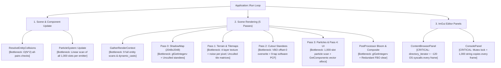

# Game Engine Performance Analysis & Optimization Roadmap

This document outlines the performance characteristics of the 2.5D Isometric Game Engine across the Core Engine (`Engine`), Editor (`Sandbox`), and Shaders (`Sandbox/assets/shaders/`). It provides a detailed, step-by-step roadmap to eliminate frame-rate hiccups, CPU stalls, unnecessary memory churn, and GPU fillrate/bandwidth bottlenecks.

---

## 1. Frame Execution & Bottleneck Flow



---

## 2. Priority & Implementation Roadmap

| Step | Area | Subsystem | Severity | Expected Benefit |
| :--- | :--- | :--- | :---: | :--- |
| **Phase 1** | Critical I/O & UI Hotspots | `ContentBrowserPanel`, `ResourceManager`, `ConsolePanel` | **P0** | Eliminates 100+ OS filesystem kernel syscalls & 1,000 heap copies **per frame** |
| **Phase 2** | CPU Scaling & Scene Traversal | `GameObject`, `Scene`, `Physics`, `ParticleSystem` | **P1** | 5x–10x faster scene gather, `O(N)` collisions, culls off-screen standees/tiles |
| **Phase 3** | GPU Pipeline & GLSL Shaders | `Renderer2D`, `Shader`, `ShadowMap`, `TerrainRenderer` | **P2** | 55% fewer shadow texture reads, stops driver VBO stalls, cuts terrain bandwidth |
| **Phase 4** | Build, SIMD & Refcount Polish | `SpriteRenderer`, `Tilemap`, `Logger`, `CMakeLists.txt` | **P3** | Removes atomic refcount churn, adds LTO + SIMD, cuts build times 2x–3x |

---

## Phase 1: Critical OS Syscall, Heap Allocation & UI Overhead (P0)

### Step 1.1: Eliminate Per-Frame Filesystem Syscalls in Asset Browser & Resource Manager
* **Source Files**:
  * `Sandbox/src/Panels/ContentBrowserPanel.cpp`
  * `Sandbox/src/Panels/ContentBrowserPanel.h`
  * `Engine/src/Core/ResourceManager.cpp`
  * `Engine/include/Engine/Core/ResourceManager.h`
* **Current Issue**:
  1. `ContentBrowserPanel::OnImGuiRender` executes `std::filesystem::directory_iterator(m_CurrentDirectory)` every frame, issuing Windows `FindFirstFileW` / `FindNextFileW` kernel calls.
  2. For every image file, line 142 calls `ResourceManager::Load<Texture>(itemPath)` every frame. `ResourceManager::Load` calls `ResolvePath` (`std::filesystem::exists`) and `ToRelativePath` (`std::filesystem::weakly_canonical`), invoking dozens of Windows kernel file attribute queries per frame even on cached textures.
* **Implementation Steps**:
  1. **In `ResourceManager::Load<T>(filepath)`**:
     - Normalize path strings purely in memory using lexical normalization (`std::filesystem::path(filepath).lexically_normal().generic_string()`) *before* invoking disk checks.
     - Check the cache map (`AssetCache<T>::data`) first. Only on a cache miss should `ResolvePath` / `exists` query the disk.
  2. **In `ContentBrowserPanel`**:
     - Add a `struct CachedDirectoryEntry` containing filename, stem, extension, `isDirectory`, and a cached `std::shared_ptr<Texture>` thumbnail.
     - Store `std::vector<CachedDirectoryEntry> m_CachedEntries` and refresh it only when:
       - The directory changes (`m_CurrentDirectory != m_LastDirectory`),
       - A file is created, deleted, or processed via cutout,
       - A slow background polling timer expires (e.g., every 1.5 seconds).
     - Render ImGui items directly from `m_CachedEntries` without touching `std::filesystem` per frame.

---

### Step 1.2: Eliminate Per-Frame Log Copying & Unclipped Rows in Console Panel
* **Source Files**:
  * `Engine/include/Engine/Utils/Logger.h`
  * `Engine/src/Utils/Logger.cpp`
  * `Sandbox/src/Panels/ConsolePanel.cpp`
* **Current Issue**:
  1. `ConsolePanel::OnImGuiRender` calls `Logger::GetRecentLogs()` every frame.
  2. `Logger::GetRecentLogs()` acquires `RingBufferLogSink::mutex_` and deep-copies up to 1,000 `LogEntry` objects (1,000 heap-allocated `std::string` instances) into a new `std::vector`.
  3. `ConsolePanel` submits `ImGui::TextUnformatted` for all 1,000 rows without clipping, generating thousands of hidden ImGui draw vertices.
* **Implementation Steps**:
  1. **In `RingBufferLogSink` (`Logger.cpp`)**:
     - Add a `std::atomic<uint64_t> m_LogRevision{ 1 };` counter.
     - Increment `m_LogRevision++` inside `sink_it_` and `Clear()`.
     - Expose `uint64_t Logger::GetLogRevision()`.
  2. **In `ConsolePanel`**:
     - Maintain a local copy of logs and filtered indices. Only re-query `Logger::GetRecentLogs()` and rebuild the filtered index list when `Logger::GetLogRevision() != m_LastSeenRevision` or when `m_LogFilter` changes.
     - Wrap visible log rows with `ImGuiListClipper`:
       ```cpp
       ImGuiListClipper clipper;
       clipper.Begin(static_cast<int>(m_FilteredLogIndices.size()));
       while (clipper.Step()) {
           for (int i = clipper.DisplayStart; i < clipper.DisplayEnd; ++i) {
               const auto& entry = m_CachedLogs[m_FilteredLogIndices[i]];
               ImGui::TextUnformatted(entry.Message.c_str());
           }
       }
       clipper.End();
       ```

---

## Phase 2: CPU Data Locality, ECS & Scene Traversal (P1)

### Step 2.1: Implement Component Type Bitmask for O(1) Rejection
* **Source Files**:
  * `Engine/include/Engine/Scene/Component.h`
  * `Engine/include/Engine/Scene/GameObject.h`
* **Current Issue**:
  - `GameObject::GetComponent<T>()` iterates `m_Components` and runs C++ RTTI `dynamic_cast<T*>()`. In `Scene::Update` and `Scene::Render`, this happens tens of thousands of times per frame across 9 separate scene-wide passes.
* **Implementation Steps**:
  1. Assign each Component type a unique bit index:
     ```cpp
     inline uint64_t GetNextComponentTypeID() {
         static uint64_t s_Counter = 0;
         return s_Counter++;
     }
     template<typename T>
     inline uint64_t GetComponentTypeMask() {
         static const uint64_t s_Mask = (1ULL << GetNextComponentTypeID());
         return s_Mask;
     }
     ```
  2. Add `uint64_t m_ComponentMask = 0;` to `GameObject`.
  3. In `AddComponent<T>()`, set `m_ComponentMask |= GetComponentTypeMask<T>()`.
  4. In `GetComponent<T>()`:
     ```cpp
     template<typename T>
     T* GetComponent() const {
         if constexpr (std::is_same_v<std::remove_cv_t<T>, Transform>) return m_Transform;
         if (!(m_ComponentMask & GetComponentTypeMask<T>())) return nullptr;
         for (const auto& comp : m_Components) {
             if (T* casted = dynamic_cast<T*>(comp.get())) return casted;
         }
         return nullptr;
     }
     ```
     Entities lacking component `T` return `nullptr` in a single CPU cycle without chasing pointer arrays or running `dynamic_cast`.

---

### Step 2.2: Single-Pass Render Bucketing in `Scene::GatherRenderContext`
* **Source Files**:
  * `Engine/include/Engine/Scene/Scene.h`
  * `Engine/src/Scene/Scene.cpp`
* **Current Issue**:
  - `Scene` iterates over `m_GameObjects` 9 separate times within a single frame (`GatherRenderContext`, `UpdateCollidersAndGravity`, 3 loops in `RenderPassGroundPlane`, `RenderPassCutoutStandees`, `RenderPassParticles`, 2 loops in `RenderPassScreenUI`).
  - `GetComponents<UIPanel>()` and `GetComponents<UILabel>()` return temporary `std::vector`s by value for every entity every frame.
* **Implementation Steps**:
  1. Expand `SceneRenderContext` to hold typed pointers gathered in a single pass:
     ```cpp
     struct StandeeRenderItem {
         GameObject* Entity;
         Transform* TransformComp;
         SpriteRenderer* SpriteComp;
         SquashStretchComponent* SquashComp;
     };
     std::vector<StandeeRenderItem> Standees;
     std::vector<TerrainComponent*> Terrains;
     std::vector<std::pair<Tilemap*, Transform*>> Tilemaps;
     std::vector<std::pair<SpriteRenderer*, Transform*>> GroundDecals;
     std::vector<ParticleSystem*> ParticleEmitters;
     std::vector<UIPanel*> UIPanels;
     std::vector<UILabel*> UILabels;
     ```
  2. Populate these scratch vectors during a single pass over `m_GameObjects` in `Scene::GatherRenderContext`.
  3. Update `RenderPassGroundPlane`, `RenderPassCutoutStandees`, `RenderPassParticles`, and `RenderPassScreenUI` to iterate directly over their pre-bucketed pointers without scanning all scene entities again.

---

### Step 2.3: Implement Frustum Culling & Tilemap Visible-Bounds Clamping
* **Source Files**:
  * `Engine/src/Scene/Scene.cpp`
  * `Engine/include/Engine/Renderer/PerspectiveCamera.h`
* **Current Issue**:
  - `RenderPassGroundPlane` executes `for (z = 0; z < Height) for (x = 0; x < Width)` over all tiles in the level, computing three 4x4 matrix multiplications per tile even when 80% of the map is outside camera view.
  - All standees are sorted, evaluated for wind motion, and drawn in both Pass 0 (Shadows) and Pass 2 (Standees), even when outside the camera view frustum or light-space orthographic box.
* **Implementation Steps**:
  1. **In `PerspectiveCamera`**:
     - Add `GetGroundPlaneVisibleAABB(float groundY, glm::vec2& outMinXZ, glm::vec2& outMaxXZ) const` by raycasting the 4 viewport corners to the XZ plane.
  2. **In `RenderPassGroundPlane` (Tilemaps)**:
     - Clamp tile loops:
       ```cpp
       int minX = std::max(0, static_cast<int>(std::floor((visMinXZ.x - origin.x) / scale.x)));
       int maxX = std::min(static_cast<int>(tilemap->GetWidth()) - 1, static_cast<int>(std::ceil((visMaxXZ.x - origin.x) / scale.x)));
       int minZ = std::max(0, static_cast<int>(std::floor((visMinXZ.y - origin.z) / scale.z)));
       int maxZ = std::min(static_cast<int>(tilemap->GetHeight()) - 1, static_cast<int>(std::ceil((visMaxXZ.y - origin.z) / scale.z)));
       ```
     - Skip building matrices via `translate * rotate * scale`; directly calculate the 4 quad corners:
       ```cpp
       glm::vec3 c0 = worldPos;
       glm::vec3 c1 = worldPos + glm::vec3(scale.x, 0.0f, 0.0f);
       glm::vec3 c2 = worldPos + glm::vec3(scale.x, 0.0f, scale.z);
       glm::vec3 c3 = worldPos + glm::vec3(0.0f, 0.0f, scale.z);
       ```
  3. **In `RenderPassCutoutStandees` and `RenderPassShadowMap`**:
     - Cull standees whose bounding spheres/boxes lie outside the camera view frustum or shadow orthographic radius before sorting and drawing.

---

### Step 2.4: Separate Dynamic vs. Static Colliders & Add Spatial Grid Broadphase
* **Source Files**:
  * `Engine/src/Scene/Scene.cpp`
* **Current Issue**:
  - `Scene::ResolveEntityCollisions` loops through all pairs `(i, j)` in `m_ColliderScratch` (`O(N^2)`). With 500 static props and 1 dynamic player, it checks 124,750 pairs per frame, only to skip static-static pairs with `continue`.
* **Implementation Steps**:
  1. Separate `m_ColliderScratch` into `m_DynamicColliders` and `m_StaticColliders`.
  2. Check collisions between `Dynamic-vs-Dynamic` and `Dynamic-vs-Static` only. For 1 dynamic player and 500 static props, this reduces collision checks from **125,000 to 500 (250x fewer iterations)**.
  3. For large scenes with dozens of dynamic NPCs, bucket static colliders into a coarse uniform 2D grid (`std::unordered_map<uint64_t, std::vector<ColliderEntry*>>` or a flat cell array) with a cell size of 2.0 meters for `O(1)` local neighborhood queries.

---

### Step 2.5: Active-Only Swap-and-Pop Particle Pool & Fast PRNG
* **Source Files**:
  * `Engine/include/Engine/Particles/ParticleSystem.h`
  * `Engine/src/Particles/ParticleSystem.cpp`
  * `Engine/src/Scene/Scene.cpp`
* **Current Issue**:
  - Every `ParticleSystem` allocates 1,000 particle slots. Both `ParticleSystem::Update` and `Scene::RenderPassParticles` iterate through all 1,000 slots (`if (!particle.active) continue;`).
  - With 10 braziers/emitters and only 8 active particles each, 20,000 slot checks occur per frame to update and render 80 particles.
  - `RandomFloat()` calls the CRT `rand()`, which acquires a global lock on Windows.
* **Implementation Steps**:
  1. Maintain active particles contiguously in `m_ParticlePool[0 .. m_ActiveParticleCount - 1]`.
  2. When a particle expires (`lifeRemaining <= 0.0f`), swap it with the last active particle:
     ```cpp
     m_ParticlePool[i] = m_ParticlePool[m_ActiveParticleCount - 1];
     --m_ActiveParticleCount;
     ```
  3. When emitting, spawn at index `m_ActiveParticleCount++`.
  4. Both `ParticleSystem::Update` and `Scene::RenderPassParticles` only iterate `0 .. m_ActiveParticleCount - 1` (9 iterations instead of 1,000).
  5. Replace `std::rand()` with an inline 32-bit Xorshift PRNG:
     ```cpp
     inline float FastRandomFloat(uint32_t& state) {
         state ^= state << 13;
         state ^= state >> 17;
         state ^= state << 5;
         return static_cast<float>(state) * (1.0f / 4294967296.0f) * 2.0f - 1.0f;
     }
     ```

---

## Phase 3: GPU Pipeline, VBO Contention & GLSL Shaders (P2)

### Step 3.1: Shared Uniform Buffer Object (UBO) for Scene Lighting & Wind
* **Source Files**:
  * `Engine/src/Renderer/Renderer2D.cpp`
  * `Engine/src/Renderer/TerrainRenderer.cpp`
  * `Sandbox/assets/shaders/Batch2D.glsl`
  * `Sandbox/assets/shaders/TerrainSplatmap.glsl`
* **Current Issue**:
  - `ApplyLightingUniforms` formats `"u_PointLightPosRadius[" + std::to_string(i) + "]"` and hashes uniform names into an `unordered_map` across 4 passes every frame.
* **Implementation Steps**:
  1. Define a standard `std140` uniform block in both `Batch2D.glsl` and `TerrainSplatmap.glsl`:
     ```glsl
     layout(std140, binding = 0) uniform SceneLightingBlock {
         mat4  u_LightSpaceMatrix;
         vec4  u_SunDirectionIntensity; // xyz = dir, w = intensity
         vec4  u_SunColor;
         vec4  u_AmbientColorIntensity;
         vec4  u_ShadowParams;          // texelSize, softness, bias, enabled
         vec4  u_PointLightPosRadius[8];
         vec4  u_PointLightColorIntensity[8];
         vec4  u_PointLightFalloff[8];
         int   u_PointLightCount;
         int   u_LightingEnabled;
     };
     ```
  2. Create a single OpenGL UBO (`glGenBuffers`, `glBindBufferBase(GL_UNIFORM_BUFFER, 0, ubo)`).
  3. Upload `SceneLightingData` **once per frame** in `Scene::Render` via `glBufferSubData`.
  4. Shaders bind the UBO automatically, eliminating all runtime uniform string formatting, map lookups, and per-pass `glUniform` API calls.

---

### Step 3.2: Ring-Buffered or Orphaned Dynamic Vertex Buffer
* **Source Files**:
  * `Engine/src/Renderer/Renderer2D.cpp`
  * `Engine/src/Renderer/Buffer.cpp`
* **Current Issue**:
  - `Renderer2D::Flush` calls `glBufferSubData(GL_ARRAY_BUFFER, 0, dataSize, data)` at offset 0 across 5 passes within the same frame (`ShadowMap`, `GroundPlane`, `CutoutStandees`, `Particles`, `ScreenUI`).
  - Overwriting offset 0 while earlier draw calls in the frame are still in flight causes driver CPU stalls or driver-side buffer reallocation.
* **Implementation Steps**:
  1. Expand `QuadVertexBuffer` to hold 3x–4x capacity (e.g. 40,000 vertices).
  2. Track a running byte offset `m_BufferWriteOffset`.
  3. When writing a batch:
     - If `m_BufferWriteOffset + dataSize <= m_BufferCapacity`, upload to `m_BufferWriteOffset` via `glBufferSubData` and draw with vertex base offset.
     - If capacity is exceeded, wrap around to 0 using buffer orphaning:
       ```cpp
       glBufferData(GL_ARRAY_BUFFER, m_BufferCapacity, nullptr, GL_DYNAMIC_DRAW);
       glBufferSubData(GL_ARRAY_BUFFER, 0, dataSize, data);
       m_BufferWriteOffset = dataSize;
       ```
     - This gives the GPU free asynchronous access to previously submitted batches without driver synchronization stalls.

---

### Step 3.3: Hardware `sampler2DShadow` Bilinear PCF
* **Source Files**:
  * `Engine/src/Renderer/ShadowMap.cpp`
  * `Sandbox/assets/shaders/Batch2D.glsl`
  * `Sandbox/assets/shaders/TerrainSplatmap.glsl`
* **Current Issue**:
  - `ShadowMap` sets `GL_NEAREST` filtering and performs 9 manual `texture()` depth comparisons in software loops.
* **Implementation Steps**:
  1. In `ShadowMap::Init`:
     ```cpp
     glTexParameteri(GL_TEXTURE_2D, GL_TEXTURE_MIN_FILTER, GL_LINEAR);
     glTexParameteri(GL_TEXTURE_2D, GL_TEXTURE_MAG_FILTER, GL_LINEAR);
     glTexParameteri(GL_TEXTURE_2D, GL_TEXTURE_COMPARE_MODE, GL_COMPARE_REF_TO_TEXTURE);
     glTexParameteri(GL_TEXTURE_2D, GL_TEXTURE_COMPARE_FUNC, GL_LEQUAL);
     ```
  2. In `Batch2D.glsl` and `TerrainSplatmap.glsl`:
     - Change `uniform sampler2D u_ShadowMap;` to `uniform sampler2DShadow u_ShadowMap;`.
     - Replace the 9-tap loop with a 4-tap Poisson disk lookup using `texture(u_ShadowMap, vec3(uv, currentDepth))`.
     - Hardware 2x2 bilinear PCF runs on each tap, giving smoother 16-sample filtering quality with **55% fewer texture fetches** (4 taps instead of 9).

---

### Step 3.4: Dynamic Branching & Derivatives for Single-Material Terrain
* **Source Files**:
  * `Sandbox/assets/shaders/TerrainSplatmap.glsl`
* **Current Issue**:
  - Every ground fragment unconditionally samples all 4 detail textures and calculates 2 octaves of procedural noise (8 `hash21` calls), even when 80%+ of the clearing is 100% Meadow Grass (`w = (1, 0, 0, 0)`).
* **Implementation Steps**:
  1. Calculate screen-space derivatives up front:
     ```glsl
     vec2 dPdx = dFdx(worldXZ);
     vec2 dPdy = dFdy(worldXZ);
     ```
  2. Check for single-layer dominance:
     ```glsl
     float dominantWeight = max(max(w.r, w.g), max(w.b, w.a));
     if (dominantWeight > 0.992) {
         // Pure single material: skip noise breakup and sample only the active layer
         if (w.r > 0.99) finalColor = textureGrad(u_Layer0, worldXZ * u_LayerTiling.x, dPdx * u_LayerTiling.x, dPdy * u_LayerTiling.x).rgb;
         else if (w.g > 0.99) finalColor = textureGrad(u_Layer1, worldXZ * u_LayerTiling.y, dPdx * u_LayerTiling.y, dPdy * u_LayerTiling.y).rgb;
         else if (w.b > 0.99) finalColor = textureGrad(u_Layer2, worldXZ * u_LayerTiling.z, dPdx * u_LayerTiling.z, dPdy * u_LayerTiling.z).rgb;
         else finalColor = textureGrad(u_Layer3, worldXZ * u_LayerTiling.w, dPdx * u_LayerTiling.w, dPdy * u_LayerTiling.w).rgb;
     } else {
         // Full 4-layer blend path
     }
     ```
  3. Reduces memory bandwidth and fragment ALU cycles by ~50% across large ground areas.

---

### Step 3.5: Squared-Distance Point Light Early Culling in Shaders
* **Source Files**:
  * `Sandbox/assets/shaders/Batch2D.glsl`
  * `Sandbox/assets/shaders/TerrainSplatmap.glsl`
* **Current Issue**:
  - `evaluatePointLights` computes `float dist = length(lPos - worldPos)` for every point light on every fragment before checking `if (dist < radius)`.
* **Implementation Steps**:
  1. Check squared distance first:
     ```glsl
     vec3 toLight = lPos - worldPos;
     float distSq = dot(toLight, toLight);
     float radius = max(u_PointLightPosRadius[i].w, 0.05);
     if (distSq < radius * radius) {
         float dist = sqrt(distSq);
         float x = clamp(1.0 - (dist / radius), 0.0, 1.0);
         float atten = pow(x * x * (3.0 - 2.0 * x), max(u_PointLightFalloff[i], 0.25));
         accum += u_PointLightColorIntensity[i].rgb * (u_PointLightColorIntensity[i].a * atten);
     }
     ```
  2. Bypasses `sqrt` and `pow` evaluations for 90%+ of screen pixels outside light influence spheres.

---

### Step 3.6: Remove Synchronous `glGetIntegerv` & Redundant Framebuffer Clears
* **Source Files**:
  * `Engine/src/Renderer/ShadowMap.cpp`
  * `Engine/src/Renderer/PostProcessor.cpp`
  * `Sandbox/src/Editor/EditorLayer.cpp`
* **Current Issue**:
  - `ShadowMap::BeginCapture` and `PostProcessor::BeginHDRScene` query `GL_FRAMEBUFFER_BINDING` and `GL_VIEWPORT` from the GPU state machine every frame.
  - `EditorLayer::OnUpdate` clears `m_Framebuffer`, which is immediately overwritten by `PostProcessor::EndHDRAndComposite`'s opaque fullscreen composite pass.
* **Implementation Steps**:
  1. Pass the target destination FBO ID and viewport rect into `BeginCapture` / `BeginHDRScene` directly instead of querying OpenGL via `glGetIntegerv`.
  2. Remove the redundant `m_Framebuffer` clear in `EditorLayer::OnUpdate` when HDR post-processing is active.

---

## Phase 4: Code Generation, Memory & Build Optimization (P3)

### Step 4.1: Eliminate Atomic Reference Count Churn
* **Source Files**:
  * `Engine/include/Engine/Renderer/SpriteRenderer.h`
  * `Engine/include/Engine/Scene/Tilemap.h`
* **Current Issue**:
  - `SpriteRenderer::GetTexture()`, `SpriteRenderer::GetSubTexture()`, and `TileSet::GetTileTexture()` return `std::shared_ptr` **by value**, triggering atomic increment/decrement instructions (`lock xadd`) on the control block for every quad rendered.
* **Implementation Steps**:
  1. Change getters to return `const std::shared_ptr<T>&`:
     ```cpp
     const std::shared_ptr<Texture>& GetTexture() const { return m_Texture; }
     const std::shared_ptr<SubTexture2D>& GetSubTexture() const { return m_SubTexture; }
     const std::shared_ptr<SubTexture2D>& GetTileTexture(uint32_t id) const;
     ```
  2. In `SceneHierarchyPanel.cpp`, replace `ImGui::PushID(std::to_string(go->GetUUID()).c_str())` with `ImGui::PushID(go)` (pointer overload, zero allocations).

---

### Step 4.2: Inline Logging Guards in Debug & Strip in Release
* **Source Files**:
  * `Engine/include/Engine/Utils/Logger.h`
* **Current Issue**:
  - In Debug builds, `ENGINE_CORE_TRACE` is called hundreds of times per frame. Even when log level is set to `info`, argument evaluation and formatting setup execute before `spdlog` drops the message.
* **Implementation Steps**:
  1. Add an inline log-level check macro:
     ```cpp
     #define ENGINE_CORE_TRACE(...) \
         do { if (::Engine::Logger::GetLevel() <= spdlog::level::trace) \
                  ::Engine::Logger::GetCoreLogger()->trace(__VA_ARGS__); } while(0)
     ```
  2. Ensure `ENGINE_CORE_DEBUG` is compiled out or guarded in standalone Release builds (`ENGINE_DIST`).

---

### Step 4.3: Enable LTO, SIMD Intrinsics & Precompiled Headers (PCH)
* **Source Files**:
  * `CMakeLists.txt`
  * `Engine/CMakeLists.txt`
  * `Sandbox/CMakeLists.txt`
* **Current Issue**:
  - Cross-module inlining (`Engine.lib` -> `EngineSandbox.exe`) is disabled.
  - GLM vector math runs scalar code without SIMD intrinsics.
  - C++ build times are slowed by repeatedly parsing large headers (`spdlog`, `glm`, `nlohmann_json`, `filesystem`).
* **Implementation Steps**:
  1. **In `CMakeLists.txt`**:
     - Enable Link-Time Optimization for Release configurations:
       ```cmake
       include(CheckIPOSupported)
       check_ipo_supported(RESULT ipo_supported)
       if(ipo_supported)
           set(CMAKE_INTERPROCEDURAL_OPTIMIZATION_RELEASE ON)
       endif()
       ```
     - Add SIMD defines and architecture flags:
       ```cmake
       if(MSVC)
           add_compile_options($<$<CONFIG:Release>:/arch:AVX2>)
       endif()
       add_compile_definitions(GLM_FORCE_INTRINSICS GLM_FORCE_DEFAULT_ALIGNED_GENTYPES)
       ```
  2. **In `Engine/CMakeLists.txt`**:
     - Enable precompiled headers:
       ```cmake
       target_precompile_headers(Engine PRIVATE
           <algorithm>
           <memory>
           <string>
           <vector>
           <unordered_map>
           <filesystem>
           <glm/glm.hpp>
           <glm/gtc/matrix_transform.hpp>
           <spdlog/spdlog.h>
           <glad/glad.h>
       )
       ```

---

## 5. Verification & Performance Validation Checklist

After implementing each phase, run the following verification steps:

1. **Compilation & Warning Integrity**:
   ```bash
   cmake --build build --config Debug
   cmake --build build-dist --config Release
   ```
2. **Unit Test Regression**:
   ```bash
   ctest --test-dir build -C Debug --output-on-failure
   ctest --test-dir build-dist -C Release --output-on-failure
   ```
3. **Profiler Panel Metrics Check**:
   - Open the **Profiler** panel (`Window -> Profiler`).
   - Monitor `ms/frame` and `FPS`:
     - Idle Editor frame time should drop from ~1.5–2.5 ms to < 0.6 ms.
     - Standalone runtime frame time should remain solidly at 0.15–0.4 ms (capped by VSync).
   - Ensure draw calls and quad counts remain stable across all camera angles.
4. **Visual Quality Regression**:
   - Verify shadow filtering remains smooth without acne or Peter-Panning.
   - Verify 4-layer terrain splatting and edge darkening match original artistic grading.
   - Verify post-processing bloom, tone-mapping, and vignette render identically.

